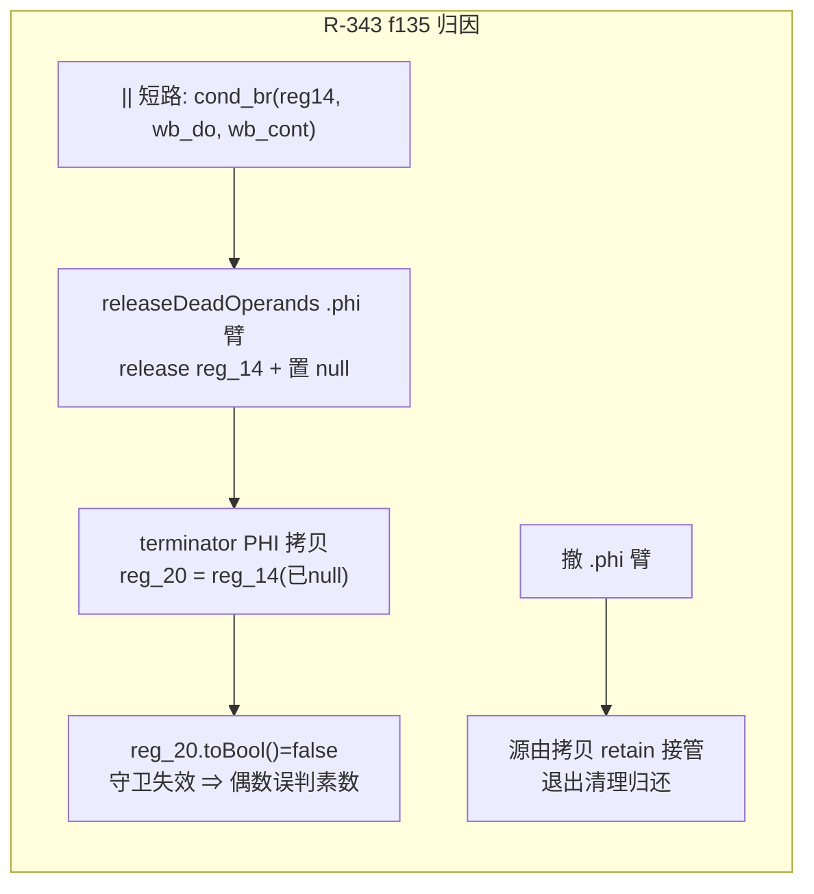

# 批次三十九：GMP 全族按裁决删除（回滚）+ R-341 恢复 + R-342 未定义函数可捕获 + R-343 `.phi` 释放时机（f135 归因）

- 日期：2026-11-08
- 工单：§269（docs/known-issues/AOT-CODEGEN-012）
- 基线 commit：`99ab362`（工作区未提交变更）

---

## 1. 高层摘要（TL;DR）

老铁裁决「删除GMP模块，我们要先把基本语言功能能力完全达到与PHP运行结果一致…不要搞这些没用的扩展」——GMP（α+β+γ，52 函数+运算符重载+序列化，§265-§267 三个批次）**整体回滚清零**，php 侧回到诚实失败（可捕获 `Error: Call to undefined function`）。同批落地：R-341（批次三十销毁时机布点恢复+借用自有化）、R-342（未定义函数直调 noreturn+exit255 改可捕获 Error）、R-343（f135 DIFF 归因=releaseDeadOperands `.phi` 臂在 terminator 拷贝前置空 incoming 源）。720 里程碑 **66/0/1/0/1**（零新增红）。

## 2. 影响范围

| 面 | 影响 |
|---|---|
| GMP 扩展 | 全族删除（运行时 extern/类注册/wrapper/map 登记/链接参数/豁免表/β 15 处热路径挂载） |
| 未定义函数调用 | 语义变化：fatal 硬终止 ⇒ 可捕获 Error（与 PHP 对齐） |
| 销毁时机优化 | `.phi` incoming 源不再提前释放（f135 修复；其余路径不变） |
| builtin_param_table_generated.zig | gmp 条目**保留**（反射事实表决策，见工单 §269.1） |

## 3. 核心变更

| 文件 | 变更 |
|---|---|
| runtime_lib_template.zig | 删 GMP 全区（extern/1138 行类区/wrapper/map 52 枚/gmp_num_hidden/β 挂载/q4DepNull 豁免）；`php_call_undefined_function` 改 throwThrowable 契约（R-342） |
| native_linker.zig | 删 52 行 gmp builtin_map + `-lgmp`；R-342 发射点（try/catch 形态）；R-341 布点恢复+capture_get 自有化；**R-343：releaseDeadOperands `.phi` 臂撤销** |
| build.zig | 删 4 处 `linkSystemLibrary("gmp")` |
| docs/changes/2026-11-08/GMP_alpha/beta/gamma 三份 | 头部标注作废留档 |

## 4. 可视化概览（Code & Logic Map）

## 5. 详细变更分析

- **GMP 回滚范围**：与 §265/§266/§267 三份摘要逐项对应的逆操作；验证=zig build 绿 + grep 零残留（参数名表除外）+ gmp_gone 探针族（function_exists/class_exists/defined 全 false、gmp_init/gmp_add 可捕获 Error）。
- **R-342**：运行时函数 !Value + nlk 发射点按 handler 分形；探针 udf_test/udf_uncaught/udf_nested 三枚 SAME（未捕获 fatal 形态逐字一致，rc=255）。
- **R-343**：最小复现 f135_min（静态方法内 `$n%2===0 ||` 守卫）→ f135 全量 SAME；面板 30/31（min_r4=§269.6 登记）、五族 5/5、zig build test 全绿。
- **P2-3 销账验证**：变量调用面 by-value 未定义变量告警分流（q4 机制）三形 SAME，仅验证不改码。

## 6. 影响与风险评估

- 破坏式变更：**仅 GMP 使用者**（项目内无语料依赖；外部用户若用 gmp_* 将从"可用"变为"可捕获 Error"，属裁决要求的方向）。
- 复测路径：720 批 39 里程碑 66/0/1/0/1（f135 转 PASS）+ 31 探针面板 + 事故五族。

## 7. 遗留/潜在问题

- min_r4 对象 id 顺序（→ 批次四十 R-344a 已修）；§268.3 数字更正已落工单。
- R-344c 句柄复用微序（catch 风暴后）P2 登记。

## 8. 后续建议

- P0：主线「基础语言语义 vs PHP 不一致」登记项继续清（老铁裁决方向）。
- P2：R-344c 句柄复用微序（异常对象释放时点与 zend 对齐）。
