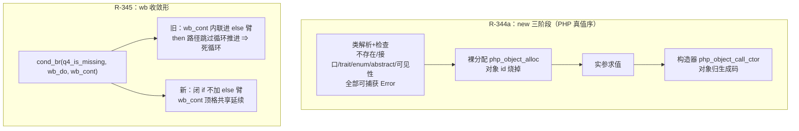

# 批次四十+四十一：R-344a `new` 三阶段拆分（检查+分配先于实参求值）+ R-345 while 面 Q3 wb 收敛形（f026 销账，720 面板清零）

- 日期：2026-11-08
- 工单：§270 / §271（docs/known-issues/AOT-CODEGEN-012）
- 基线 commit：`99ab362`（工作区未提交变更）

---

## 1. 高层摘要（TL;DR）

两条主线收口：**① `new` 语义全对齐**——PHP 的 `NEW→实参求值→DO_FCALL` 顺序落地（实例化性检查+裸分配先于实参求值），类不存在/接口/trait/enum 检查补齐且全部可捕获，顺带销账动态路径实参双求值；**② f026 死循环销账**——while 面 Q3 wb 收敛形（与 R-338 foreach 面同族）修复，720 语料面板红清零（**67/0/0/0/1**，唯 f004 既有 SKIP）。

## 2. 影响范围

| 面 | 影响 |
|---|---|
| 全部 `new` 表达式 | IR 由单一 new_object 拆为 new_alloc + ctor_call（四条路径：静态/动态/命名/匿名类） |
| 对象 id 可观测顺序 | 嵌套 new 外层先分配（var_dump #N、spl_object_id 对齐 PHP） |
| 异常模型 | `new NoSuch()` 从未捕获 fatal ⇒ 可捕获 Error（未捕获形态逐字不变） |
| while 循环 + 变量可调用 | Q3 wb 链写回命中时不再跳过循环推进（死循环修复） |

## 3. 核心变更

| 层 | 文件 | 变更 |
|---|---|---|
| IR | ir.zig | 新增 `new_alloc`/`ctor_call` 两算子 + deinit/print 镜像 |
| IR 生成 | ir_generator.zig | 四条 new 路径三阶段拆分（动态路径顺带销账实参双求值） |
| 发射 | native_linker.zig | new_alloc/ctor_call 发射臂、builtin_map 登记、三处镜像臂；**R-345**：普通 else 路径两处花括号打印点门控（wb 收敛形闭 if 不加 else 臂） |
| 优化/活性 | optimizer.zig / liveness_analysis.zig | 六处镜像臂 |
| 运行时 | runtime_lib_template.zig | 拆出 php_object_alloc（检查+裸分配，**构造器可见性前移**）/ php_object_call_ctor / php_object_alloc_dynamic / php_object_call_ctor_named；组合通道改写；类不存在改 throwThrowable 可捕获 |

## 4. 可视化概览（Code & Logic Map）

## 5. 详细变更分析

- **真值钉板**：`new Abs(f())` 等五族全部先报错不求值；`new C(new D())` 空库 C:1 D:2；`unset` 后 LIFO 复用 d:4 e:3；`new Abs(x:1)` 检查先于命名绑定；`try{new NoSuch}catch(\Error)` 可捕获。
- **R-345 方案取舍**：自开范围行走（对无标签前缀块的 cond_br 分发不标 processed ⇒ 重复发射，否证）；撤 coalesce 否决（`if(isset) continue` 形回归风险，否证）；定案=普通 else 路径括号打印点门控（内容同路零重复风险）。
- **R-344a 验收**：r344_static/r344_uncaught/oid_order 探针消息面与检查顺序全 SAME；min_r4 id 全对齐（面板红降级为 §七.4 缩进豁免残余）。
- **R-345 验收**：f026_b1/b2/min + f026 全量 40 行 SAME；for/do-while 面取证无活缺口。

## 6. 影响与风险评估

- 破坏式变更：无（全部是「错误语义 ⇒ PHP 真值语义」的对齐；正常路径生成码行为不变）。
- 复测路径：批 40 里程碑 66/0/1/0/1（R-344a 零回归）；批 41 里程碑 **67/0/0/0/1**（f026 转绿，面板清零）；31 探针面板 30/31（min_r4=§七.4 豁免）；事故五族 5/5；`zig build test` 全绿。

## 7. 遗留/潜在问题

- R-344c（P2）：catch 风暴后句柄复用微序与 zend 不一致（异常释放时点问题；语料无命中）。
- min_r4 var_dump 大括号缩进（§七.4 豁免，不追）。
- ReflectionClass::newInstance* 不经三阶段通道（独立登记）。

## 8. 后续建议

- P0：继续清「基础语言语义 vs PHP 不一致」登记项（720 面板已清零，转向工单登记的 P2 族）。
- P1：R-344c 句柄复用微序（若用户报告 spl_object_id 顺序敏感场景再升格）。
- P2：for 面 wb 收敛形已取证销账；do-while 同。

---