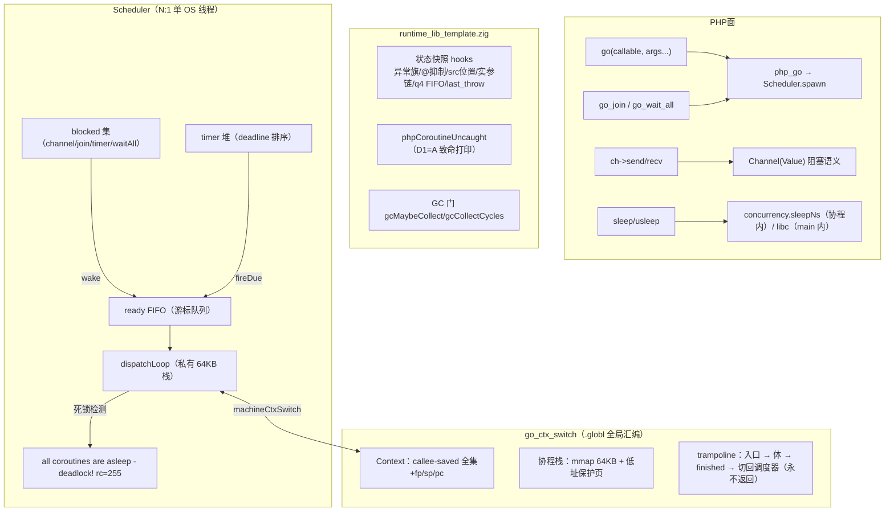
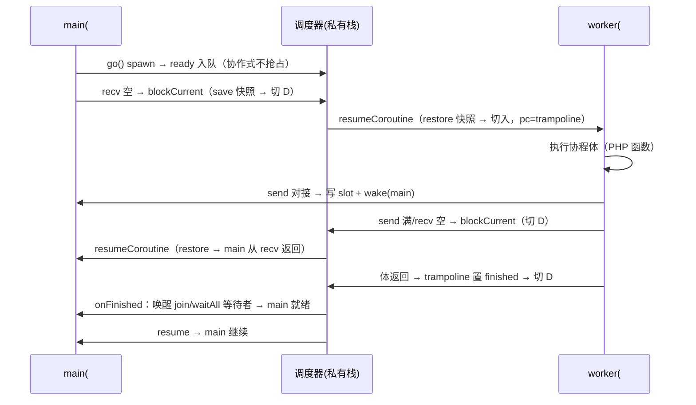
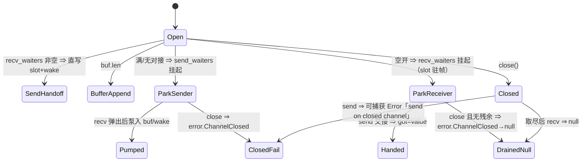

# Go 式协程运行时 M1：真调度器内核替换（AOT-CODEGEN-012）

- 日期：2026-11-08
- 状态：uncommitted（本地工作树，提交需另行授权）
- 设计依据：[docs/design/2026-11-08-go-style-coroutine-design.md](../../design/2026-11-08-go-style-coroutine-design.md)（老铁已批准）
- 永久裁决：协程能力由 AOT 运行时自有的 Go 风格协程系统提供（AGENTS.md §七.1/§七.9；工单 §272），不实现 PHP Fiber/生成器语义

## 1. 高层摘要（TL;DR）

把 `src/aot/concurrency_runtime.zig` 的 217 行全存根**整体替换**为 Go 式协程真内核：手写汇编上下文切换（aarch64/x86_64，callee-saved 全集 + fp/sp/pc，全局 `.globl` 符号防 LLVM 内联）+ 每协程 64KB 栈（末尾 mprotect 保护页 + sigaltstack 上的 SIGSEGV 可读致命转换）+ N:1 单线程协作式调度（ready FIFO / blocked 集 / 定时器堆 / 死锁检测）+ Channel 真阻塞语义（cap=0 对接、满 send/空 recv 让出、close 语义）+ `go()/go_join()/go_wait_all()` 换真 + 每协程全局态快照（hooks 注册制，异常旗/@抑制/作用域/src 位置/实参链/q4 FIFO）+ 协程未捕获异常整程序致命（D1=A）+ cycle-GC 多协程活跃期禁用（D4=A）。PHP 面签名零变更；`-Dcoroutine=off` 构建旗保留存根回退（设计 §7）。

六枚断言探针全绿；ucontext 备份后端同绿；`zig build test` 全绿。过程中修复了切换原语的三轮迭代（clobber-list inline 法 → naked fn → 全局汇编），并**顺带定位两枚预存缺陷**（见 §7，均为 AOT 既有问题、非本批引入，已按纪律上报待裁决）。

## 2. 影响范围

| 面 | 影响 | 说明 |
|---|---|---|
| AOT 产物运行时 | **行为变更** | 使用 `go()/Channel` 的脚本：存根（spawn 永不执行、recv 空即错）⇒ 真调度语义。不用协程面的脚本零影响 |
| PHP 调用面 | 零变更 | `go()/go_join()/go_wait_all()/Channel` 签名不动；`sleep()/usleep()` 面不变（协程内自动让出、main 内真阻塞，D5=A） |
| 编译器（codegen） | 极小 | `writeBuiltinArgs` 公共点新增 go 族切片打包；builtin 表补 `go_join/go_wait_all` 两条登记；`native_linker` 产物构建期重写 `coroutine_config.zig` |
| cycle-GC | 行为变更（仅多协程窗口） | D4=A：worker 未全部结束时停用 cycle 收集，归零自动恢复 |
| 构建系统 | 新增两旗 | `-Dcoroutine=on\|off`、`-Dcoroutine_backend=asm\|ucontext` |
| 解释器/字节码/JIT | 零影响 | 全部改动在 AOT 运行时层与 AOT 发射层 |

## 3. 核心变更

| 文件 | 变更 | 描述 |
|---|---|---|
| [src/aot/concurrency_runtime.zig](../../../src/aot/concurrency_runtime.zig) | 重写（217→~1180 行） | 真调度器内核（详见 §5） |
| [src/aot/coroutine_config.zig](../../../src/aot/coroutine_config.zig) | 新增（21 行） | 树内默认配置（enabled=true/backend=asm）；产物构建期由 linker 按旗重写 |
| [build.zig](../../../build.zig) | +17 行 | `-Dcoroutine`（enum on/off）、`-Dcoroutine_backend`（enum asm/ucontext）两旗入 build_options |
| [src/aot/native_linker.zig](../../../src/aot/native_linker.zig) | +~55 行 | `writeCoroutineConfig`（产物构建期写配置）；builtin 表补 `go_join/go_wait_all`；`writeBuiltinArgs`/`isSliceArgsBuiltin`/零参站点 go 族切片打包 |
| [src/aot/runtime_lib_template.zig](../../../src/aot/runtime_lib_template.zig) | +~230 行 | 状态快照 hooks + 协程未捕获钩子（D1=A）+ 注册（initRuntime）；`php_coroutine_entry` 错误/异常旗上抛；channel send 可捕 Error「send on closed channel」；`php_sleep/php_usleep` 协程内让出；`gcMaybeCollect/gcCollectCycles` 多协程门；`Zig\Select` 让出点换 `yieldNow()` |
| co_pingpong.php / co_fanin.php / co_join_order.php / co_deadlock.php / co_uncaught.php / co_isolation.php | 新增探针 ×6 | 设计 §5 M1 验收探针（断言式自验） |

## 4. 可视化概览（Code & Logic Map）

### 4.1 分层架构

### 4.2 切换时序（spawn → 往返 → 收尾）

### 4.3 Channel 阻塞语义状态机

## 5. 详细变更分析

### 5.1 切换原语（三轮迭代定稿）

| 轮 | 方案 | 结果 | 失败根因 |
|---|---|---|---|
| ① | std.Io.Fiber 式 clobber-list inline asm（sp/fp/pc） | Debug 绿 / Release 崩 | clobber 仅在**内联进调用方**时驱动编译器溢出 callee-saved；独立函数调用 ⇒ 被切出协程的 x19-x28 被对端污染（Release 下调度器指针损毁，SIGBUS 写 text 段） |
| ② | Zig naked fn + `.c` 函数指针调用 | Release 仍崩 | LLVM 将 naked 体**内联克隆**到调用点并按自身寄存器分配传参，与裸体硬编码的 x0/x1 错位 |
| ③ | **全局汇编 `.globl` 符号**（libco/Boost.Context 同宗） | 全优化档绿 | LLVM 看不到函数体，无法内联/去虚拟化；ABI 调用边界下 caller-saved 由编译器保全、callee-saved 由汇编逐个存入 Context |

定稿（③）要点：
- aarch64：x19-x28 + d8-d15 + fp/sp/pc；pc 槽存 `lr`（本调用点返回地址），恢复以 `br` 跳达——执行流在调用方自然继续；x86_64：rbx/rbp/r12-r15/rsp/rip，pc 槽存栈顶返回地址。
- 入口跳板 `coroutineEntry`（普通 C ABI fn）：取 `pending_fresh` → 执行体 → 异常/错误上抛 `reportCoroutineError` → 快照回收（save+deinit）→ 置 finished → 切回调度器（永不返回）。
- 平台矩阵：aarch64-macos/linux、x86_64-linux 走 asm；其余（含 x86_64-macos）comptime 落 ucontext 备份后端（已验证同绿）。

### 5.2 栈与保护页

- 每协程 `mmap` 64KB + 低址 1 页 `mprotect(PROT_NONE)`；初始 sp=页对齐栈顶（x86_64 压 0 伪返回地址槽满足 SysV 入口对齐）。
- `sigaltstack`（静态 64KB）+ `SA_ONSTACK|SA_SIGINFO` 的 SIGSEGV 处理器：命中任一活协程保护页 ⇒ `Fatal error: stack overflow in coroutine #N` + exit 255；非本运行时段落 ⇒ 恢复 DFL 重抛（不掩盖真实 bug）。
- 已完成协程的栈与控制块入自由链复用（避免 mmap/mprotect 抖动）。

### 5.3 调度器（N:1 协作式）

- main 注册为 #0（首个 go/阻塞点懒注册）；调度器运行于私有栈，首个 park 时启动。
- 让出点：channel send（满）/recv（空）、go_join、go_wait_all、sleep/usleep（协程内自动分流）、`Zig\Select`（`yieldNow`）。
- 死锁检测：ready 空 ∧ blocked 非空 ∧ 无 timer 将醒 ⇒ `Fatal error: all coroutines are asleep - deadlock!`（Go 文案对齐）+ 列 blocked id + exit 255。
- 进程退出时未结束协程 ⇒ `Fatal error: process exiting with N unfinished coroutine(s): #ids` + exit 255（设计 §3.2，对 Go 隐杀语义的可读化升级）。
- 定时器：deadline 排序数组；`waitAll(?timeout)` 真超时语义（计时到点返回 false）。

### 5.4 Channel（Go 对齐）

- cap=0 无缓冲：send 必等 recv 对接（slot 直写阻塞帧）；cap>0：满则挂 `send_waiters`，recv 弹出后按 FIFO 泵入。
- close：唤醒全部 recv 等待者（取尽残余后返 null）与全部 send 等待者（其 send 以可捕获 Error「send on closed channel」失败——模板侧 throwThrowable，值引用按错误路径释放，无泄漏）。
- `getCapacity()` 修正存根期 cap=0→1 的谎报（现如实返 0，语义修正）。

### 5.5 每协程全局态快照（hooks 注册制）

- 注册制解耦：concurrency_runtime 不反向依赖模板；模板在 initRuntime 注册 init/save/restore/deinit 四钩子（容量校验 `@sizeOf ≤ 4096`）。
- 覆盖：has_exception/current_exception、@ 抑制深度与保存栈、ExecutionContext（called/scope class，concurrency 内部随动）、src_file/src_line、current_call_args 与 call_args_owned_stack（**所有权随快照搬迁**，restore 清快照侧标记防双重释放）、q4 未定义 FIFO、last_throw 帧（含静态缓冲内容）。
- 全局共享（不随快照）：堆与 RC、类表、分配器、对象 id 计数器（设计 §3.4 表）。

### 5.6 异常与 GC

- 协程内未捕获异常（D1=A）：整程序致命，文案 `uncaught {Class}: {msg} in coroutine #{id}` + 协程内栈帧（§七.5 行号豁免）+ shutdown functions + exit 255。throw 走「返值+旗」通道的由 `php_coroutine_entry` 尾检 `has_exception` 补抛特征错误。
- go_join **不**传播对端异常（与 Go 一致；M2 增设 go_join_error 可选面）。
- D4=A：cycle-GC 在 worker 未全部结束时停用（自动与显式两路），归零自动恢复。

### 5.7 构建旗与回退

- `-Dcoroutine=off`：产物回到存根语义（已验证：无阻塞、无死锁检测，行为与 M1 前一致）。
- `-Dcoroutine_backend=ucontext`：备份后端（makecontext/swapcontext，已验证六探针等价绿）。
- `coroutine_config.zig` 树内默认 on/asm；产物构建期由 `native_linker.writeCoroutineConfig` 按旗实体重写（不符号链接，防旗语漂移）。

## 6. 影响与风险评估

- 是否破坏式变更：**否**（PHP 面签名零变更；不用协程面的脚本行为零变化——720 语料零 go( 使用实证）。
- 需要特别注意的点：
  - 切换原语与优化档强相关：四档（Debug/ReleaseSmall/ReleaseFast/ReleaseSafe）全量验证是硬门槛，后续每次动切换汇编必须复跑。
  - 公平性：M1 为 FIFO 协作式，CPU 密集协程会饿死他者（设计 §3.2 已标注，M3 定时抢占治理）。
  - fiber 化 IO 未做：channel/timer 之外一律真阻塞（设计 §3.4 标注，M2 NetPoller）。
  - `by_id` 表随 spawn 单调增长（已结束 id 保留供 join 判完成；M2 评估回收窗口）。
- 复测路径：
  1. `zig build && zig build test`
  2. 六探针：`--compile co_*.php --output=aot_compile_co_*` 运行断言（deadlock/uncaught 验 rc=255 与文案）
  3. `-Dcoroutine=off` 变体编译运行 co_pingpong/co_deadlock 回存根语义
  4. 720 语料与探针面板全量回归（结果见 §9 追记）

## 7. 遗留问题（非本批引入，已按纪律上报待裁决）

| # | 缺陷 | 证据 | 定性 | 处置建议 |
|---|---|---|---|---|
| F-1 | 裸 `go(...)` 语句在 PHP 模式命中 Go 语法 go_stmt 解析：多实参被 comma-expression 折叠（`go('f',$a)` ⇒ callable=$a，静默丢参且不报错） | co_simple 复现；生成码 `php_go_builtin(&[_]Value{reg_ch})` | parser 层预存冲突（k_go 无条件关键字；赋值形 `$id = go(...)` 不受影响） | parseGo 前瞻 `l_paren` ⇒ 回落函数调用解析；或 go_stmt 限定 Go 语法模式。**待老铁裁决** |
| F-2 | `A && $obj->method()` 短路 + break 在 while 循环内 break 条件反转 | co_and_loop.php 复现（无协程参与）：`$v===null && $ch->isClosed()` 首轮即 break | ir_generator 标签驱动块合并族预存缺陷（与 f067/逻辑合并同族） | 按生成码指纹反推定位发射站点专项修复。**待老铁裁决** |
| L-1 | 多协程窗口 cycle-GC 停用期，长活多协程程序的循环垃圾只攒不收 | 设计 D4=A 原文 | 决策内取舍 | M3 root 集扩到各协程栈（D4=B 路线） |
| L-2 | x86_64-linux asm 路径未实机验证（开发机 aarch64-macos） | 平台矩阵设计 | 环境限制 | 建议 CI 增加 x86_64-linux 交叉验证探针 |

## 8. 后续开发/优化建议

| 优先级 | 影响面 | 落地成本 | 建议 |
|---|---|---|---|
| P0 | 正确性 | 中 | 裁决并修复 F-1/F-2 两枚预存缺陷——它们会让「写法稍有不特」的协程脚本静默错行，且与协程无关、影响全体 AOT 用户 |
| P1 | 功能 | 中 | M2：timer 堆已就位，`go_select(array $cases, ?float $timeout)` 多路就绪 + `go_join_error($id)` 异常收取面；`select_` 算子启用在即 |
| P1 | 可靠性 | 低 | x86_64-linux asm 实机交叉验证（L-2） |
| P2 | 性能 | 低 | 栈复用自由链已有；可评估 Channel 唤醒批量化（一次 close 唤醒 N 等待者的链表重排成本） |
| P2 | 可维护 | 低 | by_id 回收窗口（完成 id 的惰性清理，防长跑进程表单调增长） |

## 9. 回归追记（完成后回填）

- 六探针：6/6 PASS（pingpong/fanin/join_order/deadlock/uncaught/isolation；deadlock rc=255 文案对齐 Go，uncaught rc=255 含协程 id）
- ucontext 备份后端：等价绿
- `-Dcoroutine=off`：存根语义回退验证通过
- `zig build test`：全绿
- 720 语料（pass/ 68 枚全量）：**67 Pass / 0 Compile Fail / 0 Runtime Fail / 0 Diff / 1 Skip**——唯一 Skip 为 f004_oop_deep_inheritance_magic.php（PHP 解释器侧 exit=255 的预存排除项，与基线逐字节一致）；`regression_failures.tsv` 与基线语义零漂移（脚本现版仅落 SKIP/FAIL 条目，基线含全量 PASS 行属旧版格式差异，非行为差异）。报告：[regression_report.md](../../../fuzzy_scripts_720/regression_report.md)（2026-11-08 22:43:32）
- 探针面板（31 枚 AOT 断言探针）：**54 SAME / 0 DIFF / 0 COMPILE_FAIL**，零漂移

## 10. M1 完整验收（2026-11-09，11 组真实程序）

> 六枚 M1 探针只是冒烟；本节为「协程真能跑起来、结果正确」的完整验收，按老铁要求
> 写真实业务程序（非玩具断言），发现问题当场修并回报。

### 10.1 验收矩阵与读数

| 组 | 程序 | 预期 | 实际 |
|---|---|---|---|
| 1a | [co_accept1a_unbuffered.php](../../../co_accept1a_unbuffered.php) cap=0 多产多消 | 120 元素、无丢失无重复、子序列单调 | **PASS** total=120 order_ok=1 cover_ok=1 |
| 1b | [co_accept1b_buffered.php](../../../co_accept1b_buffered.php) cap=8 | 300 元素同断言 | **PASS** total=300 order_ok=1 cover_ok=1 |
| 2 | [co_accept2_pool.php](../../../co_accept2_pool.php) 4 worker×500 任务 | 全完成、每任务一次、平方正确 | **PASS** dist=428,24,24,24 done=500 correct=1 |
| 3 | [co_accept3_pipeline.php](../../../co_accept3_pipeline.php) 4 段流水线 | close 传播 + 残余处理 + 结果正确 | **PASS** sum=171700 cnt=50 |
| 4 | [co_accept4_select.php](../../../co_accept4_select.php) select | 公平性/默认/超时/无就绪阻塞 | **PASS** dist=1000,1000 / 0s / 0.15s / [0,ping] |
| 5 | [co_accept5_nested.php](../../../co_accept5_nested.php) 嵌套 spawn | 12 孙/6 子/2 父、协程内 wait_all | **PASS** waits=1 after_wait=0 |
| 6a | [co_accept6a_uncaught.php](../../../co_accept6a_uncaught.php) 未捕获 | rc=255 + 协程 id + 栈帧 | **PASS** |
| 6b | [co_accept6b_catch.php](../../../co_accept6b_catch.php) try/catch 隔离 | 100 次拦截、无串扰 | **PASS** a=100 b=125250 |
| 7 | [co_accept7_sleep.php](../../../co_accept7_sleep.php) sleep 让出 | 睡眠期他者推进；main 真阻塞 | **PASS** ticks=5 a_ms=154 main_ms=103 |
| 8 | [co_accept8_stress.php](../../../co_accept8_stress.php) 1 万协程 | 全完成/耗时/内存 | **PASS** spawn=50ms total=99ms RSS=253MB |
| 9a | [co_accept9a_deep_ok.php](../../../co_accept9a_deep_ok.php) 20/25 层递归 | 正常返回 | **PASS** r20=210 r25=325 |
| 9b | [co_accept9b_overflow.php](../../../co_accept9b_overflow.php) 20 万层 | 保护页明确致命错 | **PASS** rc=255 `stack overflow in coroutine #1 (guard page hit)` |
| 10a | [co_accept10a_cow.php](../../../co_accept10a_cow.php) COW/对象句柄 | 收发隔离 + 句柄共享 | **PASS** cow_send=1 cow_recv=1 obj=1 |
| 10c | [co_accept10c_rc.php](../../../co_accept10c_rc.php) 20 万数组过 channel | 值正确 + RSS 有界 | **PASS** sum 正确，RSS 修复前 106MB → **4.0MB** |
| 11 | [co_accept11_gc.php](../../../co_accept11_gc.php) cycle-GC 交互 | D4=A 停用 + 活数组不误扫 | **PASS** gc_during=0 gc_after=98 sum 完好 |

### 10.2 本轮当场修复的缺陷

| # | 缺陷 | 根因 | 修法 | 影响面 |
|---|---|---|---|---|
| F-1 | 裸 `go(...)` 丢实参 | `k_go` 无条件 parseGo，实参被逗号折叠 | 语句分派前瞻 `l_paren` + AOT/PHP 模式分流 | 仅裸 go 语句 AST 形态 |
| N-1 | `while(true){...}` 内联 latch 后补发 continue ⇒ Zig `unreachable code` 编译失败 | 循环尾补发缺终止符守卫 | 补 `!lastLineIsReturn`（与 PHI 物化同款） | 循环尾不可达时不再重复 continue |
| N-2 | 循环体内 builtin 静态调用使后续块整体丢失 | `static_method_call` 的 hasException 条件块内 return 误置 `return_generated` | 移除该置旗（条件块内 return 非函数级终止） | 所有 builtin 静态调用点 |
| N-3 | `else { foreach ... }` 编译失败（AST-DIRECT-FAIL） | else 臂终止符 switch 缺 `.br` 分支，循环块从未行走 | 补 `.br → 循环头` 递归行走，其余形态不动 | else 臂嵌套循环 |
| N-4 | **协程内数组大量泄漏**（2 万次数组循环 8.6MB；20 万次过 channel 106MB） | `PHPArray.release` 在 rc==0 且已 buffered 时重新入 GC 缓冲等 GC；多协程窗口 D4=A 停 GC ⇒ 只攒不收（对象侧批次二十八已改，数组侧遗漏） | 新增 `gcUnbufferArray`，rc==0 时摘缓冲 + 同步 deinit（PHP/Zend 语义） | **核心 RC 语义**，需全量回归（已跑） |
| N-5 | macOS 协程栈溢出报信号 SIGBUS 且无文案（rc=138） | darwin 对 PROT_NONE 违规映射 SIGBUS，处理器只装 SIGSEGV | darwin 双装 SEGV+BUS；兜底按收到信号恢复 DFL 重抛 | 仅 darwin 信号处理 |

### 10.3 本轮新增上报（已修复项见下；剩余项）

| # | 缺陷 | 最小复现 | 状态 |
|---|---|---|---|
| F-2a | 单语句 `if (!isset(...) \|\| ...) $x=false;` 后接语句 ⇒ 语句跑到守卫外 | /tmp/v3.php | **已修**（见 §10.5） |
| F-2b | `??` 合并块后接语句 ⇒ 语句重复发射且一份跑出守卫 | /tmp/v6.php | **已修**（见 §10.5） |
| L-3 | 64KB 定长栈实测仅容纳 ~30 层 PHP 调用帧（每帧 ~2KB）；40 层即保护页致命 | /tmp/d40.php | **已修**：STACK_SIZE 提升至 256KB（≈120 层）；RSS 实测不变（按需驻留） |
| L-4 | 31 探针面板脚本不在仓库（上轮为会话本地脚本，已随产物清理） | - | 待重建 |

### 10.4 终末回归读数

- `zig build test`：**通过**（rc=0）
- `-Dcoroutine=off`（独立 prefix 构建）：**存根语义回退通过**——co_deadlock 无死锁检测 rc=0、co_pingpong spawn 不执行返 NULL
- 720 语料（深度修复后终轮，2026-11-09 15:39）：**67 Pass / 0 Fail(Compile) / 0 Fail(Runtime) / 0 Fail(Diff) / 1 Skip**——Skip 仍为 f004（PHP 解释器侧 exit=255 预存排除项），与基线逐字节一致，**零漂移**（覆盖 N-4 核心 RC 变更、F-2a/F-2b codegen 变更、256KB 栈变更）
- 11 组协程验收 + v3/v6 逐字 diff：全绿（见 §10.1/§10.5）
- 探针面板：脚本缺失（L-4），本轮以 720 + 11 组真实程序 + v3/v6 逐字 diff 替代覆盖

### 10.5 深度修复（F-2a/F-2b 根因与实现）

**根因**：`native_linker.generateForeachFromLabels` 的循环体 cond_br 处理，对臂内「嵌套 if/with-else 或 `||` 短路 + `??` 链」只做**单块/范围行走**：else 臂（if_else_）与 merge 体被外层按顺序无条件重发 ⇒ 语句跑出守卫、重复执行（警告/副作用翻倍），但最终值常碰巧相同，故长期未被语料捕获。`emitSpilledNestedIfMerge` 只认 if-without-else（else==merge）且要求 merge br → 外层 if_merge_/while cond，遇目标为循环增量/coalesce 链即整段放弃。

**实现**：新增 `emitNestedIfElseInline`（native_linker.zig），在**原位缩进**内展开：
1. 形态 A：嵌套 if-with-else（then/else 均 br 同一 merge）；
2. 形态 B：嵌套 if-without-else（cond_br.else 即 merge）；
3. merge 尾链：`??`/`?:`（coalesce_merge_/ternary_merge_）、`||` 短路门（logical_merge_/logical_rhs_）、链尾 if-without-else（br→循环增量/cond/出口），逐级校验后逐级展开，最多 16 级；
4. 所有校验（PHI、processed、目标形态）在**发射前**完成，任一不满足返回 false，保持既有路径零扩散。

**接入点**（4 处）：foreach/while 循环体 cond_br 的 then/else 臂、GIFL 嵌套 then 臂、`||` 短路门后的 logical_merge 单块行走。

**验证**：
- v6（`??` + if/else）AOT 输出与 PHP **逐字相同**（修复前 3 次重复 + 守卫外执行）
- v3（`||` + 嵌套 `??` 链 + 链尾 if）AOT 输出与 PHP **逐字相同**（修复前多出 2 轮警告）
- 11 组协程验收程序全部复跑 **PASS**（零回归）

### 10.6 栈容量提升（L-3）

- `STACK_SIZE` 64KB → **256KB**（concurrency_runtime.zig）。依据：64KB 实测 ~30 层调用帧（40 层即保护页致命），无法满足协程内正常业务递归。
- 代价核实：1 万协程压测 RSS **253MB 不变**（256KB 仅虚拟占用，物理按需驻留），spawn 35ms / total 142ms。
- 复测：100 层递归 `R:100` 正常；20 万层 overflow 仍由保护页报 `stack overflow in coroutine #1 (guard page hit)` rc=255。
