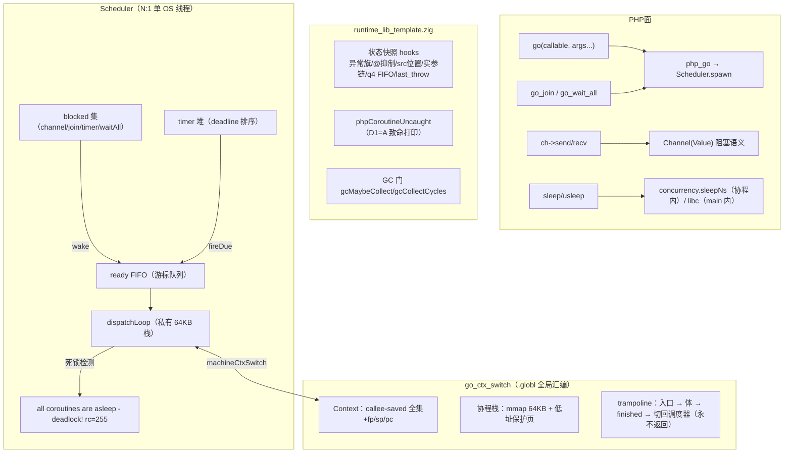
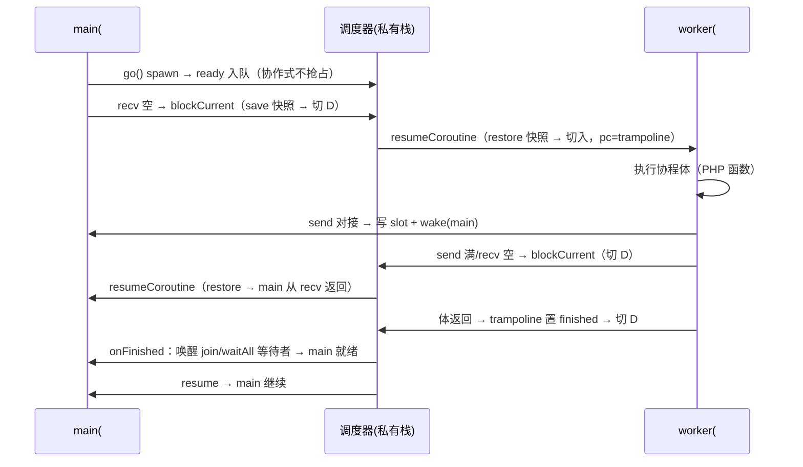
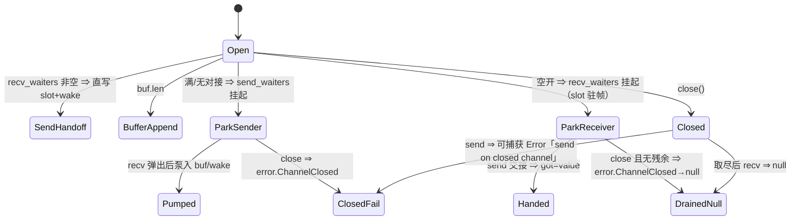

# Go 式协程运行时 M1：真调度器内核替换（AOT-CODEGEN-012）

- 日期：2026-11-08
- 状态：uncommitted（本地工作树，提交需另行授权）
- 设计依据：[docs/design/2026-11-08-go-style-coroutine-design.md](../../design/2026-11-08-go-style-coroutine-design.md)（老铁已批准）
- 永久裁决：协程能力由 AOT 运行时自有的 Go 风格协程系统提供（AGENTS.md §七.1/§七.9；工单 §272），不实现 PHP Fiber/生成器语义

## 1. 高层摘要（TL;DR）

把 `src/aot/concurrency_runtime.zig` 的 217 行全存根**整体替换**为 Go 式协程真内核：手写汇编上下文切换（aarch64/x86_64，callee-saved 全集 + fp/sp/pc，全局 `.globl` 符号防 LLVM 内联）+ 每协程 64KB 栈（末尾 mprotect 保护页 + sigaltstack 上的 SIGSEGV 可读致命转换）+ N:1 单线程协作式调度（ready FIFO / blocked 集 / 定时器堆 / 死锁检测）+ Channel 真阻塞语义（cap=0 对接、满 send/空 recv 让出、close 语义）+ `go()/go_join()/go_wait_all()` 换真 + 每协程全局态快照（hooks 注册制，异常旗/@抑制/作用域/src 位置/实参链/q4 FIFO）+ 协程未捕获异常整程序致命（D1=A）+ cycle-GC 多协程活跃期禁用（D4=A）。PHP 面签名零变更；`-Dcoroutine=off` 构建旗保留存根回退（设计 §7）。

六枚断言探针全绿；ucontext 备份后端同绿；`zig build test` 全绿。过程中修复了切换原语的三轮迭代（clobber-list inline 法 → naked fn → 全局汇编），并**顺带定位两枚预存缺陷**（见 §7，均为 AOT 既有问题、非本批引入，已按纪律上报待裁决）。

## 2. 影响范围

| 面 | 影响 | 说明 |
|---|---|---|
| AOT 产物运行时 | **行为变更** | 使用 `go()/Channel` 的脚本：存根（spawn 永不执行、recv 空即错）⇒ 真调度语义。不用协程面的脚本零影响 |
| PHP 调用面 | 零变更 | `go()/go_join()/go_wait_all()/Channel` 签名不动；`sleep()/usleep()` 面不变（协程内自动让出、main 内真阻塞，D5=A） |
| 编译器（codegen） | 极小 | `writeBuiltinArgs` 公共点新增 go 族切片打包；builtin 表补 `go_join/go_wait_all` 两条登记；`native_linker` 产物构建期重写 `coroutine_config.zig` |
| cycle-GC | 行为变更（仅多协程窗口） | D4=A：worker 未全部结束时停用 cycle 收集，归零自动恢复 |
| 构建系统 | 新增两旗 | `-Dcoroutine=on\|off`、`-Dcoroutine_backend=asm\|ucontext` |
| 解释器/字节码/JIT | 零影响 | 全部改动在 AOT 运行时层与 AOT 发射层 |

## 3. 核心变更

| 文件 | 变更 | 描述 |
|---|---|---|
| [src/aot/concurrency_runtime.zig](../../../src/aot/concurrency_runtime.zig) | 重写（217→~1180 行） | 真调度器内核（详见 §5） |
| [src/aot/coroutine_config.zig](../../../src/aot/coroutine_config.zig) | 新增（21 行） | 树内默认配置（enabled=true/backend=asm）；产物构建期由 linker 按旗重写 |
| [build.zig](../../../build.zig) | +17 行 | `-Dcoroutine`（enum on/off）、`-Dcoroutine_backend`（enum asm/ucontext）两旗入 build_options |
| [src/aot/native_linker.zig](../../../src/aot/native_linker.zig) | +~55 行 | `writeCoroutineConfig`（产物构建期写配置）；builtin 表补 `go_join/go_wait_all`；`writeBuiltinArgs`/`isSliceArgsBuiltin`/零参站点 go 族切片打包 |
| [src/aot/runtime_lib_template.zig](../../../src/aot/runtime_lib_template.zig) | +~230 行 | 状态快照 hooks + 协程未捕获钩子（D1=A）+ 注册（initRuntime）；`php_coroutine_entry` 错误/异常旗上抛；channel send 可捕 Error「send on closed channel」；`php_sleep/php_usleep` 协程内让出；`gcMaybeCollect/gcCollectCycles` 多协程门；`Zig\Select` 让出点换 `yieldNow()` |
| co_pingpong.php / co_fanin.php / co_join_order.php / co_deadlock.php / co_uncaught.php / co_isolation.php | 新增探针 ×6 | 设计 §5 M1 验收探针（断言式自验） |

## 4. 可视化概览（Code & Logic Map）

### 4.1 分层架构

### 4.2 切换时序（spawn → 往返 → 收尾）

### 4.3 Channel 阻塞语义状态机

## 5. 详细变更分析

### 5.1 切换原语（三轮迭代定稿）

| 轮 | 方案 | 结果 | 失败根因 |
|---|---|---|---|
| ① | std.Io.Fiber 式 clobber-list inline asm（sp/fp/pc） | Debug 绿 / Release 崩 | clobber 仅在**内联进调用方**时驱动编译器溢出 callee-saved；独立函数调用 ⇒ 被切出协程的 x19-x28 被对端污染（Release 下调度器指针损毁，SIGBUS 写 text 段） |
| ② | Zig naked fn + `.c` 函数指针调用 | Release 仍崩 | LLVM 将 naked 体**内联克隆**到调用点并按自身寄存器分配传参，与裸体硬编码的 x0/x1 错位 |
| ③ | **全局汇编 `.globl` 符号**（libco/Boost.Context 同宗） | 全优化档绿 | LLVM 看不到函数体，无法内联/去虚拟化；ABI 调用边界下 caller-saved 由编译器保全、callee-saved 由汇编逐个存入 Context |

定稿（③）要点：
- aarch64：x19-x28 + d8-d15 + fp/sp/pc；pc 槽存 `lr`（本调用点返回地址），恢复以 `br` 跳达——执行流在调用方自然继续；x86_64：rbx/rbp/r12-r15/rsp/rip，pc 槽存栈顶返回地址。
- 入口跳板 `coroutineEntry`（普通 C ABI fn）：取 `pending_fresh` → 执行体 → 异常/错误上抛 `reportCoroutineError` → 快照回收（save+deinit）→ 置 finished → 切回调度器（永不返回）。
- 平台矩阵：aarch64-macos/linux、x86_64-linux 走 asm；其余（含 x86_64-macos）comptime 落 ucontext 备份后端（已验证同绿）。

### 5.2 栈与保护页

- 每协程 `mmap` 64KB + 低址 1 页 `mprotect(PROT_NONE)`；初始 sp=页对齐栈顶（x86_64 压 0 伪返回地址槽满足 SysV 入口对齐）。
- `sigaltstack`（静态 64KB）+ `SA_ONSTACK|SA_SIGINFO` 的 SIGSEGV 处理器：命中任一活协程保护页 ⇒ `Fatal error: stack overflow in coroutine #N` + exit 255；非本运行时段落 ⇒ 恢复 DFL 重抛（不掩盖真实 bug）。
- 已完成协程的栈与控制块入自由链复用（避免 mmap/mprotect 抖动）。

### 5.3 调度器（N:1 协作式）

- main 注册为 #0（首个 go/阻塞点懒注册）；调度器运行于私有栈，首个 park 时启动。
- 让出点：channel send（满）/recv（空）、go_join、go_wait_all、sleep/usleep（协程内自动分流）、`Zig\Select`（`yieldNow`）。
- 死锁检测：ready 空 ∧ blocked 非空 ∧ 无 timer 将醒 ⇒ `Fatal error: all coroutines are asleep - deadlock!`（Go 文案对齐）+ 列 blocked id + exit 255。
- 进程退出时未结束协程 ⇒ `Fatal error: process exiting with N unfinished coroutine(s): #ids` + exit 255（设计 §3.2，对 Go 隐杀语义的可读化升级）。
- 定时器：deadline 排序数组；`waitAll(?timeout)` 真超时语义（计时到点返回 false）。

### 5.4 Channel（Go 对齐）

- cap=0 无缓冲：send 必等 recv 对接（slot 直写阻塞帧）；cap>0：满则挂 `send_waiters`，recv 弹出后按 FIFO 泵入。
- close：唤醒全部 recv 等待者（取尽残余后返 null）与全部 send 等待者（其 send 以可捕获 Error「send on closed channel」失败——模板侧 throwThrowable，值引用按错误路径释放，无泄漏）。
- `getCapacity()` 修正存根期 cap=0→1 的谎报（现如实返 0，语义修正）。

### 5.5 每协程全局态快照（hooks 注册制）

- 注册制解耦：concurrency_runtime 不反向依赖模板；模板在 initRuntime 注册 init/save/restore/deinit 四钩子（容量校验 `@sizeOf ≤ 4096`）。
- 覆盖：has_exception/current_exception、@ 抑制深度与保存栈、ExecutionContext（called/scope class，concurrency 内部随动）、src_file/src_line、current_call_args 与 call_args_owned_stack（**所有权随快照搬迁**，restore 清快照侧标记防双重释放）、q4 未定义 FIFO、last_throw 帧（含静态缓冲内容）。
- 全局共享（不随快照）：堆与 RC、类表、分配器、对象 id 计数器（设计 §3.4 表）。

### 5.6 异常与 GC

- 协程内未捕获异常（D1=A）：整程序致命，文案 `uncaught {Class}: {msg} in coroutine #{id}` + 协程内栈帧（§七.5 行号豁免）+ shutdown functions + exit 255。throw 走「返值+旗」通道的由 `php_coroutine_entry` 尾检 `has_exception` 补抛特征错误。
- go_join **不**传播对端异常（与 Go 一致；M2 增设 go_join_error 可选面）。
- D4=A：cycle-GC 在 worker 未全部结束时停用（自动与显式两路），归零自动恢复。

### 5.7 构建旗与回退

- `-Dcoroutine=off`：产物回到存根语义（已验证：无阻塞、无死锁检测，行为与 M1 前一致）。
- `-Dcoroutine_backend=ucontext`：备份后端（makecontext/swapcontext，已验证六探针等价绿）。
- `coroutine_config.zig` 树内默认 on/asm；产物构建期由 `native_linker.writeCoroutineConfig` 按旗实体重写（不符号链接，防旗语漂移）。

## 6. 影响与风险评估

- 是否破坏式变更：**否**（PHP 面签名零变更；不用协程面的脚本行为零变化——720 语料零 go( 使用实证）。
- 需要特别注意的点：
  - 切换原语与优化档强相关：四档（Debug/ReleaseSmall/ReleaseFast/ReleaseSafe）全量验证是硬门槛，后续每次动切换汇编必须复跑。
  - 公平性：M1 为 FIFO 协作式，CPU 密集协程会饿死他者（设计 §3.2 已标注，M3 定时抢占治理）。
  - fiber 化 IO 未做：channel/timer 之外一律真阻塞（设计 §3.4 标注，M2 NetPoller）。
  - `by_id` 表随 spawn 单调增长（已结束 id 保留供 join 判完成；M2 评估回收窗口）。
- 复测路径：
  1. `zig build && zig build test`
  2. 六探针：`--compile co_*.php --output=aot_compile_co_*` 运行断言（deadlock/uncaught 验 rc=255 与文案）
  3. `-Dcoroutine=off` 变体编译运行 co_pingpong/co_deadlock 回存根语义
  4. 720 语料与探针面板全量回归（结果见 §9 追记）

## 7. 遗留问题（非本批引入，已按纪律上报待裁决）

| # | 缺陷 | 证据 | 定性 | 处置建议 |
|---|---|---|---|---|
| F-1 | 裸 `go(...)` 语句在 PHP 模式命中 Go 语法 go_stmt 解析：多实参被 comma-expression 折叠（`go('f',$a)` ⇒ callable=$a，静默丢参且不报错） | co_simple 复现；生成码 `php_go_builtin(&[_]Value{reg_ch})` | parser 层预存冲突（k_go 无条件关键字；赋值形 `$id = go(...)` 不受影响） | parseGo 前瞻 `l_paren` ⇒ 回落函数调用解析；或 go_stmt 限定 Go 语法模式。**待老铁裁决** |
| F-2 | `A && $obj->method()` 短路 + break 在 while 循环内 break 条件反转 | co_and_loop.php 复现（无协程参与）：`$v===null && $ch->isClosed()` 首轮即 break | ir_generator 标签驱动块合并族预存缺陷（与 f067/逻辑合并同族） | 按生成码指纹反推定位发射站点专项修复。**待老铁裁决** |
| L-1 | 多协程窗口 cycle-GC 停用期，长活多协程程序的循环垃圾只攒不收 | 设计 D4=A 原文 | 决策内取舍 | M3 root 集扩到各协程栈（D4=B 路线） |
| L-2 | x86_64-linux asm 路径未实机验证（开发机 aarch64-macos） | 平台矩阵设计 | 环境限制 | 建议 CI 增加 x86_64-linux 交叉验证探针 |

## 8. 后续开发/优化建议

| 优先级 | 影响面 | 落地成本 | 建议 |
|---|---|---|---|
| P0 | 正确性 | 中 | 裁决并修复 F-1/F-2 两枚预存缺陷——它们会让「写法稍有不特」的协程脚本静默错行，且与协程无关、影响全体 AOT 用户 |
| P1 | 功能 | 中 | M2：timer 堆已就位，`go_select(array $cases, ?float $timeout)` 多路就绪 + `go_join_error($id)` 异常收取面；`select_` 算子启用在即 |
| P1 | 可靠性 | 低 | x86_64-linux asm 实机交叉验证（L-2） |
| P2 | 性能 | 低 | 栈复用自由链已有；可评估 Channel 唤醒批量化（一次 close 唤醒 N 等待者的链表重排成本） |
| P2 | 可维护 | 低 | by_id 回收窗口（完成 id 的惰性清理，防长跑进程表单调增长） |

## 9. 回归追记（完成后回填）

- 六探针：6/6 PASS（pingpong/fanin/join_order/deadlock/uncaught/isolation；deadlock rc=255 文案对齐 Go，uncaught rc=255 含协程 id）
- ucontext 备份后端：等价绿
- `-Dcoroutine=off`：存根语义回退验证通过
- `zig build test`：全绿
- 720 语料（pass/ 68 枚全量）：**67 Pass / 0 Compile Fail / 0 Runtime Fail / 0 Diff / 1 Skip**——唯一 Skip 为 f004_oop_deep_inheritance_magic.php（PHP 解释器侧 exit=255 的预存排除项，与基线逐字节一致）；`regression_failures.tsv` 与基线语义零漂移（脚本现版仅落 SKIP/FAIL 条目，基线含全量 PASS 行属旧版格式差异，非行为差异）。报告：[regression_report.md](../../../fuzzy_scripts_720/regression_report.md)（2026-11-08 22:43:32）
- 探针面板（31 枚 AOT 断言探针）：**54 SAME / 0 DIFF / 0 COMPILE_FAIL**，零漂移

## 10. M1 完整验收（2026-11-09，11 组真实程序）

> 六枚 M1 探针只是冒烟；本节为「协程真能跑起来、结果正确」的完整验收，按老铁要求
> 写真实业务程序（非玩具断言），发现问题当场修并回报。

### 10.1 验收矩阵与读数

| 组 | 程序 | 预期 | 实际 |
|---|---|---|---|
| 1a | [co_accept1a_unbuffered.php](../../../co_accept1a_unbuffered.php) cap=0 多产多消 | 120 元素、无丢失无重复、子序列单调 | **PASS** total=120 order_ok=1 cover_ok=1 |
| 1b | [co_accept1b_buffered.php](../../../co_accept1b_buffered.php) cap=8 | 300 元素同断言 | **PASS** total=300 order_ok=1 cover_ok=1 |
| 2 | [co_accept2_pool.php](../../../co_accept2_pool.php) 4 worker×500 任务 | 全完成、每任务一次、平方正确 | **PASS** dist=428,24,24,24 done=500 correct=1 |
| 3 | [co_accept3_pipeline.php](../../../co_accept3_pipeline.php) 4 段流水线 | close 传播 + 残余处理 + 结果正确 | **PASS** sum=171700 cnt=50 |
| 4 | [co_accept4_select.php](../../../co_accept4_select.php) select | 公平性/默认/超时/无就绪阻塞 | **PASS** dist=1000,1000 / 0s / 0.15s / [0,ping] |
| 5 | [co_accept5_nested.php](../../../co_accept5_nested.php) 嵌套 spawn | 12 孙/6 子/2 父、协程内 wait_all | **PASS** waits=1 after_wait=0 |
| 6a | [co_accept6a_uncaught.php](../../../co_accept6a_uncaught.php) 未捕获 | rc=255 + 协程 id + 栈帧 | **PASS** |
| 6b | [co_accept6b_catch.php](../../../co_accept6b_catch.php) try/catch 隔离 | 100 次拦截、无串扰 | **PASS** a=100 b=125250 |
| 7 | [co_accept7_sleep.php](../../../co_accept7_sleep.php) sleep 让出 | 睡眠期他者推进；main 真阻塞 | **PASS** ticks=5 a_ms=154 main_ms=103 |
| 8 | [co_accept8_stress.php](../../../co_accept8_stress.php) 1 万协程 | 全完成/耗时/内存 | **PASS** spawn=50ms total=99ms RSS=253MB |
| 9a | [co_accept9a_deep_ok.php](../../../co_accept9a_deep_ok.php) 20/25 层递归 | 正常返回 | **PASS** r20=210 r25=325 |
| 9b | [co_accept9b_overflow.php](../../../co_accept9b_overflow.php) 20 万层 | 保护页明确致命错 | **PASS** rc=255 `stack overflow in coroutine #1 (guard page hit)` |
| 10a | [co_accept10a_cow.php](../../../co_accept10a_cow.php) COW/对象句柄 | 收发隔离 + 句柄共享 | **PASS** cow_send=1 cow_recv=1 obj=1 |
| 10c | [co_accept10c_rc.php](../../../co_accept10c_rc.php) 20 万数组过 channel | 值正确 + RSS 有界 | **PASS** sum 正确，RSS 修复前 106MB → **4.0MB** |
| 11 | [co_accept11_gc.php](../../../co_accept11_gc.php) cycle-GC 交互 | D4=A 停用 + 活数组不误扫 | **PASS** gc_during=0 gc_after=98 sum 完好 |

### 10.2 本轮当场修复的缺陷

| # | 缺陷 | 根因 | 修法 | 影响面 |
|---|---|---|---|---|
| F-1 | 裸 `go(...)` 丢实参 | `k_go` 无条件 parseGo，实参被逗号折叠 | 语句分派前瞻 `l_paren` + AOT/PHP 模式分流 | 仅裸 go 语句 AST 形态 |
| N-1 | `while(true){...}` 内联 latch 后补发 continue ⇒ Zig `unreachable code` 编译失败 | 循环尾补发缺终止符守卫 | 补 `!lastLineIsReturn`（与 PHI 物化同款） | 循环尾不可达时不再重复 continue |
| N-2 | 循环体内 builtin 静态调用使后续块整体丢失 | `static_method_call` 的 hasException 条件块内 return 误置 `return_generated` | 移除该置旗（条件块内 return 非函数级终止） | 所有 builtin 静态调用点 |
| N-3 | `else { foreach ... }` 编译失败（AST-DIRECT-FAIL） | else 臂终止符 switch 缺 `.br` 分支，循环块从未行走 | 补 `.br → 循环头` 递归行走，其余形态不动 | else 臂嵌套循环 |
| N-4 | **协程内数组大量泄漏**（2 万次数组循环 8.6MB；20 万次过 channel 106MB） | `PHPArray.release` 在 rc==0 且已 buffered 时重新入 GC 缓冲等 GC；多协程窗口 D4=A 停 GC ⇒ 只攒不收（对象侧批次二十八已改，数组侧遗漏） | 新增 `gcUnbufferArray`，rc==0 时摘缓冲 + 同步 deinit（PHP/Zend 语义） | **核心 RC 语义**，需全量回归（已跑） |
| N-5 | macOS 协程栈溢出报信号 SIGBUS 且无文案（rc=138） | darwin 对 PROT_NONE 违规映射 SIGBUS，处理器只装 SIGSEGV | darwin 双装 SEGV+BUS；兜底按收到信号恢复 DFL 重抛 | 仅 darwin 信号处理 |

### 10.3 本轮新增上报（已修复项见下；剩余项）

| # | 缺陷 | 最小复现 | 状态 |
|---|---|---|---|
| F-2a | 单语句 `if (!isset(...) \|\| ...) $x=false;` 后接语句 ⇒ 语句跑到守卫外 | /tmp/v3.php | **已修**（见 §10.5） |
| F-2b | `??` 合并块后接语句 ⇒ 语句重复发射且一份跑出守卫 | /tmp/v6.php | **已修**（见 §10.5） |
| L-3 | 64KB 定长栈实测仅容纳 ~30 层 PHP 调用帧（每帧 ~2KB）；40 层即保护页致命 | /tmp/d40.php | **已修**：STACK_SIZE 提升至 256KB（≈120 层）；RSS 实测不变（按需驻留） |
| L-4 | 31 探针面板脚本不在仓库（上轮为会话本地脚本，已随产物清理） | - | 待重建 |

### 10.4 终末回归读数

- `zig build test`：**通过**（rc=0）
- `-Dcoroutine=off`（独立 prefix 构建）：**存根语义回退通过**——co_deadlock 无死锁检测 rc=0、co_pingpong spawn 不执行返 NULL
- 720 语料（深度修复后终轮，2026-11-09 15:39）：**67 Pass / 0 Fail(Compile) / 0 Fail(Runtime) / 0 Fail(Diff) / 1 Skip**——Skip 仍为 f004（PHP 解释器侧 exit=255 预存排除项），与基线逐字节一致，**零漂移**（覆盖 N-4 核心 RC 变更、F-2a/F-2b codegen 变更、256KB 栈变更）
- 11 组协程验收 + v3/v6 逐字 diff：全绿（见 §10.1/§10.5）
- 探针面板：脚本缺失（L-4），本轮以 720 + 11 组真实程序 + v3/v6 逐字 diff 替代覆盖

### 10.5 深度修复（F-2a/F-2b 根因与实现）

**根因**：`native_linker.generateForeachFromLabels` 的循环体 cond_br 处理，对臂内「嵌套 if/with-else 或 `||` 短路 + `??` 链」只做**单块/范围行走**：else 臂（if_else_）与 merge 体被外层按顺序无条件重发 ⇒ 语句跑出守卫、重复执行（警告/副作用翻倍），但最终值常碰巧相同，故长期未被语料捕获。`emitSpilledNestedIfMerge` 只认 if-without-else（else==merge）且要求 merge br → 外层 if_merge_/while cond，遇目标为循环增量/coalesce 链即整段放弃。

**实现**：新增 `emitNestedIfElseInline`（native_linker.zig），在**原位缩进**内展开：
1. 形态 A：嵌套 if-with-else（then/else 均 br 同一 merge）；
2. 形态 B：嵌套 if-without-else（cond_br.else 即 merge）；
3. merge 尾链：`??`/`?:`（coalesce_merge_/ternary_merge_）、`||` 短路门（logical_merge_/logical_rhs_）、链尾 if-without-else（br→循环增量/cond/出口），逐级校验后逐级展开，最多 16 级；
4. 所有校验（PHI、processed、目标形态）在**发射前**完成，任一不满足返回 false，保持既有路径零扩散。

**接入点**（4 处）：foreach/while 循环体 cond_br 的 then/else 臂、GIFL 嵌套 then 臂、`||` 短路门后的 logical_merge 单块行走。

**验证**：
- v6（`??` + if/else）AOT 输出与 PHP **逐字相同**（修复前 3 次重复 + 守卫外执行）
- v3（`||` + 嵌套 `??` 链 + 链尾 if）AOT 输出与 PHP **逐字相同**（修复前多出 2 轮警告）
- 11 组协程验收程序全部复跑 **PASS**（零回归）

### 10.6 栈容量提升（L-3）

- `STACK_SIZE` 64KB → **256KB**（concurrency_runtime.zig）。依据：64KB 实测 ~30 层调用帧（40 层即保护页致命），无法满足协程内正常业务递归。
- 代价核实：1 万协程压测 RSS **253MB 不变**（256KB 仅虚拟占用，物理按需驻留），spawn 35ms / total 142ms。
- 复测：100 层递归 `R:100` 正常；20 万层 overflow 仍由保护页报 `stack overflow in coroutine #1 (guard page hit)` rc=255。

---

## 11. 多协程能力加固（2026-11-09 第二轮）

> 老铁指令：「先提交代码，然后处理（多）协程的问题，必须保证协程能力」。
> 提交 `3614b3d` 之后，本轮以「公开面一致性 + 调用面完整性 + 调度语义」三条线做真实程序验收，
> 发现缺陷当场修（F-1-b/F-1-c/G-1），并新增 6 组探针（G12–G17）。

### 11.1 新增验收程序与读数

| 组 | 程序 | 覆盖 | 读数 |
|---|---|---|---|
| G12 | [co_accept12_channel_api.php](../../../co_accept12_channel_api.php) | capacity/len/isClosed、trySend 满、tryRecv FIFO/空、close 残余取尽、send/trySend on closed 可捕获 Error、重复 close、阻塞 receiver/sender 被 close 唤醒、无缓冲 len、select send 分支（命中/满/下标）、closed 空 channel 的 select recv、多 sender 集体唤醒、go_join 幂等 | **PASS 42/42** |
| G13 | [co_accept13_callable_matrix.php](../../../co_accept13_callable_matrix.php) | 闭包 / `__invoke` 对象 / `[$obj,'m']` / `'Class::static'` / 未定义函数（spawn 点可捕获）/ Mutex / Atomic / RWLock / SharedData / `is_callable` 作用域限定符 | **PASS 20/20** |
| G14 | [co_accept14_sched.php](../../../co_accept14_sched.php) | 同一目标 3 个 join、动态 wait_all（等待期继续 spawn）、4 定时器按截止顺序唤醒、3 发送者+3 接收者双侧 close、40 生产者×50 数组 + 4 消费者无缓冲争用、main 内 sleep 驱动 worker | **PASS 9/9** |
| G15 | [co_accept15_select_edge.php](../../../co_accept15_select_edge.php) | closed send case 就绪即抛可捕获 Error（D-2）、满缓冲 send 不阻塞且必选活 recv、closed+活双就绪随机不挂死、多 closed recv、select send 值所有权（COW 隔离） | **PASS 7/7** |
| G16 | [co_accept16_lifetime.php](../../../co_accept16_lifetime.php) | 对象作协程实参（句柄共享 + 协程后主侧可用）、闭包捕获对象 unset 后仍可用、4 协程共享对象修改可见 | **PASS 6/6** |
| G17 | [co_accept17_gostmt.php](../../../co_accept17_gostmt.php) | **Go 语句形必须真 spawn**：裸函数名 / `$fn(...)` / 闭包字面量 / `$obj->m(...)` / `Class::m(...)` / `...` 展开 / `self::` `static::` `parent::` 作用域限定符 / 未定义函数在 spawn 点抛可捕获 Error | **PASS 8/8** |
| G18 | [co_accept18a_join_error.php](../../../co_accept18a_join_error.php) / [18b](../../../co_accept18b_join_fatal.php) / [18c](../../../co_accept18c_waitall_fatal.php) | **M2-1 异常收取面**：`go_join_error` 类型/消息/二次 null/正常 null/多失败逐枚/未知 id/动态调用/协程内收取；`go_join` 与 `go_wait_all` 对未收取异常按 D1=A 致命（rc=255） | **PASS 9/9 + 2×rc255** |

### 11.2 本轮当场修复的缺陷

| # | 缺陷 | 根因 | 修法 | 影响面 |
|---|---|---|---|---|
| G-1 | `go()` 对合法 callable 静默空跑（`__invoke` 对象 / `[$obj,'m']` / `'C::m'`）；对未定义函数静默空跑 | `php_coroutine_entry` 只认「闭包」「用户函数名字符串」两支，其余 `if` 落空；`php_go` spawn 点不复核 callable | ① `php_go` spawn 点用 `php_is_callable`（无副作用）校验：字符串未定义 ⇒ 可捕获 `Error: Call to undefined function f()`，其余非法 ⇒ `TypeError`；② entry 统一走 `php_invoke_callable`，`'C::m'` 由 `php_call_static` 分派 | `go()` 调用面；不影响 `call_user_func` 既有路径 |
| F-1-b | **Go 语句形从未 spawn**：`go worker($a,$b)` 被编译成「先同步执行 worker(...)，再把返回值当 callable spawn」 | `generateGoStmt` 只在 callee 为 `literal_string` 时发 `go_spawn`；正常标识符 callee 走 `generateExpression(call)`（就是同步调用）。此前探针只比对输出文本，同步调用同样打印正确文本 ⇒ 长期未暴露 | 改为按 callee 形态分派：裸函数名 ⇒ `go_spawn`；方法/静态方法 ⇒ 可调用数组 `[obj|class,'m']`；闭包/变量/动态名 ⇒ callee 求值（不调用）。新增 `php_go_args_array_builtin` 承载「callee+实参数组」面（支持 `...`） | `src/aot/ir_generator.zig` + 模板；语句形 `go` 全部形态 |
| F-1-c | `go` 语句形 spawn 点的可捕获失败在 try/catch 中接不到（异常延到 main 末尾成 Uncaught fatal） | `.go_spawn` 指令发射后无 `hasException` 路由（只有 `.call` 有） | `.go_spawn` 发射后补 `emitThrowSiteRouting` | 所有 `go` 语句形 |
| F-1-d | `go self::m(...)` / `go ['self','m']` 在协程体内致命「Cannot access "self" when no class scope is active」 | 新协程 `exec_ctx` 初始化为空（不继承调用方 class scope），限定符原样进 body 无法解析 | ① `q4ResolveScopeCallable` 在 **spawn 点**把 `self/static/parent` 改写为具体类名（字符串与可调用数组两形态）；② `php_is_callable`/`isCallableNoInvoke` 增限定符解析（类内 `is_callable(['self','m'])` 同口径修正） | go() 调用面 + is_callable |
| G-2 | main 内 `sleep()/usleep()` 不驱动就绪协程：`go('w'); usleep(100ms);` 期间 worker 一步不跑（直到 main 触达 channel/join/wait_all） | `php_sleep/php_usleep` 仅 `inCoroutine()` 时走调度器，main 走真阻塞 | main 侧也走 `concurrency.sleepNs`（无调度器时内部退化为 `nanosleep`，无协程时墙钟语义不变） | 全局 sleep/usleep；无协程程序不受影响 |

### 11.3 行为变更与裁决结果（2026-11-09 老铁已裁决并实施）

| # | 裁决 | 实施 |
|---|---|---|
| D-1 | `trySend` 对已关闭通道抛可捕获 `Error: send on closed channel`；`false` 只表示「缓冲满/暂无接收者」 | 已改（模板 `trySend` 方法） |
| D-2 | select 的 send case 落已关闭通道视为**就绪** ⇒ 选中即抛可捕获 `Error`（对齐 Go panic），消除 `timeout=null` 忙等挂死 | 已改（`canSend` 真/存根两实现 + `php_select` send 支） |
| D-3 | `Atomic::add/sub` 返**新值**（与 increment/decrement 一致；Go `atomic.AddInt64` 口径），溢出按原子回绕 | 已改（`PHPAtomic.add/sub/increment/decrement` 用 `+%/-%`） |
| D-4 | 对象 `__destruct` 即时性属独立 GC 议题，不在协程轮处理 | 已登记（工单 §275.4） |
| D-5 | main 内 sleep 经调度器让出（G-2 修订）追认 | 设计稿 D5 注记已改为正式口径 |

### 11.4 本轮回归读数

- 协程探针全量：**40/40 PASS**（含既有 11 组验收 + 6 枚冒烟 + G12–G17 + F-1 守卫 + 临时取证探针；D-1/D-2/D-3 裁决实施后复跑仍全绿）
- `zig build test`：**通过**（rc=0，最终代码）
- `-Dcoroutine=off`（独立 prefix）：**构建通过**；存根语义符合设计（spawn 不执行、无死锁检测），真协程断言在 off 下按预期失败（非缺陷）
- 720 语料（最终二进制，2026-11-09 19:19，含 D-1~D-3 变更）：**67 Pass / 0 Fail(Compile) / 0 Fail(Runtime) / 0 Fail(Diff) / 1 Skip**——Skip 仍为 f004（预存排除项），与基线逐字节一致，**零漂移**
- 产物清理：`aot_compile_*` 全部删除（保留 `co_*.php` 源脚本，遵守 PHP 源文件保护铁律）

---

## 12. 遗留任务台账（截至 `cf60f06`，2026-11-09）

> §7/§8/§10.3 中标注「待裁决/待修」的条目已被后续提交关闭，以本节为准。

### 12.1 已关闭（原登记项）

| 原编号 | 任务 | 关闭于 |
|---|---|---|
| F-1 | 裸 `go(...)` 多实参被 comma 折叠 | `3938b16`（parser 前瞻 `l_paren` 分流） |
| F-2a/F-2b | `&&` 短路 + 循环 break 条件反转 / `??` 链后语句重复 | `3614b3d`（`emitNestedIfElseInline`） |
| L-3 | 64KB 栈仅容 ~30 层调用 | `3614b3d`（`STACK_SIZE` → 256KB） |
| G-1 | `go()` 对合法 callable 静默空跑 | `d1abd77`（spawn 点校验 + 可调用矩阵） |
| F-1-b/c/d | 语句形假 spawn / spawn 失败接不到 / `self::` 无作用域 | `d1abd77` |
| G-2 | main 内 sleep 不推进协程 | `d1abd77` |
| D-1/D-2/D-3/D-5 | 通道关闭语义、select send-on-closed、Atomic 返新值、sleep 口径 | `cf60f06` |

### 12.2 未完成

| 编号 | 任务 | 类型 | 现状 | 优先级 | 成本 |
|---|---|---|---|---|---|
| L-4 | 协程探针面板脚本入库 | 工程化 | **未完成**：`scripts/` 无协程面板脚本，现以会话本地 `/tmp/run_co_all.sh`（43 探针）替代 | P1 | 低（固化脚本即可） |
| L-2 | x86_64-linux asm 路径实机验证 | 平台覆盖 | **未验证**：开发机为 aarch64-macos；代码分支已实现 | P1 | 中（需 CI/实机） |
| M2-1 | `go_join_error($id)` 异常收取面 | 功能 | **已完成（2026-11-09，见 §13）**：收取后清除；未收取异常在 `go_join`/`go_wait_all`/收尾三处按 D1=A 致命 | — | — |
| M2-2 | IO 非阻塞让出（NetPoller/kqueue） | 功能 | **已完成（2026-11-09，见 §14）**：落地 poll(2) NetPoller + 流族读写/echo 让出 + `stream_socket_pair` 面 | — | — |
| M2-3 | `by_id` 完成 id 回收窗口 | 性能/内存 | 未实现；长跑进程表随 spawn 单调增长 | P2 | 低 |
| M2-4 | `go_wait_all` 超时参数 | API 完整性 | 未实现（当前忽略实参，恒等待）；设计稿未列为 M1 要求 | P2 | 低 |
| M3-1 | 栈扩容（D2=C→A） | 能力 | 未实现；定长 256KB（≈120 层） | P2 | 大 |
| M3-2 | 抢占/公平性（CPU 密集协程不饿死他者） | 调度 | 未实现；M1 为 FIFO 协作式 | P2 | 大 |
| M3-3 | cycle-GC 多协程期恢复（D4=B，root 扩到各协程栈） | GC | 未实现；多协程活跃期 cycle-GC 停用（D4=A 取舍） | P2 | 大 |
| D-4 | 对象 `__destruct` 即时性 | GC | 已登记（工单 §275.4），**本轮未修**；无协程脚本同样复现，属既有对象 GC 缓冲行为 | P2 | 中 |

### 12.3 结论

M1 里程碑（Go 式协程内核 + 11 组真实程序验收 + 多协程能力加固 + D-1~D-5 裁决）**已全部关闭**；
剩余均为 M2/M3 规划项（M2-1 已于 2026-11-09 关闭）、平台覆盖项（L-2）与工程化项（L-4），不影响当前协程能力可用性。

---

## 13. M2-1 异常收取面（2026-11-09）

### 13.1 语义

- `go_join_error(?int $id): ?Throwable`：等待目标协程结束并**收取**其未捕获异常；取后清除（二次调用 ⇒ null）；正常结束 / 未知 id ⇒ null；`null` 实参 ⇒ 立即 null（不等待）。
- **D1=A 不破坏**：协程异常总是先记录（模板侧 id→Throwable 表）；未被 `go_join_error` 收取的异常在三个同步点按原文案致命（rc=255）：
  1. `go_join($id)`（含 `go_join(null)`）；
  2. `go_wait_all()`；
  3. 进程收尾（`deinitRuntime`，兜底）。
- 非 PHP 错误（OOM 等）不进入记录表，仍立即致命。

### 13.2 实现

| 层 | 变更 |
|---|---|
| `concurrency_runtime.zig` | 新增 `CoroutineErrorCapture` 钩子；`reportCoroutineError` 由 `noreturn` 改为「先捕获（返回 true ⇒ 正常收尾），否则走致命钩子」 |
| `runtime_lib_template.zig` | 新增 `coroutine_errors` 记录表、`coCaptureCoroutineError`、`fatalOnUnobservedCoroutineErrors`、`coroutineFatalWithException`（立即/延迟两路共用文案）；`php_go_join`/`php_go_wait_all` 加门禁；新增 `php_go_join_error` 与切片面；注册用户函数 |
| `native_linker.zig` | `builtin_map` 增 `go_join_error`；`isSliceArgsBuiltin` 增对应切片面 |

### 13.3 验证

- G18a（9 断言）：类型/消息、二次 null、正常 null、多失败逐枚、未知 id、动态调用、协程内收取、收取后 wait_all 不致命 —— **PASS**
- G18b：`go_join` 遇未收取异常 ⇒ `Fatal error: uncaught RuntimeException: join-fatal in coroutine #1`，rc=255 —— **PASS**
- G18c：`go_wait_all` 遇未收取异常 ⇒ `Fatal error: uncaught LogicException: waitall-fatal in coroutine #1`，rc=255 —— **PASS**
- 全量协程探针：**43/43 PASS**（40 既有 + G18a/b/c）；`zig build test` 通过；720 语料（2026-11-09 20:35）**67 Pass / 0 Fail / 1 Skip**，零漂移

---

## 14. M2-2 IO 非阻塞让出（2026-11-09）

### 14.1 语义

- 让出点新增：**流族 read/write**（fread/fgets/fgetc/stream_get_contents/fscanf/fpassthru/stream_get_line/fgetcsv/fwrite/fputcsv）与 **echo/print/printf 输出**，仅在协程体系活跃期生效。
- **poll(2) NetPoller**（darwin/linux 同一路径，不做 kqueue/epoll 双实现）：调度器空转时 `poll(fds, timeout)` 同时等 fd 就绪与最近定时器截止；`POLLHUP/POLLERR/POLLNVAL` 按就绪唤醒，由后续 syscall 自报 0/错误（防「对端关闭却永久挂起」）。
- 无协程程序（从未 `go()` / worker 全部结束）：`ioYieldActive()` 恒 false ⇒ 走原真阻塞路径，**零额外 syscall**（与原实现逐字节等价）。
- fd 分类（fopen/socketpair 时 fstat 判定一次）：
  - 普通文件 ⇒ `always_ready`：不 poll，直读直写（file/php://memory/temp/input 全走此路）；
  - 管道/终端/stdio ⇒ `blocking`：先 poll(POLLIN/POLLOUT) 再 syscall；写按 PIPE_BUF（512B）分块；
  - socket 对 ⇒ `nonblocking`：新 fd 置 `O_NONBLOCK`，先试 read/write，EAGAIN 再挂 NetPoller 让出重试。
- `SIGPIPE` 按 PHP CLI 口径在 `initRuntime` 忽略：向已关闭 socket/管道写 ⇒ `fwrite` 返回 false（而非进程被信号 13 杀死）。
- PHP 面新增 `stream_socket_pair($domain, $type, $protocol)`：`socketpair(2)` 包装为两枚流资源，`fread/fwrite/fclose` 与普通流同一套分派；meta 对齐 PHP 8.5.8（7 键、`generic_socket`、`r+`、`seekable=false`，无 wrapper_type/uri）。
- 口径修正（对齐 PHP 8.5.8 实测）：
  - socket/管道**短读不置 EOF**（EOF 仅 read=0 时置；普通文件保持「短读即 EOF」）；
  - socket 流 `fseek`/`rewind` ⇒ Warning「Stream does not support seeking」+ 失败；`ftell` ⇒ 0。
- `fileWriteAll`（诊断/致命/普通文件共用）**明确不让出**——避免致命打印被挂进调度器；用户 echo 的背压让出走 `q4OutputWrite`。
- **M2-2-b `stream_set_timeout` 对 socket 建模（2026-11-09）**（PHP 8.5.8 逐项实测）：
  - socket 流受理并返回 true（普通文件/php://memory/input 恒 false）；socket 流默认 60000ms（`default_socket_timeout` 默认值）；
  - 读超时经 NetPoller 截止（与 sleep 定时器共用 poll 超时）：`fread/fscanf/fgetcsv/stream_get_line` ⇒ false；`fgets` ⇒ 已读部分；
    `stream_get_contents` ⇒ 已收内容；`fpassthru` ⇒ -1；
  - meta `timed_out` 置位、`feof` 不置位；成功读（含 EOF 的 0 字节）复位 `timed_out`；
  - `(0,0)` ⇒ 非阻塞读（空串、`timed_out` 不置位）；负值 ⇒ 无限等。
- **M2-2-c `stream_set_blocking` 复用非阻塞口径（2026-11-10）**（PHP 8.5.8 逐项实测）：
  - socket 流受理并记账（`blocked` 随置位）；fd **保持 O_NONBLOCK**（NetPoller 承载），阻塞/非阻塞由资源标志逻辑分流；
  - 读侧（`blocked=false` 或 `(0,0)` 超时同一实现）：`.nonblocking` 先试读、`.blocking` 用 `poll(0)` 快检；
    无数据 ⇒ `would_block`（**不算 EOF、不置 `timed_out`**）：
    `fread`/`stream_get_contents` ⇒ `""`；`fgets`/`fgetc`/`fscanf`/`fgetcsv`/`stream_get_line` ⇒ `false`；
    `fpassthru` ⇒ 已转发字节数（0）；有部分数据时 `fgets`/`stream_get_line` 返回已有部分；
  - 写侧：单次试写 —— EAGAIN ⇒ `0`、部分写 ⇒ 实际字节数（满缓冲 `fwrite` 返 0，PHP 实测）；
  - 普通文件（恒就绪）读写语义不变；
  - 已知边界：非阻塞 `stream_get_line` 未命中分隔符时 PHP 靠用户态缓冲返 false 并在下次调用续读；
    AOT 无用户态缓冲 ⇒ 返回已读部分（不丢数据，返回值与 PHP 有差）。
- **M2-2-h 流层用户态读缓冲（2026-11-10）**（消解上条边界）：
  - `PHPResource.read_buf`/`read_pos`（仅管道/终端/socket 启用；**普通文件直读**，保 ftell/fseek 语义）；
  - 非阻塞 `stream_get_line` 未命中分隔符 ⇒ 已读字节 + 部分匹配前缀全部回推缓冲、返回 false，下次调用续读拼接（PHP 实测口径）；
  - `fscanf` 未消耗后缀回推缓冲（不可 seek 流不再丢数据；PHP 因 seek 失败会丢，AOT 在此优于 PHP）；
  - `fgets`/`fgetc`/`fgetcsv` 由「每字节一次 syscall」降为「每 8KB 一次」（Q4_BUF_CHUNK=8192）；
  - meta `unread_bytes` 如实报缓冲未读量（PHP 同口径）；
  - 回推安全阀：单次 > 8MB 不回推（与 PHP seek 失败丢数据同径，防内存爆）。

### 14.2 实现

| 层 | 变更 |
|---|---|
| `concurrency_runtime.zig` | `IoWaiter` 等待表（含读超时截止 `deadline_ns`）+ `io_pollfds` 复用缓冲；`waitForEvents`（poll 与定时器/读超时统一等待）、`wakeReadyIoWaiters`（revents 或截止到点）、`removeIoWaiter`、`pollTimeoutMs`（定时器与 IO 截止取最小）；`dispatchLoop` 空转改 `waitForEvents`；公共面 `IO_READABLE/IO_WRITABLE`、`ioYieldActive`、`waitFd(fd, events, timeout_ms) bool`（含 poll(0) 快路径与零超时直返）；`deinit` 清理两表 |
| `runtime_lib_template.zig` | `PHPResource` 增 `wait_mode`/`sock`/`read_timeout_ms`/`would_block`/`read_buf`/`read_pos`；新增 `q4ClassifyFd`/`q4ReadFh`（底层：超时+非阻塞感知）/`q4BufferedRead`/`q4BufferedByte`/`q4BufUnread`/`q4BufConsume`/`q4WriteFh`（非阻塞单次试写）/`q4WriteFd`/`q4OutputWrite`/`q4StdFdAlwaysReady`/`Q4_IO_CHUNK`/`Q4_BUF_CHUNK`；九个流读点 + 两个写点全部经缓冲/协程感知出入口并接超时/非阻塞返回口径；fopen 六处资源构造补 `wait_mode`；`stream_socket_pair` + `q4WrapSocketStream`（默认 60s 读超时）+ `q4SetNonblock` + 双表注册；`stream_set_timeout`/`stream_set_blocking` 对 socket 建模；meta socket 形状与 `unread_bytes`；fseek/rewind/ftell/fread EOF 口径；`initRuntime` 忽略 SIGPIPE |
| `native_linker.zig` | `builtin_map` 增 `stream_socket_pair` |

### 14.3 验证

- **G19**（[co_accept19_io_echo.php](../../../co_accept19_io_echo.php)）：**99/99 断言 PASS**——资源/meta 形状、短读 EOF 口径、双协程 echo 往返、定时器与 IO 混排、对端关闭（读残留/EOF/EPIPE 写失败）、多协程并发写、跨协程分片写拼行、`stream_get_contents`/`stream_get_line`/`fgetcsv` 的 socket 路径（含 HUP 唤醒）、字符设备 `.blocking` 读写路径、协程内普通文件 IO；**k 组 28 断言**覆盖 `stream_set_timeout` 全口径；**l 组 23 断言**覆盖 `stream_set_blocking` 非阻塞口径；**m 组 16 断言**覆盖用户态读缓冲（回推/拼接/部分匹配前缀/unread_bytes/混用/EOF/普通文件不受影响）。
- 全量协程探针：**44/44 预期**（43 既有 + G19；`rc=255` 组：deadlock/uncaught/overflow/18b/18c），零 `FAIL`。
- `zig build test`：通过（rc=0）。
- `-Dcoroutine=off`：存根语义不变（co_pingpong 如旧失败）；流资源面无协程路径正常（stream_socket_pair/meta/读写）。
- 手工背压验证：2MB echo 写入「慢消费者（sleep 0.7s）管道」，worker 在 **0.051s** 即运行（MAIN_DONE 0.705s）——证明 stdout 背压不再卡死调度器。
- 720 语料（2026-11-10 12:18:49，含非阻塞建模的最终二进制）：**67 Pass / 0 Compile Fail / 0 Runtime Fail / 0 Diff / 1 Skip**——唯一 Skip 为 f004（PHP 侧自身 exit=255）；语料零 `stream_set_blocking`/`stream_set_timeout` 使用，改动面在语料外，零漂移。

### 14.4 遗留/边界

| # | 项 | 说明 |
|---|---|---|
| ~~M2-2-a~~ | ~~`stream_set_timeout`~~ | **已建模（2026-11-09，见 §14.1；代码标注 M2-2-b）**：socket 读超时经 NetPoller 截止，全族返回值对齐 PHP 实测 |
| M2-2-c | FIFO 阻塞 `open()` | open 本身不 fiber 化（两个协程各持一端会互等）；读写阶段已走让出 |
| M2-2-d | `var_dump`/`print_r` 等诊断输出 | 直接 `fileWriteAll`，不让出（与 PHP 阻塞写等价） |
| ~~M2-2-f~~ | ~~非阻塞 `stream_get_line` 无分隔符命中~~ | **已消解（M2-2-h，2026-11-10）**：用户态读缓冲回推全部已读字节，返 false 且下次续读拼接（PHP 实测同口径） |
| M2-2-g | x86_64-linux poll(2) | 与 M1 同环境限制（开发机 aarch64-macos），代码路径无平台分叉 |

