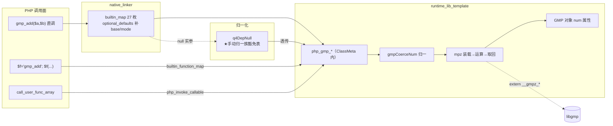
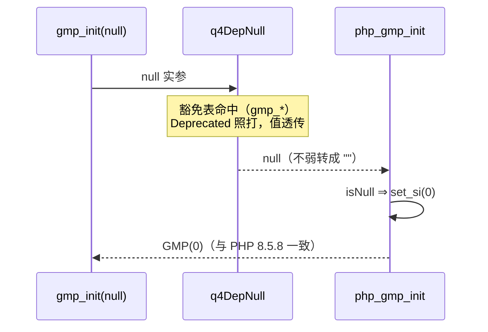

# GMP-α 批次三十五：核心 27 枚落地（libgmp extern + 对象 num 属性承载）

> **⚠️ 已作废（2026-11-08 批次三十九）**：老铁裁决「删除GMP模块，我们要先把基本语言功能能力完全达到与PHP运行结果一致…不要搞这些没用的扩展」。GMP（α+β+γ）已**整体回滚清零**，本文档仅作历史决策留档，所记落地物均已不存在。删除记录见工单 §269。

- 日期：2026-11-08
- 工单：§265
- 基线 commit：`99ab362`（工作区未提交变更）

---

## 1. 高层摘要（TL;DR）

GMP 扩展首批 27 枚核心函数全链路落地（直调 + 变量调用 + cufa 三面）。承载决策（真值驱动）：**GMP 对象 = PHPObject + `num` 属性（十进制字符串）**——与 PHP var_dump/print_r 形态天然对齐，每次运算临时 mpz 装载/取回，零 C 态驻留 ⇒ RC/clone/deinit 全走既有对象机制。最大坑在 **q4DepNull 归一化与 GMP C 层手动归一的冲突**：反射表 stub 签名（string|int）触发 ZPP union 弱转规则把 null 转成 ""，而 PHP gmp.c 用 Z_PARAM_ZVAL 手动归一（null→0）——以「手动归一族豁免表」（数据表，非逻辑硬编码）收口。

## 2. 影响范围

| 维度 | 范围 | 说明 |
|---|---|---|
| 运行库 | +1 区块（extern 34 + GMP 区 ~600 行 + wrapper 27） | ClassMeta 容器内（与 DateTime 族同位） |
| 归一化共用件 | q4DepNull | 豁免表前置 + Emit 助手抽取；纯标量路径零漂移（depnull_r1 实证） |
| 编译器 | builtin_map +27、链接参数 +`-lgmp` | 无发射逻辑变更 |
| 构建 | build.zig 四 target linkSystemLibrary("gmp") | zig build test 依赖修复 |
| 常量 | GMP_ROUND_ZERO/PLUSINF/MINUSINF = 0/1/2 | 全局常量表 |

## 3. 核心变更

| # | 变更点 | 说明 |
|---|---|---|
| 1 | extern 34 枚 `__gmpz_*` + mpz_t 布局 | `__mpz_struct{_mp_alloc,_mp_size,_mp_d}` 与 gmp.h 一致 |
| 2 | gmpCoerceNum 归一 | GMP 读 num 属性 / int / string(**base 0 前缀探测**，"0x1F"=31) / float Deprecated+trunc / bool / null→0 / 其他 TypeError |
| 3 | 27 函数 + registerGmpClass | rounding 三档（0=tdiv/1=cdiv/2=fdiv）、mpz_mod 恒非负、div 系除零文案（Division/Modulo 分流）、root 负偶次 ValueError |
| 4 | q4DepNull 豁免表 | 27 枚 gmp_* ⇒ null Deprecated 照打 + 透传 |
| 5 | 变量调用面 wrapper 27 枚 | builtin_function_map 挂载，可选参补默认值 |

## 4. 可视化概览（Code & Logic Map）

## 5. 详细变更分析

- **端（生成码）**：`gmp_add(...)` 直调 ⇒ `runtime.ClassMeta.php_gmp_add(...)`；变量调用经 builtin_function_map 同汇聚。
- **模块（归一化）**：q4DepNull 拆两段（判定 + Emit），豁免表前置；纯标量 union 维持批次二十四「文本序首标量」。
- **业务（PHP 语义）**：rounding 常量 0/1/2=ZERO/PLUSINF/MINUSINF ⇒ tdiv/cdiv/fdiv；mod 恒非负（mpz_mod 忽略除数符号）；错误文案逐枚实测（"Division by zero" vs "Modulo by zero" vs 无前缀 "Modulo by zero" 三形态）。
- **数据（内存）**：每次调用 mpz init/clear 配对（defer clear）；num 属性 PHPString 走既有 RC；无 C 态跨调用驻留。

## 6. 影响与风险评估

- **破坏式变更**：否（纯新增面 + q4DepNull 豁免表只影响 gmp_* 27 枚）。
- **需特别注意**：① runtime_lib_template.zig 是**模板**，语法错误只在 AOT 编译时暴露（zig build 编译器自身不实例化）——本批 6 处错误（dupeZ/callconv/_mp_size/qr 声明/throwThrowable discard/streamLseek 误伤）全部经探针编译暴露并修复；② build.zig 的 gmp 链接是 zig build test 前置（测试 target 链接运行库）。
- **复测路径**：4 探针（a1_core/a2_div/a3_num/a4_err 30 枚错误边界）+ a5_dyn + depnull_r1 回归 + zig build test。

## 7. 遗留问题/潜在问题

| 项 | 级 | 说明 |
|---|---|---|
| 对象 id 序号 | P2 | AOT 单调 vs PHP 句柄池（§263.4 同族既有） |
| GMP-β | P1 | 运算符/比较重载（**碰 php_add 热路径前先量基线**）、serialize hex 形、$g->num 访问拦截、internal_data 二进制承载 |
| GMP-γ | P1 | 数论/位/IO 24 枚 |
| float 参数 clamp | P2 | 超 i64 float ⇒ clamp 边界；PHP 真值未单独取 |
| 性能 | P2 | 每运算两次进制转换（dec⇔mpz）；β 的 internal_data 二进制承载可消 |

## 8. 后续开发/优化建议

| 优先级 | 影响面 | 落地成本 | 建议 |
|---|---|---|---|
| P0 | GMP-β 热路径安全 | 低 | β 开工前跑 php_add 基线基准（N=1e6 混合类型），do_operation 挂载点限定 tag 快判前置 |
| P1 | GMP-γ | 中 | 24 枚按同模板扩（extern + coerce + 真值探针），binomial/perfect_* 优先（用户面大） |
| P2 | 性能 | 中 | internal_data 存 mpz 惰性十进制缓存：运算直读二进制，var_dump 时才转 dec |
| P2 | 豁免表通用化 | 低 | 「C 层手动归一族」若再发现（如某些 date 族），同款登记进 q4_null_passthrough_fns |
