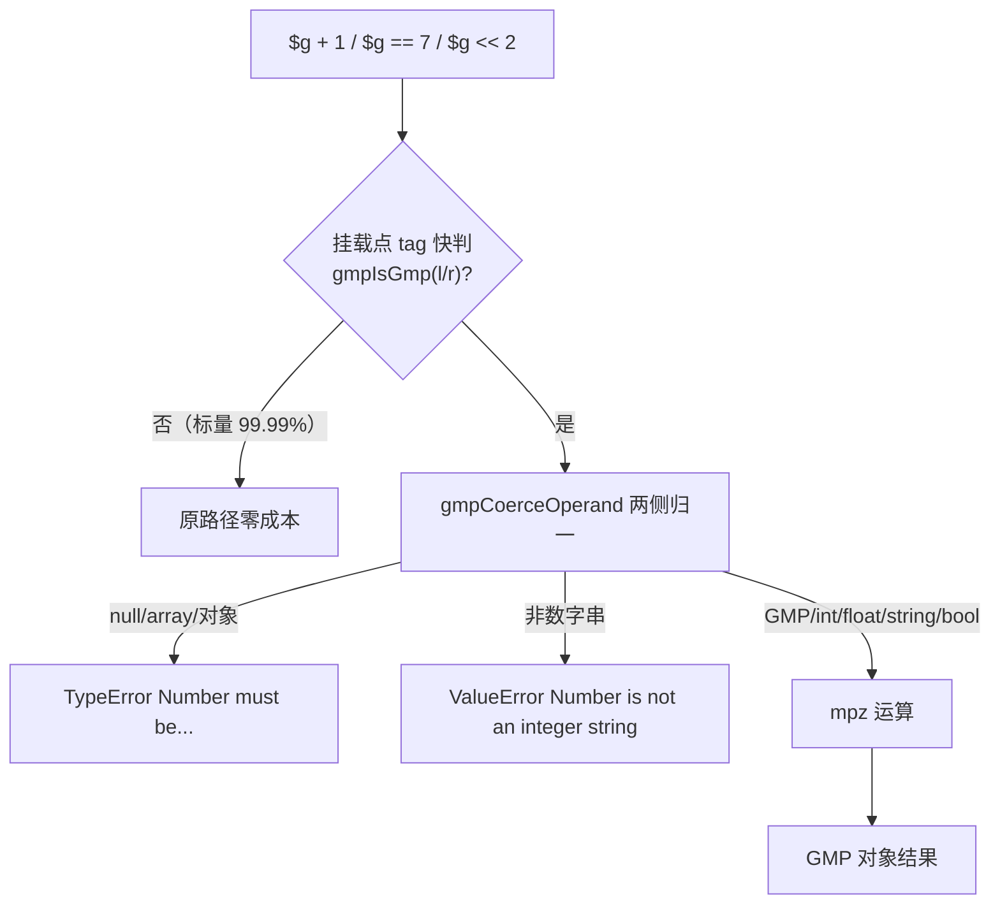
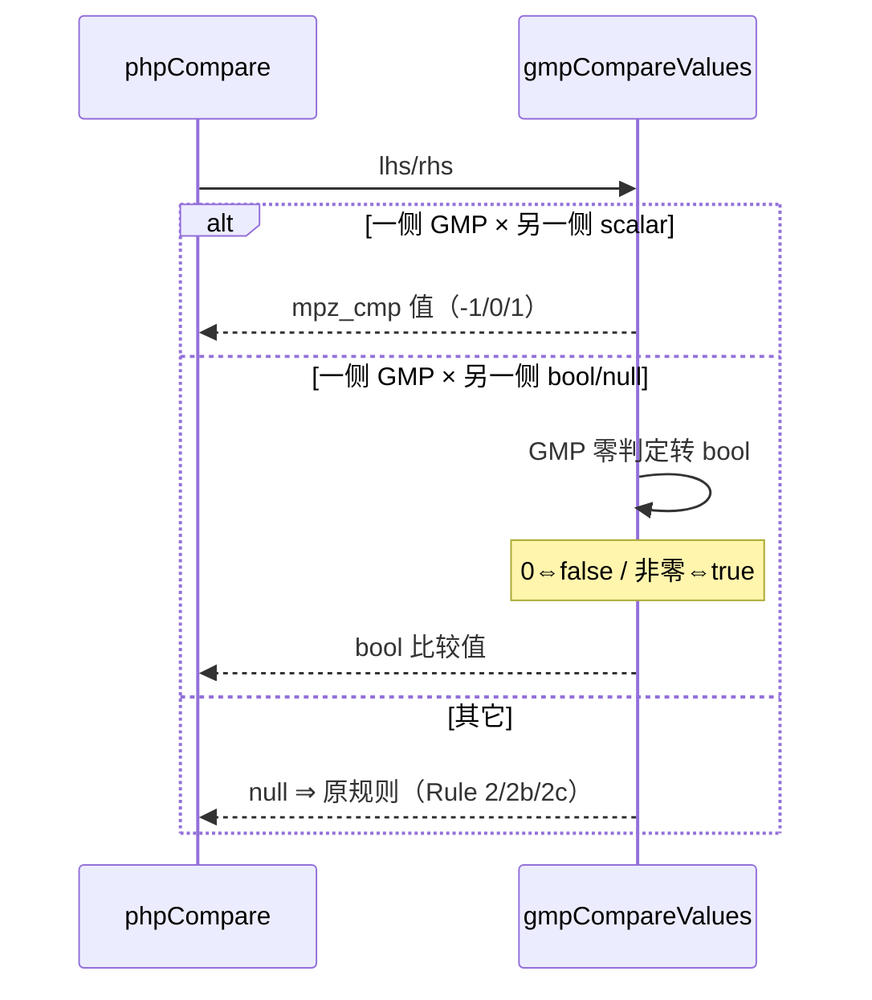

# GMP-β 批次三十六：运算符重载 12 枚 + serialize/var_dump/num 保真

> **⚠️ 已作废（2026-11-08 批次三十九）**：老铁裁决「删除GMP模块…不要搞这些没用的扩展」。GMP（α+β+γ）已**整体回滚清零**，本文档仅作历史决策留档，所记落地物均已不存在。删除记录见工单 §269。

- 日期：2026-11-08
- 工单：§266
- 关联：§265（GMP-α 底座）、§266.4 遗留
- 基线 commit：`99ab362`（工作区未提交变更）

---

## 1. 高层摘要（TL;DR）

GMP 对象 do_operation（+ - * / % ** | & ^ << >> ~ 一元- 共 12 形）与 do_compare 全族落地，serialize（hex 形）/print_r/`(string)`/echo/`$g->num` 拦截全保真。热路径宪法守卫达标：**php_add 实测 0.169-0.170s vs 基线 0.173-0.179s 零劣化**（tag 快判前置，标量零成本直通）。最深陷阱是**比较对 bool/null 侧的语义**——PHP 不是「对象恒 truthy」而是「GMP 零判定转 bool」；其次是 magic_toString 只有 addMethod 才设（putMethodOrdered 不设）导致 (string)/echo 双通道静默失败。

## 2. 影响范围

| 维度 | 范围 | 说明 |
|---|---|---|
| 热路径 | php_add/sub/mul/div/mod/pow + phpCompare + php_eq | tag 快判 ×1-2，实测零劣化 |
| 位/移位 | php_bit_and/or/xor/not + php_shl/shr | 同口径挂载 |
| 比较族 | phpCompare 顶部 + php_eq 对象×对象支 | 全族（eq/ne/lt/le/gt/ge/spaceship）通吃 |
| 属性读 | php_object_get GMP.num 拦截 | ClassMeta 加 gmp_num_hidden bool（非 GMP 零 memcmp） |
| 序列化 | __serialize/__unserialize 注册 | magic_serialize/unserialize 钩子 |

## 3. 核心变更

| # | 变更 | 说明 |
|---|---|---|
| 1 | extern +6（位/移位） | ior/and/xor/com/mul_2exp/fdiv_q_2exp |
| 2 | gmpDoArith 11 op 分流 | 结果恒 GMP；div=tdiv_q 截断、mod=mpz_mod 恒非负、>>=fdiv 算术、负移位/负指数/除零无前缀文案 |
| 3 | gmpCoerceOperand | do_operation 语境归一（TypeError「Number must be...」/ValueError「Number is not an integer string」无前缀） |
| 4 | gmpCompareValues | scalar 侧数值比；**boolish 侧 GMP 零判定转 bool** |
| 5 | num 伪属性拦截 | ClassMeta.gmp_num_hidden + php_object_get 特判；var_dump/内部读不拦 |
| 6 | float 归一化修正 | 仅非整值发 Deprecated（7.0 不警 1.9 警） |

## 4. 可视化概览（Code & Logic Map）

## 5. 详细变更分析

- **端（生成码）**：零变更（全部运行库内分流，无 IR/nlk 改动）。
- **模块（运行库）**：β 核心 ~210 行 + 11 处挂载点一行式前置 + ClassMeta 一字段。
- **业务（PHP 语义）**：do_operation 文案族（Number must be / Number is not an integer string / 无前缀三种）与函数面文案族（{fn}(): Argument #N）严格分流；bool/null 比较的零判定语义。
- **数据（性能）**：标量路径 +1 tag 判（~1ns）；GMP 路径每次运算 dec⇔mpz 转换（α 承载决策，β 未改）。

## 6. 影响与风险评估

- **破坏式变更**：否（分流全部条件触发，标量路径仅 +1 tag 判）。
- **实测数据**：php_add 3e5 混合 0.169-0.170s（基线 0.173-0.179s）⇒ 零劣化；arith_regress 24 形标量回归 SAME。
- **需特别注意**：`putMethodOrdered` 不设 magic_* 字段（addMethod 才设）——内建类注册魔术方法必须**直设** meta.magic_*；PHPObject.toString 只认 magic_toString（与 echo 的 methods.get 判定不对称）。

## 7. 遗留问题/潜在问题

| 项 | 级 | 说明 |
|---|---|---|
| `$r = &$g->num` ref 通道未拦截 | P2 | 罕见形登记 |
| `$g + 非GMP对象` 的 __toString 族差异 | P2 | 未取真值 |
| internal_data 二进制承载 | P1 | 消 dec⇔mpz 转换，β+γ 全部落地后统一做 |
| GMP-γ | P1 | 数论/位/IO 24 枚（下一批） |

## 8. 后续开发/优化建议

| 优先级 | 影响面 | 落地成本 | 建议 |
|---|---|---|---|
| P0 | GMP-γ | 中 | 按 α/β 同模板推进；prob_prime/nextprime 优先（用户面大） |
| P1 | 内建类注册防错 | 低 | registerGmpClass 的 putMethodOrdered→addMethod 坑登记进项目记忆（magic_* 直设清单） |
| P1 | internal_data 承载 | 中 | β+γ 完成后统一改造，保留 num 伪属性 dump 形 |
| P2 | 位运算函数族（gmp_and/or/xor/com） | 低 | γ 批与运算符面共享 gmpBinop 骨架 |
