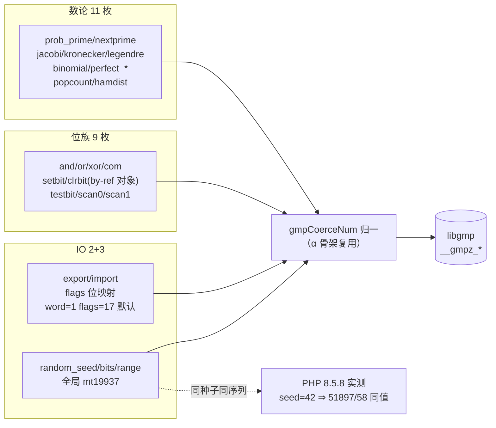

# GMP-γ 批次三十七：数论/位扫描/导入导出/随机族 25 枚

> **⚠️ 已作废（2026-11-08 批次三十九）**：老铁裁决「删除GMP模块…不要搞这些没用的扩展」。GMP（α+β+γ）已**整体回滚清零**，本文档仅作历史决策留档，所记落地物均已不存在。删除记录见工单 §269。

- 日期：2026-11-08
- 工单：§267
- 关联：§265（α）、§266（β）——GMP 全 52 枚函数面闭环
- 基线 commit：`99ab362`（工作区未提交变更）

---

## 1. 高层摘要（TL;DR）

GMP 第三批 25 枚落地，全 52 枚函数面闭环（α 27 + γ 25，β 为运算符/序列化面）。三个符号学教训：① `mpz_kronecker`/`mpz_legendre` 在 gmp.h 是 `mpz_jacobi` **宏别名**（无独立导出符号）；② `mpz_testbit` 的真身是 `__gmpz_tstbit`（无 e）；③ extern 声明必须 `nm libgmp.dylib` 实测，不凭宏名猜。random 族用全局 mt19937 randstate——**同 libgmp 即同序列**，种子确定性跨实现逐字节一致（seed=42 ⇒ bits(16)=51897 双侧同值）。

## 2. 影响范围

| 维度 | 范围 | 说明 |
|---|---|---|
| 运行库 | +25 函数 +25 wrapper +5 IO 常量 | 复用 α 的 coerce/binop/fromMpz 骨架，零新机制 |
| 编译器 | builtin_map +25（4 枚带 optional_defaults） | 无发射逻辑变更 |
| 常量 | GMP_MSW_FIRST/LSW_FIRST/LITTLE_ENDIAN/BIG_ENDIAN/NATIVE_ENDIAN | PHP 8.5.8 实测值 1/2/4/8/16 |
| 全局态 | gmp_randstate（lazy init） | mt19937，进程单例，与 PHP 同算法 |

## 3. 核心变更

| # | 变更 | 说明 |
|---|---|---|
| 1 | extern +19 | 数论/位扫描/导入导出/randstate；tstbit 拼写修正、kronecker/legendre 走 jacobi 宏别名 |
| 2 | γ 25 函数 | scan0/1 负 start ValueError；setbit/clrbit by-ref 对象就地写回；export/import flags 冲突双文案 + word_size≥1；popcount/hamdist 负数 @bitCast -1 |
| 3 | random 族 | gmp_randstate 全局单例 + __gmp_randseed mpz 种子 + urandomb/urandomm |
| 4 | setbit/clrbit 修复 | `want_set == value` 误中 clrbit ⇒ 改 `want_set and value`（g2 探针擒获） |

## 4. 可视化概览（Code & Logic Map）

## 5. 详细变更分析

- **端**：无（零 IR/nlk 发射面改动，全部运行库 + 登记）。
- **模块**：γ 实现全部复用 α 骨架（gmpCoerceNum/gmpBinop/gmpFromMpz/gmpMpzToString），新增仅 gmpIoFlagsOf/gmpRandState 两枚族内助手。
- **业务**：by-ref 对象写回（setbit/clrbit 改 num 属性）；export 的 word 序×endian 双维 flags 映射（默认 MSW_FIRST|NATIVE_ENDIAN=17）；random 的 min<max 校验。
- **数据**：randstate 不透明 48B 静态承载（__gmp_randstate_struct 布局 32B 充裕估计）。

## 6. 影响与风险评估

- **破坏式变更**：否（纯新增面）。
- **复测路径**：g1/g2/g3 三探针（58 形）+ α/β 回归 3 格 + zig build test 全绿；720 里程碑（批次三十六+三十七合并）后台在跑。

## 7. 遗留问题/潜在问题

| 项 | 级 | 说明 |
|---|---|---|
| random 未 seed 首次序列 | P2 | PHP time/pid 播种，§七.7 时间族豁免口径 |
| prob_prime reps 语义随库版 | P2 | 同库同值，跨库不保证 |
| internal_data 二进制承载 | P1 | 全族落地后统一批（消 dec⇔mpz 转换） |

## 8. 后续开发/优化建议

| 优先级 | 影响面 | 落地成本 | 建议 |
|---|---|---|---|
| P1 | GMP 性能 | 中 | internal_data 承载 mpz + num 惰性十进制缓存（var_dump/serialize 才转）；全族函数面已稳，改造窗口成熟 |
| P1 | 队列推进 | 中 | 回登记队列：G2/G4 销毁时机（待老铁解冻）、catch 变量重绑、构造器可见性、§257/§258 正确性缺口 |
| P2 | extern 防错 | 低 | 「nm 实测符号」写进项目记忆（gmp.h 宏别名/拼写陷阱 tstbit） |
