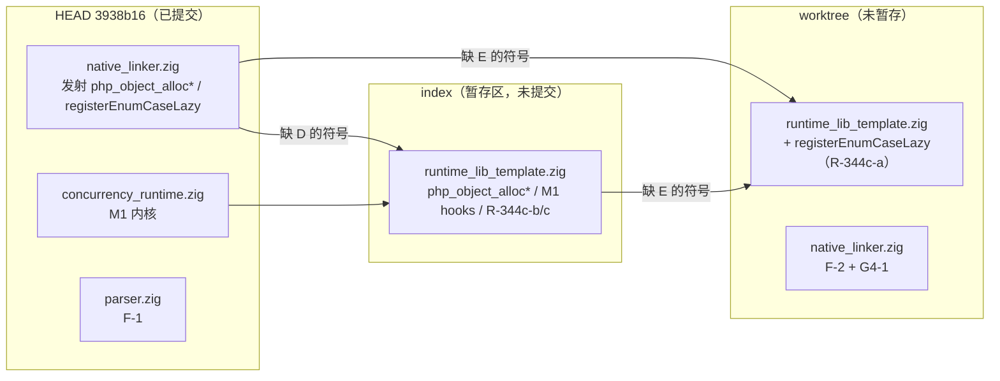

# AOT-CODEGEN-012 交接文档：Go 式协程 M1 与在飞修复

- 日期：2026-11-09
- 仓库：`/Users/wangjianjun/products/parser`
- HEAD：`3938b166f82630e37bc980ca5b3f15fff041fe8b`（`main`，领先 `origin/main` 116 个提交，未推送）
- HEAD 提交：2026-11-08 23:36:00 +0800，`feat(coroutine): implement Go-style coroutine runtime in AOT products`
- 工具链：`zig version` = **0.17.1**；`build.zig.zon:28` 要求 `minimum_zig_version = "0.17.0"`；[AGENTS.md](file:///Users/wangjianjun/products/parser/AGENTS.md#L1) 仍写 "Zig 0.16.0"（文档与实测冲突，以实测为准）
- 文档性质：交接文档；本次只读取证 + 写本文件，未改任何源码
- 证据口径：每条结论附文件/行号或实测命令；查不到写「未取证」；与旧记录冲突时以代码与最近实测为准，并在附录 B 单列

---

## 0. 给接手者的三句话

1. **不要回退、不要 clean、不要只提交暂存区。** 当前 HEAD 缺少 `runtime_lib_template.zig` 的运行时半，暂存区又缺 `registerEnumCaseLazy`；只有「HEAD + 暂存区 + 未暂存工作树」三者叠加才补齐上述运行时符号缺口（证据见 §2.2）。
2. 协程 M1 内核已在 HEAD；六枚探针本次复跑全绿；但 **11 组真实程序验收没有完成**，只有 4 组留下脚本/二进制，且无正式读数（§4）。
3. F-1 已修且已提交；F-2、G4-1、R-344c-a/b/c 已在工作树/暂存区落地但未提交、未登记工单、未重跑面板/720（§5）。先复核这些，再谈提交。

---

## 1. 高层摘要

### 1.1 当前阶段

协程线按宪法 §七.9 的 Go 式路线推进（老铁 2026-11-08 永久裁决，工单 §272）。M1（N:1 协作式调度 + 手写汇编上下文切换 + 64KB 栈/保护页 + Channel 真阻塞 + 每协程全局态快照 + 死锁检测 + D1=A 未捕获致命 + D4=A cycle-GC 门）已落地并进入 HEAD 提交；M2（sleep/select/IO 让出面）、M3（栈扩容/抢占/M:N）尚未开始。

当前工作树的实际状态比 HEAD 更向前：M1 的 `runtime_lib_template.zig` 集成在暂存区，F-2/G4-1 的发射器修复与 R-344c-a 的枚举惰性化在未暂存工作树。**HEAD 单独不构成自洽的 AOT 运行时**（§2.2）。

### 1.2 已完成 / 未完成

| 项 | 状态 | 证据 |
|---|---|---|
| M1 内核（调度器/汇编/栈/Channel/死锁） | 已完成并提交 | [concurrency_runtime.zig](file:///Users/wangjianjun/products/parser/src/aot/concurrency_runtime.zig#L62-L230)；`git show --stat HEAD`（+1209 行） |
| M1 构建旗 / 配置 | 已完成并提交 | [build.zig](file:///Users/wangjianjun/products/parser/build.zig#L24-L38)；[coroutine_config.zig](file:///Users/wangjianjun/products/parser/src/aot/coroutine_config.zig#L1-L20) |
| M1 运行时模板集成（hooks/sleep/GC 门/异常钩子） | 已完成但**未提交**（暂存区） | `git diff --cached --stat`：`runtime_lib_template.zig` 550+/248- |
| 六枚 M1 探针 | 通过（本次复跑 6/6） | §3.4、附录 A |
| ucontext 备份后端 / `-Dcoroutine=off` 回退 | 记录通过（本次未复跑） | [M1 摘要 §9](file:///Users/wangjianjun/products/parser/docs/changes/2026-11-08/AOT-CODEGEN-012_go_style_coroutine_runtime_M1_2026-11-08_uncommitted.md#L190-L197) |
| 四优化档（Debug/ReleaseSmall/ReleaseFast/ReleaseSafe） | 记录通过（本次未复跑，无原始日志） | [M1 摘要 §5.1](file:///Users/wangjianjun/products/parser/docs/changes/2026-11-08/AOT-CODEGEN-012_go_style_coroutine_runtime_M1_2026-11-08_uncommitted.md#L106-L117)、[§6](file:///Users/wangjianjun/products/parser/docs/changes/2026-11-08/AOT-CODEGEN-012_go_style_coroutine_runtime_M1_2026-11-08_uncommitted.md#L157-L164) |
| F-1 裸 `go(...)` 多实参丢参 | 已完成并提交 | [parser.zig](file:///Users/wangjianjun/products/parser/src/compiler/parser.zig#L469-L484)；§5.1 |
| F-2 短路 `&&` + while break 条件反转 | 代码已落，**未提交** | [native_linker.zig](file:///Users/wangjianjun/products/parser/src/aot/native_linker.zig#L8820-L8837)；§5.2 |
| G4-1 循环内 static call 的 `return_generated` 泄漏 | 代码已落，**未提交** | [native_linker.zig](file:///Users/wangjianjun/products/parser/src/aot/native_linker.zig#L28436-L28445)；§5.3 |
| R-344c-a 枚举 case 早实例化烧号 | 代码已落，**未提交**（工作树） | [runtime_lib_template.zig](file:///Users/wangjianjun/products/parser/src/aot/runtime_lib_template.zig#L34309-L34400)；§5.4 |
| R-344c-b 私有构造器失败不还号 | 代码已落，**未提交**（暂存区） | [runtime_lib_template.zig](file:///Users/wangjianjun/products/parser/src/aot/runtime_lib_template.zig#L33683-L33717)；§5.5 |
| R-344c-c Reflection newInstance 绕通道 | 代码已落，**未提交**（暂存区） | [runtime_lib_template.zig](file:///Users/wangjianjun/products/parser/src/aot/runtime_lib_template.zig#L28538-L28584)；§5.6 |
| 11 组真实程序验收 | **未完成**（4/11 有脚本/二进制，7 组未开始） | §4 |
| M2 / M3 | **未开始** | §3.6 |
| 在飞修复后的 720 / 探针面板复跑 | **未做** | §6.4 |

### 1.3 接手者第一件事

打开 §2.2 的三层状态表，按 §8.1 跑只读取证命令；**在任何 git 写操作之前**先确认暂存区/工作树两层模板内容。随后按 §8.2 重编六枚探针。不要执行 `git checkout/reset/restore/stash/clean/revert/amend`。

---

## 2. 仓库现状

### 2.1 HEAD 与分支

```text
$ git rev-parse HEAD
3938b166f82630e37bc980ca5b3f15fff041fe8b
$ git status -sb | head -1
## main...origin/main [领先 116]
$ git log -1 --format='%H %ad %s' --date=iso
3938b166f82630e37bc980ca5b3f15fff041fe8b 2026-11-08 23:36:00 +0800 feat(coroutine): implement Go-style coroutine runtime in AOT products
```

HEAD 提交包含 11 个文件、+1942/−70（`git show --stat HEAD`）：

- `AGENTS.md`（+4/−1）
- `build.zig`（+16/−0）
- `src/aot/concurrency_runtime.zig`（+1209）
- `src/aot/coroutine_config.zig`（+20）
- `src/aot/native_linker.zig`（+108/−23）
- `src/compiler/parser.zig`（+13/−1，F-1）
- 三份批次摘要 + 协程设计稿 + 工单 §272-§274

**不在 HEAD 的关键文件**：`src/aot/runtime_lib_template.zig`（M1 运行时集成、R-344a、R-344c-b/c、`php_select` 重写、R-339 等）。它的改动停在暂存区，见 §2.2。

### 2.2 三层状态（本交接最重要的一节）

`git status --short --untracked-files=no` 对模板文件的标记是 `MM`（暂存区有改动 + 工作树还有改动）：

```text
 M fuzzy_scripts_720/regression_failures.tsv
 M fuzzy_scripts_720/regression_report.md
 M src/aot/native_linker.zig
MM src/aot/runtime_lib_template.zig
```

| 文件 / 符号 | HEAD `3938b16` | 暂存区（index） | 工作树（worktree） | 结论 |
|---|---|---|---|---|
| `runtime_lib_template.zig` 的 `php_object_alloc*` / `php_object_call_ctor*` | **0 处定义** | 有定义（R-344a 三阶段） | 同 index | HEAD 的 `native_linker` 已发射调用，HEAD 单独编译 `new` 会缺符号 |
| `registerEnumCaseLazy` | nlk 有 1 处发射；template **0 处定义** | template **仍 0 处定义** | template 有定义（R-344c-a） | 只提交 index 仍会缺符号；必须带工作树 |
| `phpCoroutineUncaught` / `registerStateHooks`（M1） | template **0 处** | 有（+2 处注册/定义） | 同 index | M1 的模板半不在 HEAD |
| `enum_lazy_cases` 字段 | 0 | 1 处字段声明 | 字段 + 6 处使用 | R-344c-a 只在工作树完整 |
| `php_select`（Zig\Select 核心） | 旧实现 | 重写（就绪查询/随机公平/`yieldNow`） | 同 index | 组 4 验收依赖 index 版本 |
| `native_linker.zig` F-2/G4-1 | 无 | 无 | +60/−5（含 `NLK_DEBUG_G4B` 调试打印） | 在飞 |
| `parser.zig` F-1 | 有 | 同 HEAD | 干净 | 已提交 |
| `concurrency_runtime.zig` / `build.zig` / `coroutine_config.zig` | M1 内核 | 同 HEAD | 干净 | 已提交 |

静态判据（本次未在 clean checkout 实跑，因禁止 git 回退类命令）：

```text
$ git show HEAD:src/aot/native_linker.zig | grep -c 'php_object_alloc\|php_object_call_ctor'   → 8
$ git show HEAD:src/aot/runtime_lib_template.zig | grep -c 'php_object_alloc\|php_object_call_ctor' → 0
$ git show HEAD:src/aot/native_linker.zig | grep -c 'registerEnumCaseLazy'                     → 1
$ git show HEAD:src/aot/runtime_lib_template.zig | grep -c 'registerEnumCaseLazy'              → 0
$ git show :src/aot/runtime_lib_template.zig | grep -c 'registerEnumCaseLazy'                  → 0
$ grep -c 'registerEnumCaseLazy' src/aot/runtime_lib_template.zig                              → 1
```

结论：

- **HEAD 单独**：`new` 表达式与 enum 脚本会在 AOT 产物编译时引用不存在的运行时函数。
- **HEAD + index**：`new` 的符号静态齐全（未单独实跑该组合）；enum 仍缺 `registerEnumCaseLazy`。
- **HEAD + index + 工作树**：上述已知缺口补齐（静态判据）；`timeout 120 zig build` 返回 0 只证明**编译器自身**可构建，AOT 产物仍需按 §8.2 重编探针验证。



### 2.3 未提交改动实证

```text
$ git status --porcelain | wc -l
78
$ git diff --cached --stat
 src/aot/runtime_lib_template.zig | 798 +++++++++++++++++++++++------------
 1 file changed, 550 insertions(+), 248 deletions(-)
$ git diff --stat
 fuzzy_scripts_720/regression_failures.tsv | 54 ---------------------
 fuzzy_scripts_720/regression_report.md    | 11 ++---
 src/aot/native_linker.zig                 | 65 ++++++++++++++++++++++--
 src/aot/runtime_lib_template.zig          | 79 +++++++++++++++++++++++-
 4 files changed, 142 insertions(+), 67 deletions(-)
$ git diff HEAD --stat
 fuzzy_scripts_720/regression_failures.tsv | 54 ---------------------
 fuzzy_scripts_720/regression_report.md    | 11 ++---
 src/aot/native_linker.zig                 | 65 ++++++++++++++++++++++--
 src/aot/runtime_lib_template.zig          | 875 +++++++++++++++++++++---------
 4 files changed, 691 insertions(+), 314 deletions(-)
```

`git diff HEAD --numstat` 明细：

| 文件 | 新增 | 删除 | 说明 |
|---|---:|---:|---|
| `fuzzy_scripts_720/regression_failures.tsv` | 0 | 54 | 新版脚本只落 SKIP/FAIL，删掉旧基线里的 54 行 PASS；当前仅剩 `SKIP\|f004...` |
| `fuzzy_scripts_720/regression_report.md` | 4 | 7 | 时间戳改为 2026-11-08 22:43:32，统计表格式修正；数字仍 68/67/0/0/0/1 |
| `src/aot/native_linker.zig` | 60 | 5 | F-2 + G4-1 + `NLK_DEBUG_G4B` 调试打印 |
| `src/aot/runtime_lib_template.zig` | 627 | 248 | index 550/248 + 工作树 78/1（R-344c-a） |

### 2.4 未跟踪文件与构建产物

未跟踪路径在本文件落盘前共 **73** 项；含本文件所在目录 `docs/changes/2026-11-09/` 后为 **74** 项（`git status --porcelain` 的 `??` 行）：

| 组 | 数量 | 示例 | 说明 |
|---|---:|---|---|
| 协程探针 | 15 | `co_pingpong.php` … `co_uncaught.php`、`co_accept1a_unbuffered.php` … `co_accept4a_min.php`、`co_f1_repro.php` | M1 六探针 + F-1 复现 + 组 1-4 验收脚本 |
| 既有 B14/B15/throw 探针 | 55 | `probe_b14_*`、`probe_b15_*`、`probe_throw_*`、`p2_uasort_throw.php` 等 | 历史批次探针，未跟踪 |
| 生成脚本 | 3 | `scripts/gen_builtin_param_table.php`、`scripts/gen_html_entity_table.php`、`scripts/q5_census.php` | 未跟踪 |
| 补丁说明 | 1 目录 | `docs/patches/2026-11-06/…` | 未跟踪 |

仓库根另有 **16** 个 `aot_compile_*` 产物（15 个可执行 + `aot_compile_co_accept1a_unbuffered.zig`），已被 `.gitignore:23` 的 `aot_compile_*` 忽略。清理时只删这些；**任何 `.php` 不得删除**（AGENTS §三.9、宪法 §7.4.7）。

### 2.5 仓库自洽性风险（按严重度）

| # | 风险 | 证据 | 处置 |
|---|---|---|---|
| R1 | HEAD 单独编译 `new`/enum 脚本会缺模板符号 | §2.2 静态判据 | 提交时必须把模板 index + 工作树一起提交 |
| R2 | 只提交暂存区会缺 `registerEnumCaseLazy`，enum 脚本编译失败 | §2.2 | 提交前 `git add src/aot/runtime_lib_template.zig` |
| R3 | 工作树含 `NLK_DEBUG_G4B` 调试打印（env 门控） | [native_linker.zig:20283](file:///Users/wangjianjun/products/parser/src/aot/native_linker.zig#L20283) | 提交前删除或由老铁裁决保留 |
| R4 | 在飞修复无工单记录、无变更摘要 | §5 | 提交前补工单 §275 / 变更摘要 |
| R5 | 720/面板读数早于在飞修复 | §6.4 | 不得把旧读数当作当前树绿灯 |
| R6 | AGENTS 写 Zig 0.16.0，实测 0.17.1 | AGENTS.md:1；`zig version` | 更新文档或确认工具链 |

---

## 3. 协程线（Go 式协程，宪法 §七.9）

### 3.1 决策与设计依据

- 永久裁决：放弃 PHP Fiber 与生成器（`yield`/`yield from`），协程能力由 AOT 运行时自有的 Go 风格协程系统提供；PHP 侧调用面不得与 PHP 内建函数名冲突。[AGENTS.md §七.1](file:///Users/wangjianjun/products/parser/AGENTS.md#L66)、[§七.9](file:///Users/wangjianjun/products/parser/AGENTS.md#L77)、工单 [§272](file:///Users/wangjianjun/products/parser/docs/known-issues/AOT-CODEGEN-012-class-name-case-insensitive-lookup.md#L14140-L14151)
- 设计稿：[2026-11-08-go-style-coroutine-design.md](file:///Users/wangjianjun/products/parser/docs/design/2026-11-08-go-style-coroutine-design.md)
- 语义模型：go 式 spawn、channel（阻塞 send/recv、容量、close）、共享内存、协作让出（M1）→ 定时抢占（M3）。[设计稿 §1](file:///Users/wangjianjun/products/parser/docs/design/2026-11-08-go-style-coroutine-design.md#L12-L17)
- 线程模型：M1 = N:1 单 OS 线程协作式；M3 = 可选 M:N 工作线程池。[设计稿 §3.2](file:///Users/wangjianjun/products/parser/docs/design/2026-11-08-go-style-coroutine-design.md#L63-L68)

### 3.2 D1-D5 实际决策（逐项核对设计稿 §6）

| # | 设计稿决策 | 采用值 | M1 落地状态 | 出处 |
|---|---|---|---|---|
| D1 | 协程内未捕获异常 | **A：整程序致命**（Go 原教旨），M2 再加 `go_join_error` 可选面 | 已落：`phpCoroutineUncaught` 打印 `uncaught {Class}: {msg} in coroutine #{id}` + 栈 + exit 255 | [设计稿 §6 D1](file:///Users/wangjianjun/products/parser/docs/design/2026-11-08-go-style-coroutine-design.md#L138)、[template:47596](file:///Users/wangjianjun/products/parser/src/aot/runtime_lib_template.zig#L47596) |
| D2 | M3 栈扩容 | 倾向 C（先提上限 1MB）→ A（倍增拷栈） | **未开始**；M1 固定 64KB | [设计稿 §6 D2](file:///Users/wangjianjun/products/parser/docs/design/2026-11-08-go-style-coroutine-design.md#L139)、[concurrency_runtime.zig:249](file:///Users/wangjianjun/products/parser/src/aot/concurrency_runtime.zig#L249) |
| D3 | M:N 线程池 | 倾向 B（构建旗可选、默认关） | **未开始**；无 `coroutine_mt` 旗 | [设计稿 §6 D3](file:///Users/wangjianjun/products/parser/docs/design/2026-11-08-go-style-coroutine-design.md#L140) |
| D4 | cycle-GC | **A：多协程活跃期禁用**（M3 扩 root 到各协程栈 = B） | 已落：`gcMaybeCollect`/`gcCollectCycles` 均 `multiActive()` 门 | [设计稿 §6 D4](file:///Users/wangjianjun/products/parser/docs/design/2026-11-08-go-style-coroutine-design.md#L141)、[template:1599/1609](file:///Users/wangjianjun/products/parser/src/aot/runtime_lib_template.zig#L1599-L1609) |
| D5 | `sleep()` 协程内自动让出 | **A：自动分流**（面零增），不新增 `go_sleep` | 已落：`inCoroutine()` 走 `sleepNs`，main 走 libc | [设计稿 §6 D5](file:///Users/wangjianjun/products/parser/docs/design/2026-11-08-go-style-coroutine-design.md#L142)、[template:40530-40566](file:///Users/wangjianjun/products/parser/src/aot/runtime_lib_template.zig#L40530-L40566) |

### 3.3 M1 已落地内容

| 层 | 内容 | 证据 |
|---|---|---|
| 切换原语 | 全局汇编 `.globl go_ctx_switch`（LLVM 看不到函数体，防内联/去虚拟化）；aarch64 保存 `x19-x28 + d8-d15 + fp/sp/pc`；x86_64 保存 `rbx/rbp/r12-r15/rsp/rip`；pc 槽存调用点返回地址 | [concurrency_runtime.zig:85-186](file:///Users/wangjianjun/products/parser/src/aot/concurrency_runtime.zig#L85-L186) |
| 平台矩阵 | `aarch64-macos` / `aarch64-linux` / `x86_64-linux` 走 asm；其余（含 `x86_64-macos`）comptime 落 ucontext 备份 | [concurrency_runtime.zig:69-78](file:///Users/wangjianjun/products/parser/src/aot/concurrency_runtime.zig#L69-L78)、[188-230](file:///Users/wangjianjun/products/parser/src/aot/concurrency_runtime.zig#L188-L230) |
| 栈 | 每协程 64KB `mmap` + 低址保护页 `mprotect(PROT_NONE)`；`sigaltstack` 上 SIGSEGV 转 `Fatal error: stack overflow in coroutine #N (guard page hit)`；完成后栈/控制块入自由链复用 | [concurrency_runtime.zig:249](file:///Users/wangjianjun/products/parser/src/aot/concurrency_runtime.zig#L249)、[274](file:///Users/wangjianjun/products/parser/src/aot/concurrency_runtime.zig#L274)、[1039-1071](file:///Users/wangjianjun/products/parser/src/aot/concurrency_runtime.zig#L1039-L1071) |
| 调度器 | N:1 协作式；ready FIFO / blocked 集 / timer 堆；让出点 = channel send 满、recv 空、`go_join`、`go_wait_all`、sleep/usleep、`Zig\Select`；死锁检测文案对齐 Go；进程退出未完成协程报 fatal | [concurrency_runtime.zig:872](file:///Users/wangjianjun/products/parser/src/aot/concurrency_runtime.zig#L872)、[1115](file:///Users/wangjianjun/products/parser/src/aot/concurrency_runtime.zig#L1115)、[M1 摘要 §5.3](file:///Users/wangjianjun/products/parser/docs/changes/2026-11-08/AOT-CODEGEN-012_go_style_coroutine_runtime_M1_2026-11-08_uncommitted.md#L125-L131) |
| Channel | cap=0 对接直写；cap>0 满则挂 `send_waiters`；close 唤醒 recv（取尽返 null）与 send（可捕获 Error「send on closed channel」）；`getCapacity()` 如实返 0 | [concurrency_runtime.zig:388](file:///Users/wangjianjun/products/parser/src/aot/concurrency_runtime.zig#L388)、[M1 摘要 §5.4](file:///Users/wangjianjun/products/parser/docs/changes/2026-11-08/AOT-CODEGEN-012_go_style_coroutine_runtime_M1_2026-11-08_uncommitted.md#L133-L137) |
| 每协程快照 | 容量上限 4096；覆盖异常旗/当前异常、`@` 抑制深度、ExecutionContext、`src_file/src_line`、实参链、q4 FIFO、`last_throw`；hooks 注册制 | [concurrency_runtime.zig:39](file:///Users/wangjianjun/products/parser/src/aot/concurrency_runtime.zig#L39)、[template:968](file:///Users/wangjianjun/products/parser/src/aot/runtime_lib_template.zig#L968-L976) |
| PHP 面 | `go()/go_join()/go_wait_all()/Channel` 签名零变更；`sleep/usleep` 行为按上下文分流 | [M1 摘要 §2](file:///Users/wangjianjun/products/parser/docs/changes/2026-11-08/AOT-CODEGEN-012_go_style_coroutine_runtime_M1_2026-11-08_uncommitted.md#L18-L23) |

切换原语三轮迭代（后续动汇编必读）：① clobber-list inline asm 在独立函数调用下不保 callee-saved，Release 崩；② Zig naked fn + 函数指针被 LLVM 内联克隆裸体、寄存器错位；③ 全局汇编 `.globl` 符号是唯一稳妥形（libco/Boost.Context 同宗）。[M1 摘要 §5.1](file:///Users/wangjianjun/products/parser/docs/changes/2026-11-08/AOT-CODEGEN-012_go_style_coroutine_runtime_M1_2026-11-08_uncommitted.md#L106-L117)

### 3.4 六枚验收探针读数

本次 2026-11-09 复跑现有 `aot_compile_co_*` 二进制（构建于 2026-11-08 22:59–23:01；脚本未跟踪）：

| # | 探针 | 预期 | 本次实测 | rc | 出处 |
|---:|---|---|---|---:|---|
| 1 | `co_pingpong.php` | 2 协程 × 2 channel 往返 1000 次 | `co_pingpong PASS` | 0 | [co_pingpong.php:24](file:///Users/wangjianjun/products/parser/co_pingpong.php#L24) |
| 2 | `co_fanin.php` | 8 生产者 → 1 channel → 消费者求和 | `co_fanin PASS total=1999000` | 0 | [co_fanin.php:38](file:///Users/wangjianjun/products/parser/co_fanin.php#L38) |
| 3 | `co_join_order.php` | 3 枚不同时长按 id join，顺序/返回值断言 | `co_join_order PASS` | 0 | [co_join_order.php:24](file:///Users/wangjianjun/products/parser/co_join_order.php#L24) |
| 4 | `co_deadlock.php` | 自发自收无缓冲 channel ⇒ 死锁致命 | `Fatal error: all coroutines are asleep - deadlock!` + `blocked coroutine(s): #0` | **255** | [concurrency_runtime.zig:872](file:///Users/wangjianjun/products/parser/src/aot/concurrency_runtime.zig#L872) |
| 5 | `co_uncaught.php` | 协程内 throw 未捕获 ⇒ 整程序致命 | `PHP Fatal error: uncaught RuntimeException: kaboom in coroutine #1` + `Stack trace: #0 {coroutine}` | **255** | [template:47596](file:///Users/wangjianjun/products/parser/src/aot/runtime_lib_template.zig#L47596) |
| 6 | `co_isolation.php` | 协程内 throw 自捕获、异常旗/`@`/作用域与 main 不串扰 | `co_isolation PASS`（main 第 31 行故意读未定义变量，Warning 属探针设计，不是失败） | 0 | [co_isolation.php:33](file:///Users/wangjianjun/products/parser/co_isolation.php#L33) |

与 [M1 摘要 §9](file:///Users/wangjianjun/products/parser/docs/changes/2026-11-08/AOT-CODEGEN-012_go_style_coroutine_runtime_M1_2026-11-08_uncommitted.md#L190-L197) 的「6/6 PASS」一致。注意：这些二进制早于 2026-11-09 00:06 的 `native_linker.zig` 最后编辑；虽然 F-2/G4-1/R-344c-a 不应影响协程面，仍应在最终树上重编重跑（§8.2）。

### 3.5 构建旗与回退

```zig
// build.zig:26-38
-Dcoroutine=on|off              // 默认 on；off = 存根回退
-Dcoroutine_backend=asm|ucontext // 默认 asm；不支持的目标 comptime 落 ucontext
```

- 树内默认配置：[coroutine_config.zig](file:///Users/wangjianjun/products/parser/src/aot/coroutine_config.zig#L1-L20)（`enabled=true`、`backend=.asm`）。
- AOT 产物构建期由 `native_linker.writeCoroutineConfig` 按旗重写配置（不符号链接，防旗语漂移）。[M1 摘要 §5.7](file:///Users/wangjianjun/products/parser/docs/changes/2026-11-08/AOT-CODEGEN-012_go_style_coroutine_runtime_M1_2026-11-08_uncommitted.md#L151-L155)
- `-Dcoroutine=off` 回退与 ucontext 备份的「通过」是 M1 摘要的记录口径；本次未复跑（未取证原始日志）。

### 3.6 M2 / M3 状态

- **M2 未开始**：设计稿 M2 = timer 堆（已提前有基础）、`go_select`、`go_join_error`、stream/socket IO NetPoller。[设计稿 §5 M2](file:///Users/wangjianjun/products/parser/docs/design/2026-11-08-go-style-coroutine-design.md#L124-L127)
  - `grep -rn 'go_select\|go_join_error' src/` 无命中。
  - IR `select_` 仍走 `handleUnsupportedOp`：[native_linker.zig:28888-28891](file:///Users/wangjianjun/products/parser/src/aot/native_linker.zig#L28888-L28891)。
  - 现存的 `Zig\Select` 类是 M1 之前的 PHP 面，index 里有一次 `php_select` 重写（组 4 验收用），不等同于 M2 的 `go_select` builtin。
- **M3 未开始**：无栈扩容、无定时抢占、无 `coroutine_mt` 工作线程池；[concurrency_runtime.zig:249](file:///Users/wangjianjun/products/parser/src/aot/concurrency_runtime.zig#L249) 固定 64KB。[设计稿 §5 M3](file:///Users/wangjianjun/products/parser/docs/design/2026-11-08-go-style-coroutine-design.md#L129-L132)

### 3.7 已知限制（M1 记录口径）

| # | 限制 | 出处 |
|---|---|---|
| L-1 | 多协程窗口 cycle-GC 停用，长活多协程程序的循环垃圾只攒不收 | [M1 摘要 §7 L-1](file:///Users/wangjianjun/products/parser/docs/changes/2026-11-08/AOT-CODEGEN-012_go_style_coroutine_runtime_M1_2026-11-08_uncommitted.md#L177) |
| L-2 | `x86_64-linux` asm 路径未实机验证（开发机 aarch64-macos） | [M1 摘要 §7 L-2](file:///Users/wangjianjun/products/parser/docs/changes/2026-11-08/AOT-CODEGEN-012_go_style_coroutine_runtime_M1_2026-11-08_uncommitted.md#L178) |
| L-3 | M1 为 FIFO 协作式，CPU 密集协程会饿死他者（M3 抢占治理） | [设计稿 §3.2](file:///Users/wangjianjun/products/parser/docs/design/2026-11-08-go-style-coroutine-design.md#L68) |
| L-4 | `by_id` 表随 spawn 单调增长（已结束 id 保留供 join 判完成） | [M1 摘要 §6](file:///Users/wangjianjun/products/parser/docs/changes/2026-11-08/AOT-CODEGEN-012_go_style_coroutine_runtime_M1_2026-11-08_uncommitted.md#L164) |
| L-5 | channel/timer 之外一律真阻塞（文件/网络 IO 未 fiber 化） | [设计稿 §3.4](file:///Users/wangjianjun/products/parser/docs/design/2026-11-08-go-style-coroutine-design.md#L87) |

---

## 4. 未完成的协程验收（11 组真实程序）

### 4.1 验收清单与现状

上一轮要求覆盖 11 组真实业务场景（非玩具断言）。仓库里只有 4 组留下脚本/二进制，且**没有任何正式读数文件**：

| # | 场景 | 脚本 | 二进制 | 正式读数 | 本次复核（2026-11-09） |
|---:|---|---|---|---|---|
| 1a | 生产者-消费者，cap=0 无缓冲，3 生产者 × 40 + 2 消费者 | `co_accept1a_unbuffered.php` | `aot_compile_co_accept1a` | 无记录 | `G1A PASS total=120 order_ok=1 cover_ok=1` |
| 1b | 生产者-消费者，cap>0 缓冲 | `co_accept1b_buffered.php` | `aot_compile_co_accept1b` | 无记录 | `G1B PASS total=300 order_ok=1 cover_ok=1` |
| 2 | worker 池：4 worker × 500 任务 | `co_accept2_pool.php` | `aot_compile_co_accept2` | 无记录 | `G2 PASS done=500 correct=1`（`dist=428,24,24,24`，脚本只断言完成/正确，不保证均衡） |
| 3 | 多级流水线：gen→double→square→summer，close 逐段传播 | `co_accept3_pipeline.php` | `aot_compile_co_accept3` | 无记录 | `G3 PASS sum=171700 cnt=50` |
| 4 | select：公平性 / default / 超时 / 无就绪阻塞 | `co_accept4_select.php` | **无完整二进制**；仅 `co_accept4a_min.php` → `aot_compile_co_accept4a` | 无记录 | `4a` 最小段 `dist=1000,1000`（公平性段）；b/c/d 段未跑 |
| 5 | 嵌套 spawn | 无 | 无 | 无 | **未执行** |
| 6 | 协程内异常（真实场景：协程内 try/catch/finally + 跨协程隔离） | 无（仅 M1 `co_uncaught.php` 覆盖未捕获致命形） | — | 无 | **未执行** |
| 7 | sleep 自动让出（异速 sleep 交错） | 无独立脚本（组 4 的 `delayer` 顺带用 `usleep(150000)`，但组 4 未完整跑） | — | 无 | **未执行** |
| 8 | 万协程压测（创建/回收速率、无泄漏） | 无 | 无 | 无 | **未执行** |
| 9 | 深调用触保护页（协程内深递归 ⇒ 可读 fatal，不 segfault） | 无（`co_min_unreach.php` 是循环尾 wb 最小复现，不是深递归） | — | 无 | **未执行** |
| 10 | 数组/对象 COW 隔离与 RC（跨 channel 传递、变更隔离、析构计数） | 无（`co_isolation.php` 是异常旗/`@`/作用域隔离，不是 COW/RC） | — | 无 | **未执行** |
| 11 | cycle-GC 交互（多协程活跃期停用、归零恢复） | 无 | 无 | 无 | **未执行** |

注：现有二进制 `aot_compile_co_accept1a`/`...1b`/`...4a` 省略了脚本名中的 `_unbuffered`/`_buffered`/`_min` 后缀，与 AGENTS §三.8 的字面命名不完全一致；重编时按脚本全名生成 `aot_compile_co_accept1a_unbuffered` 等。

### 4.2 与旧记录的冲突

上一轮验收记录记为「该轮因任务取消而完全未执行」。仓库实证是**部分执行**：

- 组 1a/1b/2/3 的脚本与二进制存在（构建时间 2026-11-08 23:13–23:17），本次运行全部 PASS。
- 组 4 只有 `co_accept4_select.php` 与最小段 `co_accept4a_min.php`；完整 4 未编译，4a 本次运行通过（`dist=1000,1000`；脚本本身没有 PASS 字符串）。
- 组 5-11 无脚本、无二进制、无读数。

因此准确表述应为：**11 组验收未完成、未形成正式读数；已尝试 4/11（含 4a 子段），其余 7 组未开始。** 不能写成「已完成」，也不能把本次 spot check 当作验收通过。重跑要求见 §4.3。

### 4.3 重跑要求

- 所有命令带 `timeout`：单脚本执行 `timeout 10`；AOT 编译单枚建议 `timeout 120`；主回归后台下限 1800s。
- 协程脚本没有 PHP 解释器对参：`go()`/`Channel` 是 AOT 运行时扩展，PHP 解释器侧 `go()` 不存在（实测 `php co_f1_repro.php` 报 `Call to undefined function go()`）。因此验收以脚本内断言 + 退出码为准，不能做 PHP diff（设计稿 §5 同样口径）。
- 每组必须有明确 PASS/FAIL 输出；死锁/未捕获组额外断言 `rc=255` 与文案。
- 组 8（万协程）先小规模（如 1k/10k）再放大；每协程 64KB 栈 + 保护页，注意虚拟内存/RSS，不要一次拉满。
- 组 9（深调用）必须验证 `Fatal error: stack overflow in coroutine #N (guard page hit)` + rc=255，而不是 SIGSEGV/静默退出。
- 组 10/11 需有析构计数与 GC 可观测证据，不能只打印「PASS」。

---

## 5. 在飞缺陷队列

### 5.1 F-1：裸 `go(...)` 多实参被 comma-expression 折叠

- **状态：已修且已提交（HEAD 3938b16）**。旧记录说「代码未落」是过期信息。
- 根因：`parser.zig` 的 `.k_go => self.parseGo()` 无条件收编；`parseGo` 直接 `parseExpression(0)`，`('f', $a)` 被逗号表达式折叠，callable 变成末值。
- 修法：仅在「AOT PHP 模式 + `go` 后紧跟 `(`」时分流回 `parseExpressionStatement`；Go 语法模式不受影响。[parser.zig:469-484](file:///Users/wangjianjun/products/parser/src/compiler/parser.zig#L469-L484)
- AOT-only 证据：`case_insensitive_keywords=true` 只由 `initWithModeInsensitive` 设置（[parser.zig:78-88](file:///Users/wangjianjun/products/parser/src/compiler/parser.zig#L78-L88)），调用点是 AOT 入口 [main.zig:738](file:///Users/wangjianjun/products/parser/src/main.zig#L738) 与 [multi_file_compiler.zig:203](file:///Users/wangjianjun/products/parser/src/aot/multi_file_compiler.zig#L203)；解释器/字节码用 `initWithMode`（旗标 false）。
- 验证（本次复跑现有二进制）：
  - `aot_compile_co_f1_repro` → `W1=30` / `W2=3` / `DONE`（裸语句形不再丢参）
  - `aot_compile_co_f1_gostmt_guard` → `W3=11` / `DONE`（Go 语句形/守卫不回归）
- 遗留：工单 [§274.2](file:///Users/wangjianjun/products/parser/docs/known-issues/AOT-CODEGEN-012-class-name-case-insensitive-lookup.md#L14194-L14199) 仍写「待裁决」，应在工单补一条「已修/已提交」更正。

### 5.2 F-2：`A && $obj->method()` 短路 + while 内 break 条件反转

- **状态：代码已落工作树，未提交**（[native_linker.zig:8820-8837](file:///Users/wangjianjun/products/parser/src/aot/native_linker.zig#L8820-L8837)、[29767-29803](file:///Users/wangjianjun/products/parser/src/aot/native_linker.zig#L29767-L29803)）。
- 根因：优化器块合并可把 `while_cond` 头并入前驱（break-only 体无回边），留下无环的 `while_body_/while_exit_` 区；旧代码按 `while_true` 合成循环，导致条件只求值一次、break 蒸发、后续块落进循环体。
- 修法：`while_body_` 前缀先做前向 DFS 回边判据 `hasBackEdgeToBlock`；无回边 ⇒ 走普通线性块发射，不合成 `while(true)`。
- 验证（本次复跑 /tmp 探针）：
  - `/tmp/f2_min.php`：PHP `a3/s3`，AOT `a3/s3`（一致）
  - `/tmp/f2_series.php`：PHP/AOT 均 `a1 s1 a2 s2 a3 s3 a4 s4 1`（一致）
  - `/tmp/co_and_loop.php`：PHP/AOT 输出逐行一致（`next(2) body 0 next(1) body 1 next(0) exit i=2 next(1) b2 done`）
- 遗留：探针只在 `/tmp`，未进仓库；无工单记录；未重跑 720/面板。

### 5.3 G4-1：循环内 static call 的 `return_generated` 泄漏（未登记）

- **状态：代码已落工作树，未提交**（[native_linker.zig:28436-28445](file:///Users/wangjianjun/products/parser/src/aot/native_linker.zig#L28436-L28445)）。
- 根因：某个 builtin static call 的异常分支在 `if (hasException())` 条件块内 `return null`，旧代码置 `self.return_generated = true`；该旗泄漏到条件块外，循环尾守卫误判「body 已 return」，跳过尾段行走，循环内后续块（如 `if_merge_`）整体丢失。复现形：`for { $r = DateTime::createFromFormat(); if ($r === null) break; $cnt++; }`，组 4 select 验收时暴露。
- 修法：删除该处 `return_generated = true`（return 在条件块内，正常路径会 fallthrough）。
- 验证：`co_min_unreach.php`（while+break 循环体内尾部短路条件 if 单赋值后的数组写）→ `OK`，rc=0。
- 遗留：无工单号、无变更摘要；与 F-2 同一文件同一批，建议合并登记。

### 5.4 R-344c-a：enum case 登记期早实例化烧号

- **状态：代码已落工作树，未提交**（[runtime_lib_template.zig:34309-34400](file:///Users/wangjianjun/products/parser/src/aot/runtime_lib_template.zig#L34309-L34400)；发射点 [native_linker.zig:4140](file:///Users/wangjianjun/products/parser/src/aot/native_linker.zig#L4140)）。
- 根因：AOT 登记期把每个 enum case 全量实例化，每个 case 烧 1 个对象 id；PHP 是首访惰性实例化，未访问的 case 不烧号。凡脚本含 enum，其后所有对象 id 恒偏 +N。
- 修法：`registerEnumCaseLazy` 只建元数据（`class_constants` 入 `Missing` 占位，payload 入 `enum_lazy_cases`）；`En::A`/`cases()`/`from()`/`tryFrom()` 首访时 `materializeEnumCase`，写回 `class_constants`；`from` 前全量物化。
- 验证（本次对参 PHP 8.5.8）：
  - `/tmp/r344c_enum.php`：PHP/AOT 均 `x:1 caseA:2 z:3`
  - `/tmp/r344c_enum2.php`：PHP/AOT 逐行 SAME（`again` 同 id、`cases` 顺序、`from/tryFrom`、serialize/unserialize、`En::B` id）
  - `/tmp/r344c_ids2.php`：PHP/AOT 逐行 SAME
- **关键坑**：`native_linker.zig` 在 HEAD 已发射 `registerEnumCaseLazy`，但 HEAD 与 index 的模板都没有该函数；只有工作树有。只提交 index 会让所有 enum 脚本编译失败（§2.2 R2）。

### 5.5 R-344c-b：私有/保护构造器失败的「分配-销毁-号不还」序

- **状态：代码已落暂存区，未提交**（[runtime_lib_template.zig:33683-33717](file:///Users/wangjianjun/products/parser/src/aot/runtime_lib_template.zig#L33683-L33717)）。
- 真值：PHP 先分配对象（烧号）→ 可见性检查失败 → 先分配 Error 对象（取新顶号）→ 再销毁失败对象并归还句柄。AOT 旧形把可见性检查放在分配前，不烧号且错误对象弹空闲栈。
- 修法：`php_object_alloc` 中可见性检查移到 `PHPObject.initWithMeta` 之后；失败路径先 `throwThrowable`，再 `obj_val.release`（归还句柄）。检查仍在实参求值之前，`f-eval` 不打印。
- 验证：`/tmp/r344c_oid.php`、`/tmp/r344c_ids2.php` PHP/AOT 逐行 SAME（`priv:4`、`before:4`、`boomex:5`、`after:3/2` 全对齐）。

### 5.6 R-344c-c：`ReflectionClass::newInstance*` 手写简化通道

- **状态：代码已落暂存区，未提交**（[template:28538-28584](file:///Users/wangjianjun/products/parser/src/aot/runtime_lib_template.zig#L28538-L28584)、[33720-33748](file:///Users/wangjianjun/products/parser/src/aot/runtime_lib_template.zig#L33720-L33748)）。
- 旧形：abstract 静默返 null、无接口/trait/enum 检查、无私有/保护构造器检查、类不存在静默返 null、只认 `magic_construct`。
- 修法：`newInstance`/`newInstanceArgs` 改走 `reflectionNewInstanceImpl` = `php_object_alloc_skip_visibility` + 反射口径可见性自检查（`ReflectionException: Access to non-public constructor of class X`）+ `php_object_call_ctor`；失败序与 `new` 面同（先分异常对象、后销毁失败对象）。
- 验证：`/tmp/r344c_refl.php` PHP/AOT 逐行 SAME（abstract 措辞、private/child ReflectionException、newInstanceArgs TypeError、构造器/实参/完全限定名四段全对齐）；`/tmp/r344c_stmt.php` SAME。

### 5.7 建议顺序与提交切片

工单 [§273.4](file:///Users/wangjianjun/products/parser/docs/known-issues/AOT-CODEGEN-012-class-name-case-insensitive-lookup.md#L14176-L14180) 原文：「待 M1 窗口过后按 **273.2→273.4→273.1** 顺序修（273.2 与 R-344a 的 oid_order 探针有交互，先修它并复跑探针矩阵防回归）」。注意 §273.1 是「证伪与钉板」不是修复项，按根因编号应读作 **273.2（enum）→ 273.4（reflection）→ 273.3（visibility）**；工单此处疑为笔误。

三枚代码均已落，以下按工单顺序给出**验证/提交切片**理由：

1. **R-344c-a（enum）先**：它影响所有对象 id，先验可与 R-344a 的 oid_order 探针一次对齐；复跑 `r344c_oid`、`r344c_ids2`、`r344c_enum`、`r344c_enum2`。
2. **R-344c-c（reflection）次**：按工单 273.4；走 `php_object_alloc_skip_visibility`，不改可见性检查路径，是独立面，回归半径最小；复跑 `r344c_refl`、`r344c_stmt`。
3. **R-344c-b（visibility）后**：按工单 273.3；它改「分配 → 可见性检查 → 失败销毁/还号」微序，最后验证可对 `oid`/`ids2` 的 priv/before/boomex/after 全序做一次总对账。

提交切片建议（需老铁逐次授权）：

- **切片 1（AOT 运行时一致性，必须一起）**：`src/aot/runtime_lib_template.zig`（index + worktree 全量）+ `src/aot/native_linker.zig`（F-2/G4-1）。提交前删除 `NLK_DEBUG_G4B` 调试打印（[native_linker.zig:20283](file:///Users/wangjianjun/products/parser/src/aot/native_linker.zig#L20283)）。
- **切片 2（记录）**：`fuzzy_scripts_720/regression_report.md` + `regression_failures.tsv`。
- **切片 3（可选）**：把 `/tmp` 的 F-2/R-344c 最小探针纳入仓库探针目录（需老铁授权；不得删任何 `.php`）。
- 工单补 §275：F-2/G4-1/R-344c-a/b/c 的根因、修法、探针读数、未跑项。

---

## 6. 最近批次结果

### 6.1 批 39 / 40 / 41

| 批次 | 内容 | 720 读数（PASS / COMPILE / RUNTIME / DIFF / SKIP） | 出处 |
|---|---|---|---|
| 39 | GMP 全族删除 + R-341 恢复 + R-342 未定义函数可捕获 + R-343 `.phi` 释放时机 | 66 / 0 / 1（f026 既有 timeout） / 0 / 1（f004） | [工单 §269.7](file:///Users/wangjianjun/products/parser/docs/known-issues/AOT-CODEGEN-012-class-name-case-insensitive-lookup.md#L14068-L14071)、[批 39 摘要 §6](file:///Users/wangjianjun/products/parser/docs/changes/2026-11-08/AOT-CODEGEN-012_batch39_gmp_removal_r341_r343_2026-11-08_uncommitted.md#L53) |
| 40 | R-344a `new` 三阶段拆分（检查+分配先于实参求值）+ 类不存在可捕获 | 66 / 0 / 1（f026 既有挂） / 0 / 1（f004） | [工单 §270.3](file:///Users/wangjianjun/products/parser/docs/known-issues/AOT-CODEGEN-012-class-name-case-insensitive-lookup.md#L14096-L14102)、[批 40-41 摘要 §6](file:///Users/wangjianjun/products/parser/docs/changes/2026-11-08/AOT-CODEGEN-012_batch40_41_new_3phase_wb_converge_2026-11-08_uncommitted.md#L57) |
| 41 | R-345 while 面 Q3 wb 收敛形（f026 死循环销账） | **67 / 0 / 0 / 0 / 1（f004）** | [工单 §271.3](file:///Users/wangjianjun/products/parser/docs/known-issues/AOT-CODEGEN-012-class-name-case-insensitive-lookup.md#L14128-L14132) |

### 6.2 720 语料面板

[fuzzy_scripts_720/regression_report.md](file:///Users/wangjianjun/products/parser/fuzzy_scripts_720/regression_report.md#L1-L24)：

- 测试时间：2026-11-08 22:43:32
- Total 68 / Pass 67 / Fail(Compile) 0 / Fail(Runtime) 0 / Fail(Diff) 0 / Skip 1
- 唯一 Skip：`f004_oop_deep_inheritance_magic.php`，`PHP_error_exit=255`（预存排除项）
- [regression_failures.tsv](file:///Users/wangjianjun/products/parser/fuzzy_scripts_720/regression_failures.tsv#L1) 当前只有这一行 SKIP；旧基线里的 54 行 PASS 被新版脚本格式删除（非行为差异，M1 摘要 §9 已说明）

### 6.3 探针面板

- `/tmp/panel_result.txt` 末行：`== panel: 54 SAME / 0 DIFF / 0 COMPILE_FAIL ==`（该文件 mtime 2026-11-08 21:16:32，含 54 行 `SAME`）。
- [M1 摘要 §9](file:///Users/wangjianjun/products/parser/docs/changes/2026-11-08/AOT-CODEGEN-012_go_style_coroutine_runtime_M1_2026-11-08_uncommitted.md#L197) 记为「31 枚 AOT 断言探针：54 SAME / 0 DIFF / 0 COMPILE_FAIL」。
- 口径冲突：工单 §269.4/§270.3/§271.3 记的是「31 枚 = 30 PASS / 1 FAIL（min_r4 = §七.4 缩进豁免）」；M1 记的是 54 SAME。合理解释：面板从 31 枚断言子集扩到 54 枚全量条目，54 是最新读数，31 是子集口径。**建议重跑面板并落一份带探针清单的正式记录，消除口径歧义。**

### 6.4 读数有效期（重要）

以上 720/面板读数的时间是 2026-11-08 21:16–22:43，**早于**：

- R-344c-a enum 惰性（工作树，2026-11-08 23:49 后）
- F-2 回边判据（工作树，2026-11-09 00:06）
- G4-1 `return_generated` 删除（工作树）
- F-1 提交（HEAD 23:36）

因此这些读数**不能**当作当前工作树的绿灯；它们只证明批次 39-41 与 M1 终态当时的状态。在飞修复合并前必须至少做定向回归（§8.3），是否跑 720 由老铁裁决。

---

## 7. 纪律与硬约束

### 7.1 超时

| 场景 | 命令形态 | 出处 |
|---|---|---|
| PHP 脚本执行 | `timeout 10 <command>` | [AGENTS.md §三.4](file:///Users/wangjianjun/products/parser/AGENTS.md#L30) |
| 编译验证（增量） | `timeout 120 zig build` | [AGENTS.md §三.3](file:///Users/wangjianjun/products/parser/AGENTS.md#L29) |
| 共享层改动 / 冷构建 | `timeout 600 zig build`；`timeout 600 zig build test-aot` | 项目既有硬约束（共享层改动必须 build + test-aot） |
| 主回归 | 后台任务，下限 1800s | 本轮节奏要求；禁止无超时挂死 |
| 所有测试命令 | 必须 `timeout` 包裹 | [AGENTS.md §三.6](file:///Users/wangjianjun/products/parser/AGENTS.md#L32) |

### 7.2 产物命名与脚本保护

- AOT 产物必须 `aot_compile_{filename}`，禁止与 PHP 源同名。[AGENTS.md §三.8](file:///Users/wangjianjun/products/parser/AGENTS.md#L34)、[宪法 §7.4.6](file:///Users/wangjianjun/products/parser/constitution/PART3_DEVELOPMENT.md#L518)
- 任何时候不可删除 `.php` 原始脚本，无例外。[AGENTS.md §三.9](file:///Users/wangjianjun/products/parser/AGENTS.md#L35)、[宪法 §7.4.7](file:///Users/wangjianjun/products/parser/constitution/PART3_DEVELOPMENT.md#L535)
- 清理只删 `aot_compile_*` 可执行/临时 `.zig`。当前仓库根有 16 个此类产物（§2.4）。

### 7.3 实现质量

- 禁止简化实现、禁止打桩/Mock/占位、禁止硬编码、禁止不考虑后果的修改。[AGENTS.md §四.1-§四.4](file:///Users/wangjianjun/products/parser/AGENTS.md#L37-L44)
- 遇到明确不支持的特性（Fiber/生成器/eval/ob/spl 等）才允许按 §七.8 降级；PHP 语法已支持的特性失败必须修 AOT，不得简化脚本。[AGENTS.md §七.8](file:///Users/wangjianjun/products/parser/AGENTS.md#L74-L76)

### 7.4 共享层与确认机制

- 修改 `native_linker.zig` / `ir_generator.zig` 前必须 grep 既有模式，禁止凭推测写代码；`ir_generator.zig` 与 `native_linker.zig` 是超大文件。
- 有歧义/风险/删除代码/逻辑阉割/设计非 AOT 调整/性能损失，必须先问老铁。[AGENTS.md §六](file:///Users/wangjianjun/products/parser/AGENTS.md#L52-L53)
- 所有修复默认只针对 AOT；发现解释器/字节码/JIT 问题必须先询问是否一并修。[AGENTS.md §五](file:///Users/wangjianjun/products/parser/AGENTS.md#L44-L49)
- F-1 的 parser 改动是 AOT-only（§5.1 证据）；不要把它扩散到解释器路径。

### 7.5 git 与提交

- **禁止** `git checkout/reset/restore/stash/clean/revert/amend`（老铁硬约束）。当前 index/worktree 分裂，任何回退都会丢掉唯一自洽状态。
- **禁止只提交暂存区**：会缺 `registerEnumCaseLazy`（§2.2）。
- 不提交、不合并、不推送，除非老铁逐次授权。
- 提交消息用中文（AGENTS §九.3）；每次提交只带一个逻辑切片（§5.7）。
- AOT 编译必须在仓库根运行：`copyRuntimeLib` 用相对路径 `src/aot/runtime_lib_template.zig`（[native_linker.zig:36860-36885](file:///Users/wangjianjun/products/parser/src/aot/native_linker.zig#L36860-L36885)）。

### 7.6 回归节奏

- 本轮明确要求：**不全量回归、只做定向回归**；验收优先定点探针，对照面零转移。
- 在飞修复合并前至少跑：六探针 + F-2 三探针 + R-344c 六探针 + 组 1-4 现有验收脚本。
- 720 全量是否跑由老铁裁决；若跑，后台 + `timeout 1800` 起，禁止串行阻塞。

---

## 8. 第一步动作清单

### 8.1 只读取证（先做，不改任何文件）

```bash
cd /Users/wangjianjun/products/parser          # AOT 编译必须在仓库根
git rev-parse HEAD                             # 期望 3938b166f82630e37bc980ca5b3f15fff041fe8b
git status --porcelain | wc -l                 # 期望 78（4 tracked + 74 untracked，含本文件）
git status --short                             # 期望含 MM src/aot/runtime_lib_template.zig
git diff --cached --stat                       # 期望 1 file, 550 insertions(+), 248 deletions(-)
git diff --stat                                # 期望 4 files, 142 insertions(+), 67 deletions(-)
git diff HEAD --stat                           # 期望 4 files, 691 insertions(+), 314 deletions(-)
```

预期：看到 `MM` 与两层模板差异；不要执行任何 git 回退命令。

### 8.2 构建与六探针

```bash
timeout 600 zig build; echo "build_rc=$?"       # 期望 build_rc=0（本次增量 120s 已实测 0；冷构建用 600s）
# 逐枚重编（示例；每枚 timeout 120）
timeout 120 ./zig-out/bin/php-interpreter --compile co_pingpong.php --output=aot_compile_co_pingpong
timeout 120 ./zig-out/bin/php-interpreter --compile co_fanin.php --output=aot_compile_co_fanin
timeout 120 ./zig-out/bin/php-interpreter --compile co_join_order.php --output=aot_compile_co_join_order
timeout 120 ./zig-out/bin/php-interpreter --compile co_deadlock.php --output=aot_compile_co_deadlock
timeout 120 ./zig-out/bin/php-interpreter --compile co_uncaught.php --output=aot_compile_co_uncaught
timeout 120 ./zig-out/bin/php-interpreter --compile co_isolation.php --output=aot_compile_co_isolation
# 运行（每枚 timeout 10）
timeout 10 ./aot_compile_co_pingpong; echo rc=$?
timeout 10 ./aot_compile_co_fanin; echo rc=$?
timeout 10 ./aot_compile_co_join_order; echo rc=$?
timeout 10 ./aot_compile_co_deadlock; echo rc=$?     # 期望 255 + 死锁文案
timeout 10 ./aot_compile_co_uncaught; echo rc=$?     # 期望 255 + uncaught ... in coroutine #1
timeout 10 ./aot_compile_co_isolation; echo rc=$?    # 期望 PASS（第 31 行 Warning 属设计）
```

预期读数见 §3.4。若与表格不一致，先停下取证，不要改代码。

### 8.3 在飞修复复核

```bash
# F-2（/tmp 探针若仍在）
timeout 10 php /tmp/co_and_loop.php > /tmp/f2_php.txt 2>&1; echo "php_rc=$?"
timeout 10 /tmp/aot_compile_co_and_loop > /tmp/f2_aot.txt 2>&1; echo "aot_rc=$?"
diff -u /tmp/f2_php.txt /tmp/f2_aot.txt; echo "diff_rc=$?"     # 期望无输出/0

# R-344c（/tmp 探针若仍在；对参 PHP 8.5.8）
for n in oid ids2 enum enum2 refl stmt; do
  timeout 10 php /tmp/r344c_$n.php > /tmp/${n}_php.txt 2>&1
  timeout 10 /tmp/aot_compile_r344c_$n > /tmp/${n}_aot.txt 2>&1
  diff -u /tmp/${n}_php.txt /tmp/${n}_aot.txt && echo "$n SAME"
done
```

预期：全部 SAME（本次 2026-11-09 实测 oid/ids2/enum/enum2/refl/stmt 均 SAME）。`/tmp` 探针是易失的；若已丢失，需按 §5.2/§5.4 的最小形重建，或请老铁确认是否纳入仓库。

### 8.4 11 组验收

1. 先跑已有 4 组（重编后）：
   - `co_accept1a_unbuffered.php` → `aot_compile_co_accept1a`
   - `co_accept1b_buffered.php` → `aot_compile_co_accept1b`
   - `co_accept2_pool.php` → `aot_compile_co_accept2`
   - `co_accept3_pipeline.php` → `aot_compile_co_accept3`
2. 补组 4 完整脚本：编译 `co_accept4_select.php`；若编译/运行失败，先定位是 `Zig\Select` 的 index 重写问题还是 M2 缺口，不要简化脚本。
3. 新写组 5-11 脚本（判据见 §4.1/§4.3）；每枚 `timeout 10`；断言式自验（无 PHP 对参）。
4. 汇总一份正式读数表（组号/脚本/命令/预期/实际/rc/结论），落到 `docs/changes/2026-11-09/` 或工单追记；不要只留在 /tmp。

### 8.5 提交前检查（需老铁授权后）

- [ ] `git diff --cached` 与 `git diff` 都已审阅；模板 index + worktree 会被一起 `git add`。
- [ ] 删除/裁决 `NLK_DEBUG_G4B` 调试打印（[native_linker.zig:20283](file:///Users/wangjianjun/products/parser/src/aot/native_linker.zig#L20283)）。
- [ ] 工单补 §275：F-2/G4-1/R-344c-a/b/c 记录；更新 §274.2 F-1 状态。
- [ ] 变更摘要按 AGENTS §十 结构生成（本文件是交接文档，不是变更摘要）。
- [ ] 定向回归：六探针 + F-2 + R-344c + 组 1-4；是否 720 由老铁裁决。
- [ ] 提交切片按 §5.7；提交消息中文；不 push。

### 8.6 禁止动作

- 禁止 `git checkout/reset/restore/stash/clean/revert/amend`。
- 禁止只 `git commit`（index）而不 `git add` 工作树模板。
- 禁止删除任何 `.php`。
- 禁止把 `aot_compile_*` 命名为 PHP 源文件名。
- 禁止无 `timeout` 的测试/编译/回归命令。
- 禁止为了让脚本通过而简化协程语义、打桩、跳过断言。
- 禁止修改非 AOT 解释器路径来「顺手修复」。
- 禁止未经授权提交/合并/推送。

---

## 附录 A：本次实测命令与输出（2026-11-09）

```text
$ zig version
0.17.1
$ git status -sb | head -1
## main...origin/main [领先 116]
$ timeout 120 zig build; echo build_rc=$?
build_rc=0
```

六探针：

```text
co_pingpong PASS
co_fanin PASS total=1999000
co_join_order PASS
co_isolation PASS                      # 另有第 31 行 Undefined variable Warning（探针设计）
co_deadlock: Fatal error: all coroutines are asleep - deadlock!
             blocked coroutine(s): #0            rc=255
co_uncaught: PHP Fatal error: uncaught RuntimeException: kaboom in coroutine #1
             Stack trace: #0 {coroutine}          rc=255
```

组 1-4 现有脚本：

```text
G1A PASS total=120 order_ok=1 cover_ok=1
G1B PASS total=300 order_ok=1 cover_ok=1
dist=428,24,24,24
G2 PASS done=500 correct=1
G3 PASS sum=171700 cnt=50
dist=1000,1000                          # 组 4a 最小段
```

F-2 / R-344c 对参：

```text
/tmp/f2_min.php:    PHP a3/s3        AOT a3/s3
/tmp/f2_series.php: PHP == AOT      （a1 s1 a2 s2 a3 s3 a4 s4 1）
/tmp/co_and_loop.php: PHP == AOT    （逐行一致）
r344c oid/ids2/enum/enum2/refl/stmt: PHP == AOT（enum2/stmt 经 diff 空；其余逐行对照一致）
```

## 附录 B：冲突台账（旧记录 vs 仓库实证）

| # | 旧记录 | 仓库实证 | 采用 |
|---|---|---|---|
| B1 | F-1 旧记录「已批准动 parser.zig，但代码未落」 | parser.zig F-1 已在 HEAD 3938b16，探针通过 | 代码已落；工单 §274.2「待裁决」过期 |
| B2 | F-2「在飞缺陷，未修」 | native_linker.zig 工作树有回边判据；/tmp 探针 PHP==AOT | 代码已落未提交；补记录 |
| B3 | R-344c 三枚「登记待修」 | a/b/c 均在工作树/index 落码；oid/ids2/enum/enum2/refl/stmt 对参 SAME | 代码已落未提交；补记录 |
| B4 | 11 组验收「完全未执行」 | 组 1a/1b/2/3 有脚本+二进制且本次 PASS；4a 有二进制，本次 `dist=1000,1000`；组 5-11 无 | 部分执行、未完成、需全量重跑 |
| B5 | M1 摘要状态「uncommitted」 | 摘要本身已随 HEAD 提交；模板半仍在 index | 文档状态行过期；模板另记 |
| B6 | 批 39/40 摘要「基线 99ab362（工作区未提交变更）」 | 两份摘要已随 HEAD 提交 | 状态行过期 |
| B7 | M1 §9「31 枚探针：54 SAME」 | /tmp/panel_result.txt 有 54 行 SAME；批 39-41 记 31 枚 30/31 | 54 为全量面板读数，31 为子集口径；建议重跑落清单 |
| B8 | AGENTS.md 写 Zig 0.16.0 | `zig version`=0.17.1；`build.zig.zon` 要求 0.17.0 | 以实测 0.17.1 为准；建议更新 AGENTS |

## 附录 C：关键文件与行号索引

| 主题 | 文件 | 行号 |
|---|---|---|
| 协程裁决/§272-§274 | [工单](file:///Users/wangjianjun/products/parser/docs/known-issues/AOT-CODEGEN-012-class-name-case-insensitive-lookup.md) | 14140-14210 |
| R-344c 三根因 | 同上 | 14155-14180 |
| M1 设计稿 | [design](file:///Users/wangjianjun/products/parser/docs/design/2026-11-08-go-style-coroutine-design.md) | 全文（重点 §3、§5、§6） |
| M1 变更摘要 | [changes](file:///Users/wangjianjun/products/parser/docs/changes/2026-11-08/AOT-CODEGEN-012_go_style_coroutine_runtime_M1_2026-11-08_uncommitted.md) | 全文（重点 §5、§7、§9） |
| 调度器/汇编/栈 | [concurrency_runtime.zig](file:///Users/wangjianjun/products/parser/src/aot/concurrency_runtime.zig) | 62-230、249、872、1039-1115、1177-1190 |
| M1 构建旗 | [build.zig](file:///Users/wangjianjun/products/parser/build.zig) | 24-38 |
| 协程配置 | [coroutine_config.zig](file:///Users/wangjianjun/products/parser/src/aot/coroutine_config.zig) | 1-20 |
| F-1 | [parser.zig](file:///Users/wangjianjun/products/parser/src/compiler/parser.zig) | 78-88、469-484 |
| F-2 | [native_linker.zig](file:///Users/wangjianjun/products/parser/src/aot/native_linker.zig) | 8820-8837、29767-29803 |
| G4-1 | 同上 | 28436-28445 |
| R-344c-a | [runtime_lib_template.zig](file:///Users/wangjianjun/products/parser/src/aot/runtime_lib_template.zig) | 34309-34400 |
| R-344c-b | 同上 | 33683-33717 |
| R-344c-c | 同上 | 28538-28584、33720-33748 |
| M1 hooks/GC/sleep | 同上 | 968-976、1599-1609、40530-40566 |
| 枚举发射点 | [native_linker.zig](file:///Users/wangjianjun/products/parser/src/aot/native_linker.zig) | 4140 |
| `copyRuntimeLib` | 同上 | 36860-36885 |
| 720 报告 | [regression_report.md](file:///Users/wangjianjun/products/parser/fuzzy_scripts_720/regression_report.md) | 1-24 |
| 探针面板读数 | `/tmp/panel_result.txt` | 163（末行） |

## 附录 D：未跟踪文件全量清单（73 项，不含本文件）

```text
co_accept1a_unbuffered.php
co_accept1b_buffered.php
co_accept2_pool.php
co_accept3_pipeline.php
co_accept4_select.php
co_accept4a_min.php
co_deadlock.php
co_f1_gostmt_guard.php
co_f1_repro.php
co_fanin.php
co_isolation.php
co_join_order.php
co_min_unreach.php
co_pingpong.php
co_uncaught.php
docs/patches/
p2_uasort_throw.php
p20_filter_throw.php
p21_filter_both.php
p22_filter_key.php
p23_map_uncaught.php
p24_map_nested.php
p25_map_fnctx.php
probe_b14_multisort.php
probe_b14_p20_filter_throw.php
probe_b14_p21_filter_both.php
probe_b14_p22_filter_key.php
probe_b14_p23_map_uncaught.php
probe_b14_p24_map_nested.php
probe_b14_p25_map_fnctx.php
probe_b14_pregcb.php
probe_b14_pregcb_stmt.php
probe_b14_pregcb_top.php
probe_b14_rsort_direct.php
probe_b14_settype_splice.php
probe_b14_sort_na.php
probe_b14_sort_na2.php
probe_b14_strreplace.php
probe_b14_top_fatal.php
probe_b14_top_settype.php
probe_b14_usort_cb.php
probe_b14_walkrec.php
probe_b15_dimset.php
probe_b15_preg_count.php
probe_b15_r1_user_byref.php
probe_b15_r2_builtin_byref.php
probe_b15_r3_arr_elem.php
probe_b15_r4_obj_prop.php
probe_b15_r5_multi.php
probe_b15_r6_extra.php
probe_preg_guard.php
probe_sort_zend_faithful.php
probe_throw_array_map.php
probe_throw_array_walk.php
probe_throw_direct.php
probe_throw_fnctx.php
probe_throw_multisort_inc.php
probe_throw_multisort_na.php
probe_throw_nested.php
probe_throw_pregcb_count.php
probe_throw_settype.php
probe_throw_sort_na.php
probe_throw_splice_na.php
probe_throw_uasort.php
probe_throw_uksort.php
probe_throw_uncaught.php
probe_throw_usort.php
probe_throw_usort_nc.php
probe_throw_walk_rec.php
probe_walk_rec_plain.php
scripts/gen_builtin_param_table.php
scripts/gen_html_entity_table.php
scripts/q5_census.php
```

未跟踪 ≠ 可删除；`.php` 一律不得删除（AGENTS §三.9、宪法 §7.4.7）。`aot_compile_*` 构建产物被 `.gitignore:23` 忽略，不在上述清单内。

