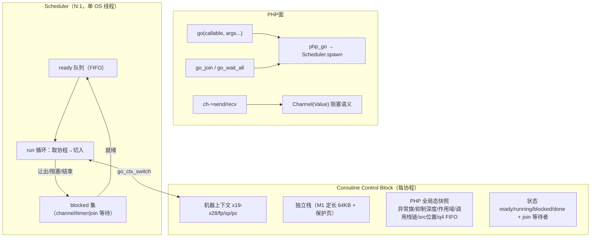

# Go 式协程系统设计稿（仅设计，不含运行时代码）

- 日期：2026-11-08
- 依据：老铁永久裁决（工单 §272；AGENTS.md §七.1/§七.9）——「放弃 Fiber 和 yield，协程能力走 Go 风格（AOT 运行时自有调度栈）」
- 状态：**待老铁过目**；落地另开专项会话（避免与模板热区改动撞车）
- 参考资产：docs/knowledge/2026-07-18 索引 §4.8（`preemptive_scheduler`/`sync`/`select`/`io_integration`/`vm_scheduler_integration`——旧 types.Value 体系，**只可参考不可直接搬**）；AOT 现存资产见 §2

---

## 1. 目标与边界

| 项 | 口径 |
|---|---|
| 语义模型 | **Go 式**：go 式 spawn、channel（阻塞式 send/recv、容量、close）、共享内存、协作让出（M1）→ 定时抢占（M3） |
| 明确不做 | PHP Fiber 类、yield/yield from 语法（永久排除，AGENTS.md §七.1）；不与 PHP Fiber API 兼容 |
| 调用面 | **复用现存 PHP 面**（`go()`/`go_join()`/`go_wait_all()`/`Channel` 类——已全部存在且与 PHP 内建零冲突，见 §2）；新增面必须过「PHP 内建名冲突检查」 |
| 线程模型 | M1：**N:1 单 OS 线程协作式**（零数据竞争面，与 PHP 单线程语义天然兼容）；M3：可选 M:N 工作线程池（以全局态审计为放行闸） |

## 2. 现存资产盘点（不得重复造轮子）

| 资产 | 现状 | 设计处置 |
|---|---|---|
| `go($callable, ...$args): int` | PHP 面已在（php_go :47343）→ 调度器**存根**（spawn 入队永不执行） | 面保留；核心换真调度 |
| `go_join(?int)` / `go_wait_all()` | 已在（:47369/:47377）→ 存根 drain 假返回 | 面保留；换真 join |
| `Channel` 类（`new Channel(cap)` + send/recv/close/trySend/tryRecv/len/isClosed/getCapacity） | 已在（channel_new :47636；承载=对象 `_ptr` 属性指向 `concurrency.Channel(Value)`） | 面保留；缓冲语义换**阻塞式**（现存根 send 永不阻塞、recv 空即错） |
| `src/aot/concurrency_runtime.zig`（217 行） | 全存根（Scheduler.spawn 仅入队、join 空、selectChannels 恒返回 0） | **整体替换**为本设计的调度器 |
| IR 算子 | `go_spawn`/`channel_new`/`channel_send`/`channel_recv`/`channel_close`/`select_`/`await_`/`yield_val`/`yield_from` 已在 IR/nlk 接线 | `go_spawn`/channel 系保留；`select_`/`await_`/`yield_*` 随 M2/M3 逐枚启用或注销 |
| 知识库索引 §4.8 五枚 | 旧 types.Value 体系 | 设计参考：preemptive_scheduler（时间片）、io_integration（NetPoller）、select（多路）、sync（WaitGroup 语义） |

## 3. 运行时架构

### 3.1 栈切换落地（Zig）

- **首选：手写 aarch64/x86_64 上下文切换**（约 60 行内联汇编，零依赖、~20ns）：
  - `Context = extern struct { callee-saved regs…, fp, sp, pc }`；`go_ctx_switch(save: *Context, restore: *Context) void`
  - 入口跳板 `go_ctx_trampoline`：从 Context 取 callable+args → 调用协程体 → 返回时置 `done`、唤醒 join 等待者、**切回调度器**（跳板自身永不 return）
  - 平台矩阵：`aarch64-macos`、`aarch64-linux`、`x86_64-linux` 三份 asm；`x86_64-macos` 不做（开发机 aarch64 优先）
- **备选：ucontext**（makecontext/swapcontext）：M1 原型期可用（macOS 仍可用，~200ns），正式路径走汇编；comptime 开关 `coroutine_backend = .asm | .ucontext`
- **栈分配**：`mmap` 64KB + 末尾 1 页 `mprotect(PROT_NONE)` 保护页（越界即 SIGSEGV→可读致命错）；M3 换「水位标记 + 倍增扩容（拷栈）或分段栈」决策点见 §6
- **禁止**依赖 Zig 的 async/await（与本设计无关，且会引入第二套调度）

### 3.2 调度器（M1：N:1 协作式）

- 单 OS 线程；`ready` FIFO；让出点仅：**channel send（满）/recv（空）、go_join、go_wait_all、sleep/usleep、go_select**——普通函数调用**不**让出（协作式，避免无处不在的重入）
- `Scheduler.run`：主协程（main）也是一枚协程；`go()` 首次调用时把 main 注册为 #0 并启动 run 循环；进程退出前 `waitAll` 未完成 ⇒ 报错并列出未结束协程 id（Go 的 "all goroutines are asleep - deadlock!" 对应物：ready 空 ∧ blocked 非空 ⇒ **死锁检测致命错**）
- 死锁检测：ready 空 ∧（blocked 全在等 channel/join/timer 且无 timer 将醒）⇒ `Fatal error: all coroutines are asleep - deadlock!`（逐字风格对齐 Go）
- 公平性（M1）：FIFO + 让出点即调度；CPU 密集协程会饿死他者——**M1 接受并在文档标注**，M3 上定时抢占

### 3.3 Channel 语义（Go 对齐）

- 容量 cap≥0（cap=0 无缓冲：send 必等 recv 对接）；send 满⇒阻塞让出；recv 空⇒阻塞让出；close 后 send⇒**可捕获 Error**「send on closed channel」；recv 自 closed⇒立即返回 null（PHP 无 ok-idiom，返 null；`isClosed()` 可判）
- 语义与 PHP 既有面差异**只修存根错**（recv 空返 null 已在存根口径内，close 后 recv 仍可取完残余再返 null——Go 口径）

### 3.4 全局态边界（每协程快照 vs 共享）

| 全局态 | 处置 | 理由 |
|---|---|---|
| `current_exception`/`has_exception`/`last_throw_frame` | **每协程私有**（切换时 save/restore） | 异常是控制流，跨协程串旗会错路由 catch |
| 错误抑制栈（`@` 深度） | 每协程私有 | 同上 |
| 作用域/called class（ExecutionContext） | 每协程私有（存根已有该结构） | 协程体可能是任意类方法 |
| `src_file`/`src_line`、调用实参链、q4_undef FIFO、P2-3 missing 态 | 每协程私有 | 诊断归属 |
| profiler/flamegraph 栈 | M1 仅采 main；协程帧挂 `coroutine#N` 伪帧（M3 再全量） | 防跨协程栈错位 |
| `runtime_allocator`（GPA）、class_registry、内建形参表 | **全局共享**（N:1 无竞争；M3 需审计加锁） | Go 共享内存模型 |
| 对象 id 计数器/空闲栈 | 全局共享（已 atomic） | — |
| RC 与 cycle-GC | **共享堆，RC 即活证**；挂起协程栈上的 alloca 槽值由 RC 钉活，无泄漏；cycle-GC 的 root 集 M1 只扫 main 栈，**多协程活跃期禁用 cycle 收集**（文档标注；M3 扩展 root 到各协程栈） | 防 GC 误扫/漏扫 |
| fiber 化 IO | M1：channel/timer 之外**一律真阻塞**（含文件/网络 IO——文档标注）；M2：kqueue NetPoller（参考 io_integration.zig） | 边界清晰 |

### 3.5 异常语义（Go 对齐 + PHP 可读）

- 协程内**未捕获异常**（逃逸出协程体）：Go 口径=整个程序致命错——`Fatal error: uncaught {Class}: {msg} in coroutine #{id}` + 协程内栈帧（§七.5 行号豁免适用）+ exit 255
- `go_join` **不**传播对端异常（M1 与 Go 一致）；M2 增设可选 `go_join_error($id): ?Throwable` 面（不破坏 M1 口径）
- 协程体内的 try/catch/finally 全在协程栈内自洽（既有异常机制零改动——只是栈换了）

### 3.6 PHP 调用面与命名冲突

| 面 | 冲突检查 | 结论 |
|---|---|---|
| `go()`/`go_join()`/`go_wait_all()` | PHP 无内建同名函数 | 安全（已在线） |
| `Channel` 类 | PHP 无内建同名类 | 安全（已在线） |
| M2 候选：`go_select(array $cases, ?float $timeout): ?int`、`go_sleep(float $seconds)`、`go_join_error($id)` | PHP 无 `go_*` 内建族 | 安全；**`sleep()`/`usleep()` 不改语义**（协程内自动让出、main 内真阻塞——面不变，行为分派在运行时按「当前是否在协程内」分流） |
| 禁止占用 | `Fiber`、`Generator`、`select()`（无内建但易误读）、`async()`/`await()`（PHP 生态关键字联想） | 面命名一律 `go*` 前缀 + `Channel` 类 |

## 4. 与编译器（IR/nlk）的接线

- M1 **零编译器改动**：`go()` 等走既有 builtin 通道（php_go 已在）；channel_* 的 IR 算子已在 nlk 发射（:28718 区）；M1 仅需 runtime 层换核
- M2 启用 `select_` 算子（现 handleUnsupportedOp）+ `go_select` builtin
- 生成码让出点插桩**不需要**（协作点全在运行时函数内）

## 5. 里程碑切分与验收探针

### M1 最小可跑（N:1 协作栈式）

- 内容：asm 上下文切换 + 定长栈 + ready/blocked 队列 + channel 阻塞语义 + go/go_join/go_wait_all 换真 + 每协程全局态快照 + 死锁检测 + 未捕获异常致命形
- 验收探针（每枚≤10s，PHP 侧无法用解释器对参 ⇒ 以**断言式探针**自验）：
  1. `co_pingpong.php`：2 协程经 2 channel 往返 1000 次，终值断言
  2. `co_fanin.php`：8 生产者→1 channel→消费者求和，断言总数与无丢失
  3. `co_join_order.php`：spawn 3 枚不同时长协程，按 id join，断言完成顺序与 join 返回时机
  4. `co_deadlock.php`：单协程自发自收无缓冲 channel ⇒ 断言死锁致命错文案
  5. `co_uncaught.php`：协程内 throw 未捕获 ⇒ 断言致命错形态 rc=255
  6. `co_isolation.php`：协程内 `throw`+自捕获、异常旗/抑制深度/`$this` 作用域与 main 互不串扰
  7. 回归：720 里程碑 + 31 探针面板 + 事故五族 + `zig build test`（防运行时热区漂移）

### M2 阻塞让出面（sleep/select/IO）

- 内容：timer 堆（sleep/usleep 在协程内让出）；`go_select`（多 channel 就绪多路 + timeout，参考 select.zig）；`go_join_error`；stream/socket IO 经 kqueue 挂 NetPoller（参考 io_integration.zig）非阻塞让出
- 探针：`co_sleep_interleave.php`（两协程异速 sleep 输出交错断言）、`co_select.php`（就绪随机性归一化断言）、`co_io_echo.php`（socket pair 双协程 echo）

### M3 栈与调度

- 内容：栈水位上报 + 扩容策略（倍增拷栈 vs 分段——**评审时二选一**）；可选 M:N 工作线程池（构建旗 `-Dcoroutine_mt`，放行闸=全局态审计表逐项加锁：class_registry/profiler/allocator）；定时抢占（setitimer 10ms → 安全点让出，参考 preemptive_scheduler.zig；安全点=函数入口与循环回边插桩——编译器侧改动，单独评审）
- 探针：`co_deep_recursion.php`（协程内 10 万帧递归，栈扩容成活）、`co_spawn_100k.php`（10 万协程创建/回收速率基线）、`co_fairness.php`（CPU 密集协程在抢占开启前后对他者的饿死对比）

## 6. 待评审决策点（交给老铁拍板）

| # | 决策点 | 备选 | 倾向 |
|---|---|---|---|
| D1 | 协程内未捕获异常 | A 整程序致命（Go 原教旨）/ B join 可收 | M1 取 A，M2 加 B 可选面 |
| D2 | M3 栈扩容 | A 倍增拷栈（实现重）/ B 分段栈（遍历重）/ C 提上限 1MB 不扩容 | 倾向 C→A |
| D3 | M:N 线程池 | A 永不做（N:1 终态）/ B 构建旗可选 | 倾向 B 但默认关 |
| D4 | cycle-GC | A 多协程期禁用（M1）/ B root 扩展每协程栈（M3） | A→B |
| D5 | `sleep()` 在协程内自动让出 | A 自动分流 / B 新增 `go_sleep` 显式面 | 倾向 A（面零增） |

> **实施修订（2026-11-09，G-2）**：D5=A 落地时 main 侧走「真阻塞」，实测 `go('w'); usleep(100ms);`
> 期间就绪 worker 一步不跑（违背 Go 式直觉，且 `go` 后直接 sleep 的用法会饿死 worker）。
> 现统一为：`sleep()/usleep()` 一律经 `concurrency.sleepNs`——协程内挂定时器让出；main 侧
> 同样挂定时器让出（睡眠窗口内调度 worker）；调度器不存在（从未 `go()`）时内部退化为
> `nanosleep`，墙钟语义不变。PHP 调用面零变化。待老铁追认。

## 7. 风险与回退

- **asm 切换正确性**：寄存器保存不全 ⇒ 间歇性寄存器污染——M1 用「全 callee-saved + 探针矩阵 + 长随机交错压测」兜底；ucontext 备份路径保编译期可切
- **栈保护页误判**：生成码深度递归 PHP 函数在 64KB 内爆栈 ⇒ 保护页转可读致命错（不误判合法程序）；M3 根治
- **回退**：`go*` 面保留存根语义构建旗 `-Dcoroutine=off`（M1 起即提供），任一里程碑不过可整体退回存根
