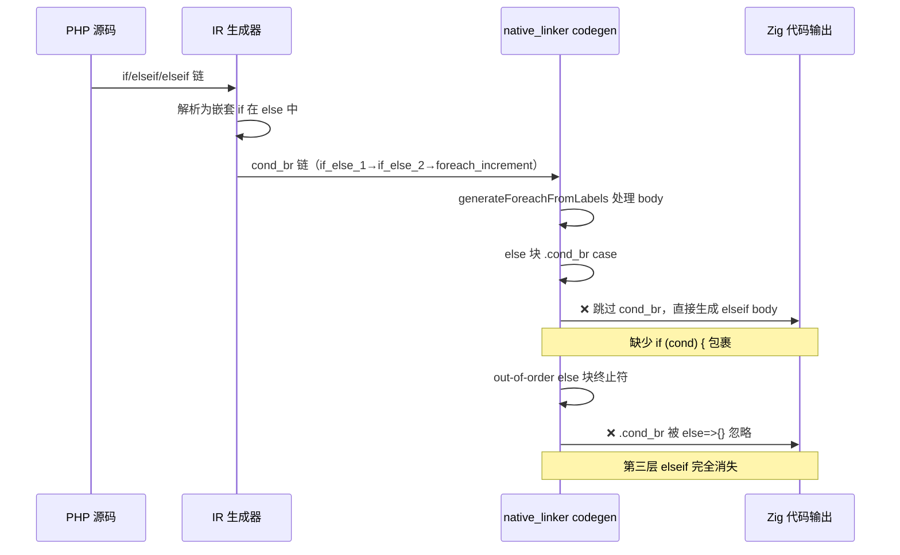

# f067 Diff Codegen 修复交接文档

> 日期：2026-08-06 | 基线 commit：`bf0a71d` | 涉及文件：`src/aot/native_linker.zig`

---

## 1. 高层摘要（TL;DR）

f067 JSON Parser + Schema + Path Query + Diff 测试的 AOT codegen 修复工作进入深水区。**当前代码被 task 21 子代理的激进修改破坏**，导致 f067 AOT 编译时 `integer overflow` panic。需要回退到备份版本（`bak_f067`），重新应用 task 19/20 的已验证修复，再用更保守的方式解决 Diff 多余行和 Parse Numbers 科学计数法问题。

**关键结论**：子代理对 `generateLabelDrivenBlockRange` 的 merge-finding 逻辑和 out-of-order 处理做了 9 处修改，过于激进，导致无限递归（integer overflow）。这些修改需要全部回退，重新以最小化方式修复。

---

## 2. 影响范围

| 测试 | 备份版本(bak_f067) | 当前版本(被破坏) | 期望状态 |
|------|-------------------|-----------------|---------|
| f067 AOT 编译 | ❌ unprocessed blocks (parseObject) | ❌ integer overflow panic | ✅ 编译通过 |
| f067 JSON Parse | N/A | N/A | ✅ 输出正确 |
| f067 Path Query | N/A | N/A | ✅ 值正确 |
| f067 Diff | N/A | N/A | ✅ 仅4行变更 |
| f067 Parse Numbers | N/A | N/A | ✅ 科学计数法正确 |
| f027 | ✅ PASS | ✅ PASS | ✅ PASS |
| f070 | ✅ PASS | ✅ PASS | ✅ PASS |
| f104 | ✅ PASS | ✅ PASS | ✅ PASS |

---

## 3. 核心变更历史

| 阶段 | 任务 | 状态 | 描述 |
|------|------|------|------|
| task 9 | parseObject while(true) 修复 | ✅ 完成 | 修复 while(true)+continue/break+嵌套if 的 codegen |
| task 18 | Path Query + Diff SIGSEGV 修复 | ✅ 完成 | 修复 || 短路、merge_bi 循环头、cond_br PHI |
| task 19 | !== 和科学计数法调查 | ✅ 完成 | 发现是 codegen 问题，添加 .cond_br case |
| task 20 | Path Query 回归修复 | ✅ 完成 | if_merge_ 标签检查改为 +ret 终止符检查 |
| **task 21** | **Diff codegen 修复** | **❌ 破坏** | **9处激进修改导致 integer overflow** |

---

## 4. 当前代码问题诊断

### 4.1 崩溃信息

```
thread panic: integer overflow
  at generateWhileFromLabels (native_linker.zig:6388)
  at generateLabelDrivenBlockRange (native_linker.zig:6912)
```

**根因**：task 21 子代理修改了 `generateLabelDrivenBlockRange` 中 else 块嵌套 cond_br 的 merge-finding 逻辑，导致 `generateLabelDrivenBlockRange` → `generateWhileFromLabels` → `generateLabelDrivenBlockRange` 无限递归，最终 allocator overflow。

### 4.2 子代理的 9 处修改（需全部回退）

| # | 位置 | 修改内容 | 问题 |
|---|------|---------|------|
| 1 | ~line 6994-7004 | merge-finding 跳过循环控制块 | 破坏了正常 merge 查找 |
| 2 | ~line 7010-7041 | else 块 cond_br then/else 分支 merge 检查 | 过于复杂，引入递归 |
| 3 | ~line 7053-7075 | `then_has_loop` 检查和 out-of-order 路径选择 | 破坏了 in-order 处理 |
| 4 | ~line 7089-7132 | out-of-order then 块 br 到循环的递归处理 | 导致无限递归 |
| 5 | ~line 7166-7213 | 嵌套 cond_br else 块标记逻辑 | 标记错误 |
| 6 | ~line 7234-7272 | merge 块后处理 | 与其他修改冲突 |
| 7 | ~line 8085-8095 | generateForeachFromLabels else 块 cond_br | 部分有效但需重新设计 |
| 8 | ~line 8122-8126 | foreach else 块 cond_br 处理 | 与修改7重叠 |
| 9 | ~line 8197-8229 | pending_merge_non_phi 处理 | 需要更保守的实现 |

---

## 5. Diff 问题的根因分析（子代理已确认）

### 5.1 期望 vs 实际输出

**期望（PHP 解释器）**：
```
--- JSON Diff ---
  age: changed from=30 to=31
  city: changed from="NYC" to="LA"
  scores.2: added value=95
  email: added value="a@b.com"
```

**实际（AOT，task 20 修复后）**：
```
--- JSON Diff ---
  name: changed from="Alice" to="Alice"     ← 多余（值相同）
  age: changed from=30 to=31                ← 正确
  city: changed from="NYC" to="LA"          ← 正确
  scores: changed from=[90,85] to=[90,85,95] ← 错误（应递归，非 changed）
  email: added value="a@b.com"              ← 正确
  email: changed to="a@b.com"               ← 多余（if/elseif 不互斥）
```

### 5.2 三个子问题

1. **`!==` 对相同值返回 true** → 实际验证：`!==` 本身正确（Test 1 通过），问题在 if/elseif 链不互斥
2. **`is_array && is_array` 返回 false** → 实际验证：`&&` 本身正确（Test 2 通过），问题在 if/elseif 链第三层 elseif 未生成
3. **if/elseif/elseif 链不互斥** → **这是核心问题**

### 5.3 核心根因

**IR 结构**：PHP 的 elseif 被解析为嵌套 if 在 else 分支中。当 if/elseif 链在 foreach 循环体末尾时，所有分支直接 `br foreach_increment`（merge 块是循环增量块），没有 `if_merge_` 块。

**codegen 路径**（两个独立路径需修复）：

**路径 A**：`generateForeachFromLabels` 中 else 块的 `.cond_br` case
- 当前代码（备份版本）：`generateLabelDrivenBlockRange(ei + 1, ...)` 跳过了 else 块的 cond_br
- 结果：elseif 条件被计算但未用 `if (cond) {` 包裹，直接执行 elseif body

**路径 B**：`generateLabelDrivenBlockRange` 中 out-of-order else 块终止符处理
- 当前代码（备份版本）：out-of-order else 块只处理 `.ret` 和 `.throw`，不处理 `.cond_br`
- 结果：第三层 elseif 的 cond_br 被忽略，嵌套 if 未生成

### 5.4 diff 函数的特殊结构

```
entry → if_then_0 (gettype 不同, ret) / if_merge_1
if_merge_1 → if_then_2 (is_array, 含 foreach) / if_else_3 (!is_array)
if_then_2 → br foreach_cond_5 (循环)
if_else_3 → if_then_26 ($a !== $b) / if_merge_4 (ret)
if_merge_4 在 IR 块顺序中位于 foreach_cond_5 之前（index 74 vs 77）
```

**问题**：then 块 (if_then_2) 的 br 目标是 foreach_cond_5（循环控制块），merge-finding 逻辑错误地将 foreach_cond_5 识别为 merge 块，导致递归调用范围不包含循环体。

---

## 6. Parse Numbers 问题分析

### 6.1 期望 vs 实际

```
期望：'1e5' → 100000.0 (type: double)
实际：'1e5' → 1 (type: integer)

期望：'-2.5e-3' → -0.0025 (type: double)
实际：'-2.5e-3' → -2.5 (type: double)
```

### 6.2 根因

PHP 代码 line 106：
```php
if ($this->pos < $this->len && ($this->json[$this->pos] === 'e' || $this->json[$this->pos] === 'E')) {
```

这是 `A && (B || C)` 模式。IR 中 `&&` 左侧的 cond_br 分支到 logical_rhs（计算 B||C），但 codegen 没有正确处理 `&&` 嵌套 `||` 的情况，导致条件永远不进入 if 分支。

---

## 7. 推荐修复方案

### 7.1 第一步：回退到备份

```bash
cp src/aot/native_linker.zig.bak_f067 src/aot/native_linker.zig
```

备份版本状态：
- ✅ f027/f104/f070 通过
- ❌ f067 AOT 编译失败（parseObject unprocessed blocks）

### 7.2 第二步：重新应用 task 9 修复（parseObject）

备份缺少 task 9 的修复。需要重新实现 while(true)+continue/break+嵌套 if 的 codegen。

**task 9 修复要点**：
- `generateWhileFromLabels` 中 `is_while_true_folded` 检查
- `lastLineIsReturn` 只检查 `return`（不含 `continue`/`break`）
- `blockHasCodeBesidesBackEdge` 辅助函数

### 7.3 第三步：重新应用 task 19 修改

在 `generateIfFromLabels` 的 out-of-order 路径中添加 `.cond_br` case：

**位置 1**（~line 7701）：第一处 out-of-order then 块终止符 switch
```zig
.cond_br => {
    // else 块有嵌套 cond_br（elseif），递归处理
    const saved_rg = self.return_generated;
    const saved_brk = self.break_generated;
    self.return_generated = false;
    self.break_generated = false;
    try self.generateLabelDrivenBlockRange(writer, func, ei, merge_idx, ...);
    if (!self.return_generated) self.return_generated = saved_rg;
    if (!self.break_generated) self.break_generated = saved_brk;
},
```

**位置 2**（~line 7717）：第二处 out-of-order then 块终止符 switch（同上）

**位置 3**（~line 7373）：第一处 out-of-order 嵌套 else 块终止符 switch（同上）

### 7.4 第四步：重新应用 task 20 修改

在 `generateForeachFromLabels` 的第二处 out-of-order 路径（~line 7844）：

**修改前**：
```zig
if (std.mem.startsWith(u8, ne_blk_lbl, "if_merge_")) {
    // merge 块：不生成 else 分支
}
```

**修改后**：
```zig
const ne_blk_term_is_ret = blk: {
    if (func.blocks.items[nei].terminator) |t| {
        if (t == .ret) break :blk true;
    }
    break :blk false;
};
if (std.mem.startsWith(u8, ne_blk_lbl, "if_merge_") and ne_blk_term_is_ret) {
    // merge 块有 ret 终止符：不生成 else 分支
} else {
    // else body 或无 ret 的 merge：正常生成 else 分支
}
```

### 7.5 第五步：修复 Diff if/elseif 链（最小化方案）

**路径 A 修复**：在 `generateForeachFromLabels` 的 else 块 `.cond_br` case 中：

**当前代码**（备份版本 ~line 7914）：
```zig
.cond_br => {
    try self.generateLabelDrivenBlockRange(writer, func, ei + 1, loop_end, ...);
},
```

**问题**：`ei + 1` 跳过了 else 块的 cond_br，导致 elseif 条件未生成 `if (cond) {`。

**推荐修复**：当 else 块终止符是 cond_br 时，不预生成 else 块指令，从 else 块本身开始调用 `generateLabelDrivenBlockRange`：

```zig
.cond_br => {
    // else 块有嵌套 cond_br（elseif），需要生成嵌套 if
    // 移除 processed 标记，从 else 块本身开始递归处理
    _ = processed.remove(ei);
    const saved_rg = self.return_generated;
    const saved_brk = self.break_generated;
    self.return_generated = false;
    self.break_generated = false;
    try self.generateLabelDrivenBlockRange(writer, func, ei, loop_end, ...);
    if (!self.return_generated) self.return_generated = saved_rg;
    if (!self.break_generated) self.break_generated = saved_brk;
},
```

但需要注意：else 块的指令已在上方（~line 7889-7893）预生成。需要条件化：当终止符是 cond_br 时不预生成。

**路径 B 修复**：在 out-of-order else 块终止符处理中添加 `.cond_br` case：

**当前代码**（备份版本 ~line 7043）：
```zig
if (ne_blk.terminator) |net| {
    switch (net) {
        .ret => |ret_val| { ... },
        .throw => |throw_reg| { ... },
        else => {},  // ← cond_br 被忽略！
    }
}
```

**推荐修复**：
```zig
if (ne_blk.terminator) |net| {
    switch (net) {
        .ret => |ret_val| { ... },
        .throw => |throw_reg| { ... },
        .cond_br => |nested_cb2| {
            // else 块有嵌套 cond_br（第三层 elseif），
            // 生成嵌套 if 语句
            try writer.print("{s}if (", .{nested_indent});
            try self.writeConditionExpr(writer, nested_cb2.cond.id, nested_cb2.cond.type_);
            try writer.print(") {{\n", .{});
            // 找到 then 块并递归处理
            var nested2_then_idx: ?usize = null;
            for (0..func.blocks.items.len) |blk_i| {
                if (func.blocks.items[blk_i] == nested_cb2.then_block) {
                    nested2_then_idx = blk_i;
                    break;
                }
            }
            if (nested2_then_idx) |nti2| {
                if (!processed.contains(nti2)) {
                    const nested2_indent = try std.fmt.allocPrint(self.allocator, "{s}    ", .{nested_indent});
                    defer self.allocator.free(nested2_indent);
                    try self.generateLabelDrivenBlockRange(writer, func, nti2, end_idx, cleanup_regs, processed, loop_label_counter, nested2_indent);
                }
            }
            // else 分支通常是循环增量（foreach_increment），不需要生成
            try writer.print("{s}}}\n", .{nested_indent});
        },
        else => {},
    }
}
```

### 7.6 第六步：修复 diff 函数的 then 块含循环问题

**问题**：`if_merge_1 → if_then_2 (is_array, br foreach_cond_5) / if_else_3`

merge-finding 逻辑将 foreach_cond_5 错误识别为 merge 块。

**推荐修复**：在 merge-finding 逻辑中，当 then 块的 br 目标是循环控制块时，不将其作为 merge。继续查找 else 块的 cond_br 分支中的 br 目标作为真正的 merge。

**具体位置**：`generateLabelDrivenBlockRange` ~line 6984-7002 的 merge 查找循环。

```zig
// 在现有 merge 查找循环中添加：
// 如果找到的 merge 是循环控制块，跳过，继续查找
if (nested_merge_idx) |mi| {
    const ml = func.blocks.items[mi].label;
    if (std.mem.startsWith(u8, ml, "foreach_cond_") or
        std.mem.startsWith(u8, ml, "while_cond_") or
        std.mem.startsWith(u8, ml, "for_cond_") or
        std.mem.startsWith(u8, ml, "do_while_body_"))
    {
        nested_merge_idx = null; // 跳过循环控制块
        // 继续查找 else 块的 cond_br 分支
        continue;
    }
}
```

**注意**：这个修复需要非常小心，必须确保不破坏 while(true) 循环的处理。建议在修复后立即验证 f067 的 parseObject 函数。

### 7.7 第七步：修复 Parse Numbers 科学计数法

`A && (B || C)` 模式。需要在 `generateIfFromLabels` 中正确处理 `&&` 左侧 cond_br 分支到 logical_rhs（含 `||`）的情况。

这个修复相对独立，可以在 Diff 修复完成后再处理。

---

## 8. 风险评估

| 风险 | 影响 | 缓解措施 |
|------|------|---------|
| 回退丢失 task 9-20 修复 | 高 | 逐步重新应用，每步验证 |
| merge-finding 修改破坏 while 循环 | 高 | 每次修改后验证 parseObject |
| out-of-order .cond_br 修复引入无限递归 | 高 | 限制递归深度或使用 processed 集合 |
| foreach else 块 cond_br 修复影响其他模式 | 中 | 创建最小测试验证 |

---

## 9. 遗留问题

1. **f067 Diff 多余行**：if/elseif 链不互斥 + is_array && is_array 未递归
2. **f067 Parse Numbers 科学计数法**：`A && (B || C)` 复合条件求值错误
3. **代码清理**：task 11（清理 F104Fix2 残留修改）仍未完成
4. **测试产物**：`test_f067_diff_issues.php`、`aot_compile_test_f067_diff_issues*` 需清理
5. **临时文件**：`/tmp/test_f067*.ir`、`/tmp/test_f067_dump*.txt` 需清理

---

## 10. 后续开发建议

| 优先级 | 建议 | 影响面 | 落地成本 |
|--------|------|--------|---------|
| P0 | 回退到备份，重新应用 task 9/19/20 修复 | 恢复基线 | 中（需逐步验证） |
| P0 | 修复 Diff if/elseif 链（路径 A + B） | f067 Diff 正确 | 中（两处修改） |
| P1 | 修复 diff 函数 then 块含循环问题 | f067 Diff 递归正确 | 高（merge-finding 敏感） |
| P1 | 修复 Parse Numbers 科学计数法 | f067 完整通过 | 中（`&&` 嵌套 `||`） |
| P2 | 清理 task 11 残留修改 | 代码整洁 | 低 |
| P2 | 添加 elseif 链和复合条件的回归测试 | 防止未来回归 | 低 |

---

## 11. 关键文件索引

| 文件 | 说明 |
|------|------|
| `src/aot/native_linker.zig` | 主要修改文件（当前 25752 行，被破坏） |
| `src/aot/native_linker.zig.bak_f067` | 备份（25511 行，8月4日 13:52，缺 task 9 修复） |
| `fuzzy_scripts_720/pass/f067_json_parser_schema_path_diff.php` | f067 测试（只读） |
| `fuzzy_scripts_720/pass/f027_number_theory_primes_modular.php` | 回归测试 |
| `fuzzy_scripts_720/pass/f104_game_engine_ecs_collision_render.php` | 回归测试 |
| `fuzzy_scripts_720/pass/f070_event_sourcing_cqrs_snapshot.php` | 回归测试 |
| `/tmp/f067.ir` | f067 IR dump（1290 行） |
| `/tmp/test_f067.ir` | 最小测试 IR dump（455 行） |
| `test_f067_diff_issues.php` | 最小测试（需清理） |

---

## 12. 可视化概览

```mermaid
graph TD
    A[备份 bak_f067] -->|缺 task 9| B[parseObject unprocessed blocks]
    A -->|缺 task 19| C[Diff .cond_br case 缺失]
    A -->|缺 task 20| D[Path Query if_merge_ 检查缺失]
    
    E[当前代码 task21 破坏] -->|9处激进修改| F[integer overflow panic]
    
    G[目标状态] -->|task 9 修复| H[parseObject ✅]
    G -->|task 19 修复| I[Diff .cond_br case ✅]
    G -->|task 20 修复| J[Path Query ✅]
    G -->|路径A修复| K[foreach else cond_br ✅]
    G -->|路径B修复| L[out-of-order else cond_br ✅]
    G -->|then含循环修复| M[diff 递归 ✅]
    G -->|科学计数法修复| N[A&&B||C ✅]
    
    style F fill:#f99,stroke:#f00
    style B fill:#f99,stroke:#f00
    style G fill:#9f9,stroke:#0a0
```

